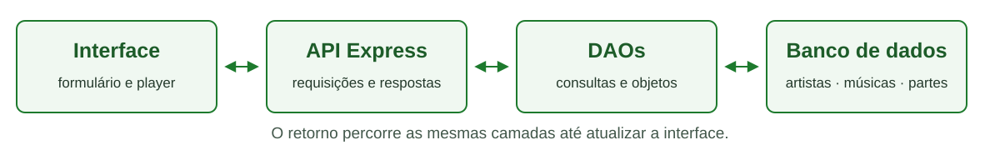

# Trabalho integrador — O repertório da turma

**Versão 2 · 27/10/2026 · Valor: 4,0 pontos.** Substitui a versão de entrega de 20/10/2026.  
**IFSul — Campus Passo Fundo · Ensino Médio Integrado — Técnico em Informática**  
**Disciplina:** Programação III  
**Professor:** Élder F. F. Bernardi  
**Tutor da atividade:** Prof. Leonardo Constantin  
**Turmas:** 3D1 e 3D2 · **Modalidade:** duplas, com verificação individual  
**Apresentações:** 3D2 em 24/11/2026; 3D1 em 04/12/2026  
**Tempo:** quatro encontros de 150min + até 60min extraclasse por encontro; apresentação em outro encontro de 150min.

> **O que mudou na versão 2**
>
> - Critérios, pesos, níveis, requisitos e datas continuam os mesmos.
> - Nova seção: "Banco de dados: preparar e conferir".
> - Novos materiais de apoio: Guia passo a passo do Supabase, Guia de interface — CRUD na tela com fetch e o `AGENTS.md` para uso de agentes de IA como tutor.
> - Os materiais passam a ser citados pelo nome e estão no Classroom da disciplina.
> - Texto revisado para leitura mais direta.

## O que vocês vão resolver

A turma está organizando um repertório para um karaokê. Quem consulta o catálogo
quer encontrar uma música, conferir seu artista e reproduzir as partes disponíveis.
Quem mantém o repertório precisa incluir uma música, corrigir seus dados ou retirar
um registro pela própria tela, sem escrever SQL para cada alteração.

O desafio é completar **interface → API → DAO → banco → resposta na interface**,
com a aplicação acessível por uma URL pública.
Os dados precisam continuar disponíveis depois de reiniciar o servidor.
Usem dados de demonstração. O trabalho não exige login.

Este trabalho continua o karaokê que vocês exploraram no terminal, na API, no player
e na integração com banco. Cada projeto pode estar numa etapa diferente, e vocês
podem começar de onde o projeto de vocês está.
A primeira meta é **abrir a página e listar músicas vindas da API**.
Completem uma operação por vez.

## De onde partir

Vocês podem aproveitar o projeto da dupla ou usar a base de retomada disponibilizada pelo professor no Classroom (também em [base_retomada.zip](https://elderbernardiifsul.github.io/programacao-iii/integrador-2026/downloads/base_retomada.zip), na página do trabalho).
A base vem acompanhada do Roteiro de retomada, disponível no Classroom da disciplina.
**A base é opcional, não reduz a nota e permite alcançar o nível excelente.**
Vocês podem recorrer a ela durante o trabalho, preservando os registros úteis.

Na base, leitura, listagem, seleção, player, API e DAOs já estão preparados.
As três tarefas de integração ficam em `public/admin.js`:

1. Conectar o formulário ao **cadastro** de música.
2. Aproveitar a seleção para **editar** a música escolhida.
3. Conectar a ação de **exclusão**, com confirmação.

Em cada tarefa, tratem a resposta, informem sucesso ou erro e atualizem a lista.
Os controles de escrita começam indisponíveis: habilitem cada ação quando sua integração estiver pronta.
Quem usa projeto próprio aproveita o que já funciona e demonstra os mesmos requisitos.

HTML, CSS e JavaScript com `fetch` atendem ao núcleo. Vue é opcional.
Reaproveitem as classes, os DAOs e as relações que já existem.
O núcleo não exige trocar a arquitetura nem adicionar dependências.
O Roteiro de retomada informa como instalar e executar a base com Node.js 22 ou superior.

## Como as partes se conectam

Um artista pode ter várias músicas; uma música pode ter várias partes.
O CRUD obrigatório na interface é o de **músicas, com nome e artista**.
As outras tabelas não precisam de telas próprias de administração.

Na base, página e API usam a mesma origem: a interface chama `/api/musicas`.
Por isso, não é preciso configurar CORS.
No POST e no PUT, enviem `nome` e `artista` como **strings**.
Na resposta, `artista` é um **objeto** com `id` e `nome`.
Para preencher o formulário, usem o nome contido nesse objeto.

**Editar o artista de uma música** significa alterar o nome informado e o vínculo
daquela música com o artista correspondente. A mudança vale só para aquela música:
as outras músicas do catálogo continuam com o artista que já tinham.

## Banco de dados: preparar e conferir

Esta seção orienta o preparo do banco; os requisitos continuam sendo R1 a R8.
Os guias da disciplina usam um projeto Supabase por dupla, com dados de demonstração.

Quem já tem o projeto Supabase da Unidade 3 pode continuar com ele.
Antes, recomendamos rodar o diagnóstico da etapa 4 do Guia passo a passo do Supabase,
disponível no Classroom da disciplina, e os ajustes que ele indicar.
O diagnóstico confere se as tabelas estão como a aplicação espera; por exemplo,
se excluir uma música também remove as partes dela.
Para criar um projeto novo, o passo a passo está na mesma etapa 4.

As credenciais, como a chave secreta do Supabase, ficam somente no servidor:
no `.env` local e nas variáveis de ambiente do serviço publicado.
Não as coloquem no JavaScript público, no Git, em capturas ou no README.

O plano gratuito do Supabase pausa projetos sem atividade por 7 dias.
Com o projeto pausado, o banco não responde e a aplicação publicada passa a dar erro.
Antes da apresentação, abram o painel do projeto e confiram o status.
Se ele estiver pausado, restaurem o projeto (botão **Restore**) e esperem o banco voltar a responder.
Se o projeto não voltar a responder, sigam a seção "Se houver impedimento técnico".

## Núcleo do trabalho — R1 a R8

| ID | Resultado esperado |
|---|---|
| **R1 — Consultar** | Listar músicas da API e selecionar uma para consultar seus dados, mostrando nome e artista. |
| **R2 — Cadastrar** | Enviar nome e artista pela interface; o registro criado aparece em nova consulta e tem ID identificável na resposta da API. |
| **R3 — Editar** | Alterar nome/artista da música escolhida, mantendo seu ID e conservando a mudança no banco. |
| **R4 — Excluir** | Identificar a música, pedir confirmação e remover pela interface; cancelar mantém o registro. |
| **R5 — Validar e informar** | Campos obrigatórios vazios não geram cadastro válido; mensagens distinguem sucesso de erro, inclusive falha de conexão. |
| **R6 — Preservar o repertório** | Reproduzir uma música com partes do repertório inicial; música nova sem partes é válida e mostra a situação com Tocar indisponível. |
| **R7 — Persistir e publicar** | Executar o CRUD na URL pública com banco; conferir os dados após reiniciar o servidor, antes de excluir o registro de teste. |
| **R8 — Explicar e documentar** | Cada pessoa acompanha um fluxo e realiza ou prevê uma pequena intervenção; a dupla registra execução, testes e uma decisão no README. |

O ID pode ficar fora do layout: confiram-no na resposta da API, na aba Rede do navegador, com orientação do professor.
Música sem partes continua listável, editável e removível. Cadastrar letras não faz parte do núcleo.
Preservem ao menos uma música do repertório inicial para o player.

Para a tela, bastam campos identificados, texto legível e ações utilizáveis.
Ficam fora do núcleo: relatório de dados, técnica específica de responsividade,
fila, upload, áudio, MIDI, sincronização e autenticação.

## Quatro encontros para desenvolver

O trabalho essencial acontece em aula, incluindo a configuração inicial e o apoio para a integração.
Para cada encontro, são **150min em aula + até 60min extraclasse** para revisão, testes e documentação.
No total, são **600 + até 240min**, ou seja, até **14h** de desenvolvimento.
A apresentação final ocupa mais um encontro de 150min.

| Marco | 3D2 — 2026 | 3D1 — 2026 | O que mostrar ao final |
|---|---|---|---|
| **M1 — Abrir e compreender** | 27/10 | 30/10 | Lista da API, rota/DAO e situação do banco identificados; escolher base, iniciar publicação e registrar URL inicial ou impedimento. |
| **M2 — Escrever e conservar** | 03/11 | 06/11 | Cadastro pela tela, ID e consulta após reinício. Meta: listagem/cadastro publicados com banco. Iniciar observações individuais. |
| **M3 — Fechar o CRUD** | 10/11 | 13/11 | Edição, exclusão, validação/erro, música sem partes e player conferidos; repetir CRUD na URL pública. |
| **M4 — Consolidar e ensaiar** | 17/11 | 27/11 | Conferência completa, persistência pública, README e observações individuais; corrigir pendências. |
| **Apresentação** | **24/11** | **04/12** | Percurso integrado e evidências de compreensão dos dois integrantes. |

**Extraclasse proposta, até uma hora por encontro:**

- após M1, revisar o mapa dos arquivos e as instruções de execução;
- após M2, repetir cadastro/reconsulta e registrar o resultado;
- após M3, conferir o checklist e preparar a explicação de um fluxo;
- após M4, revisar o README, ensaiar a demonstração e organizar as evidências.

Essas tarefas não pedem funcionalidades novas.
Se faltar acesso fora da aula, registrem a dificuldade para que o apoio seja organizado.
Se algo não funcionar, localizem a primeira quebra do percurso e retomem esse ponto com o professor.
Os marcos orientam o acompanhamento e a retomada. Não há desconto automático por marco.

## Percurso para testar e demonstrar

Executem esta sequência no projeto concluído. Nas escritas, usem uma música nova,
sem partes, e preservem a amostra reproduzível. Confiram o dado antes de removê-lo.

1. **Consultar e reproduzir:** abram a lista, selecionem uma música do repertório
   inicial e demonstrem o player com suas partes.
2. **Cadastrar:** criem pela tela uma música de teste com nome e artista, sem partes.
   Confiram a resposta da API, anotem o ID e consultem a música novamente.
   Ao selecioná-la, a tela deve informar que não há partes e manter Tocar indisponível.
3. **Editar:** mudem nome/artista desse registro e confiram a atualização na lista
   e na resposta da API. O ID deve continuar o mesmo.
4. **Conferir persistência:** antes de excluir, reiniciem o servidor, consultem
   novamente e mostrem o mesmo ID com os dados alterados. Repitam a conferência
   no serviço publicado, com orientação para o reinício.
5. **Cancelar exclusão:** iniciem a exclusão da mesma música de teste sem partes e cancelem.
   Uma nova consulta deve mostrar que ela continua cadastrada.
6. **Confirmar exclusão:** confirmem a remoção dessa música e consultem novamente para verificar
   a ausência do registro. Preservem a música usada para demonstrar o player.
7. **Conferir validação:** tentem cadastrar com nome vazio e com artista vazio.
   A interface deve informar o problema, sem anunciar um cadastro válido.

**Falha controlada local:** com a página já aberta, parem somente o processo
do servidor local. Tentem uma requisição, como atualizar a lista ou cadastrar
uma música de teste. Observem a mensagem de erro: a interface não pode afirmar
sucesso. Reiniciem o processo e consultem a lista para conferir o estado.
Não alterem credenciais reais para simular falhas nem parem o serviço publicado
para fazer esse teste. Realizem-no com orientação do professor.

## O que guardar e entregar

- Código-fonte versionado, identificando os dois integrantes, e URL pública com banco.
- README curto com: instalação e execução; nomes das variáveis necessárias, **sem valores secretos**;
  URL; uma decisão da dupla; um registro por marco, com data, teste, resultado e próximo passo.
- Demonstração do núcleo e verificação individual no próprio projeto.

A Ficha de marcos, disponível no Classroom da disciplina, é um apoio opcional para organizar esses registros.
Registro textual curto e demonstração observada bastam para acompanhar os testes.
Vídeo, relatório técnico separado e slides não são necessários.
Não enviem `.env`, chaves ou senhas.

**Entrega pelo Classroom da disciplina:** os dois integrantes devem constar na entrega. Informem o link do repositório GitHub, a URL pública da aplicação e o caminho do README. Mantenham o código e os registros no repositório; não é necessário anexar `node_modules/` ou um ZIP do projeto.

## O que cada integrante precisa compreender

Alternem quem conduz e quem revisa. Ambos devem passar pela interface e pela API/DAO.
As duas observações individuais de cada pessoa podem ocorrer nos encontros 2–4
e ser complementadas na apresentação. Isso evita concentrar tudo no último dia.

Cada pessoa acompanha um caminho dos dados e realiza ou prevê uma pequena mudança
já exemplificada: validar nome/artista vazio, tratar retorno de erro, conferir
persistência após reinício ou explicar o vínculo artista/música/partes.
As tarefas terão objetivos e dificuldade comparáveis para os dois integrantes.

Vocês podem consultar o próprio código e os materiais de apoio, explicar oralmente,
apontar o percurso no código ou usar anotação/desenho com demonstração.
Digitação rápida, memorização e fluência na fala não são critérios.

## Como será avaliado

| Dimensão | Evidência observada | Peso | Máximo |
|---|---|---|---|
| Integração e funcionamento — dupla | CRUD pela tela, dados coerentes e player preservado. | 30% | 1,2 ponto |
| Persistência e publicação — dupla | Banco e dados conservados após reinício; operações na URL pública. | 20% | 0,8 ponto |
| Qualidade proporcional ao ensino — dupla | Validação, feedback útil e responsabilidades identificáveis. | 10% | 0,4 ponto |
| Compreensão — individual | Cada pessoa segue o fluxo e demonstra uma intervenção equivalente. | 30% | 1,2 ponto |
| Processo e comunicação — dupla, com participação de ambos | README reproduzível, testes e decisões registrados. | 10% | 0,4 ponto |

Os quatro níveis de desempenho estão na Rubrica dos estudantes, disponível no Classroom da disciplina.
**O núcleo excelente e compreendido permite nota máxima, sem funcionalidades extras.**
A origem da base, a quantidade de código/commits e o uso de Vue não determinam a nota.
A avaliação soma **2,8 pontos da dupla (70%)** e **1,2 ponto da compreensão de cada pessoa (30%)**.
Cada integrante pode ter uma pontuação individual diferente.

Em cada critério, aplica-se o nível descrito na rubrica ao seu valor máximo:

| Nível | Parcela do valor do critério |
|---|---|
| Excelente | 100% |
| Bom | 75% |
| Regular | 50% |
| Insuficiente | 25% |

Exemplo: nível Bom em integração corresponde a `1,2 × 0,75 = 0,9 ponto`.
Evidência ausente ou impedida fica registrada para retomada. Ela não será confundida automaticamente com domínio insuficiente.

## Uso de IA

É permitido usar IA para compreender erros, discutir soluções, revisar código e apoiar a implementação. Registrem brevemente no README a ferramenta utilizada, em que parte ajudou e como vocês conferiram o resultado. Não é necessário transcrever conversas inteiras.

Cada integrante continua responsável por compreender e testar o código entregue. O uso declarado de IA não reduz a nota; a compreensão será observada no projeto, nos marcos e na verificação individual.

Recomendamos usar o `AGENTS.md` fornecido (no repositório da aula e na base de retomada; explicado no Guia passo a passo do Supabase, etapa 0), que orienta o agente a explicar e revisar sem entregar a solução pronta.

## Correção e recuperação

Durante os marcos, corrijam as pendências no mesmo repositório, preservando os registros anteriores.
Na recuperação, cada dupla ou estudante poderá corrigir os pontos não demonstrados e produzir
nova evidência equivalente, com consulta aos materiais e orientação do professor.

A nova conferência usará os mesmos critérios e pesos.
O professor comunicará o momento da retomada das pendências após o acompanhamento.
Funcionalidades extras não serão condição de recuperação.

## Aprofundamentos por escolha

Assim que demonstrarem o núcleo funcionando, vocês podem escolher um aprofundamento,
sem esperar o M4. Conversem com o professor sobre o recorte.

| Problema | Conteúdos a explorar | Primeiro limite sugerido |
|---|---|---|
| Encontrar músicas numa lista maior. | Busca/filtro, eventos e apresentação dos dados. | Filtrar nome/artista, preservando o CRUD existente. |
| Facilitar a entrada de partes de uma música. | Formulários, JSON, relação 1:N e ordenação. | Editor com cadastro/consulta pelas rotas existentes; sem áudio, MIDI ou sincronização fina. |
| Organizar pedidos de músicas. | Lista, estados e vínculo com música. | Uma fila simples, sem exigir atualização em tempo real. |
| Reorganizar a interface com Vue. | Componentes, reatividade e consumo da API. | Preservar o mesmo contrato e os mesmos testes do núcleo. |

A nota máxima não depende dessas escolhas, e elas não substituem a compreensão.
O núcleo não exige dependências novas.

## Se houver impedimento técnico

Registrem no README a data, a etapa, o erro (sem segredos) e as tentativas de solução.
Mostrem o que funciona localmente com banco e preservem as evidências anteriores.
O professor orientará a retomada da verificação impedida.
A publicação com banco continua sendo objetivo, sem penalidade automática por indisponibilidade externa.

## Apoios da disciplina

Todos estão disponíveis no Classroom da disciplina e na página do trabalho, https://elderbernardiifsul.github.io/programacao-iii/integrador-2026/, em HTML, PDF e texto (`.md`). A seção **Downloads** dessa página tem os arquivos para baixar: os dois pacotes do Classroom, a base de retomada, o exemplo do mural, o `AGENTS.md` e os quatro arquivos SQL.

- **Guia passo a passo do Supabase:** do repositório da aula até a API gravando no banco, etapa por etapa. A etapa 0 explica o `AGENTS.md`; a etapa 4, o diagnóstico do banco.
- **Guia de interface — CRUD na tela com fetch:** como a página cadastra, edita e exclui pela API, com um exemplo completo e a aplicação às músicas.
- **Guia de deploy na Render:** publicação, variáveis de ambiente e conferência do serviço publicado.
- **Roteiro de retomada:** instalação, execução e tarefas de integração da base de retomada.
- **Rubrica dos estudantes:** os quatro níveis de desempenho de cada critério.
- **Ficha de marcos:** apoio opcional para organizar os registros de cada marco.
- **Atividade "CRUD de Dispositivos com fetch"** (Atividade 3): eventos, requisições e atualização da tela.
- **Atividade "Evoluindo a API do Karaokê — DAO, Múltiplas Músicas e Player no Navegador"** (Atividade 5): rotas e responsabilidades.
- **Atividade "Karaokê com Banco de Dados — DAOs no Supabase"** (Unidade 3): relações, persistência e configuração do servidor.
