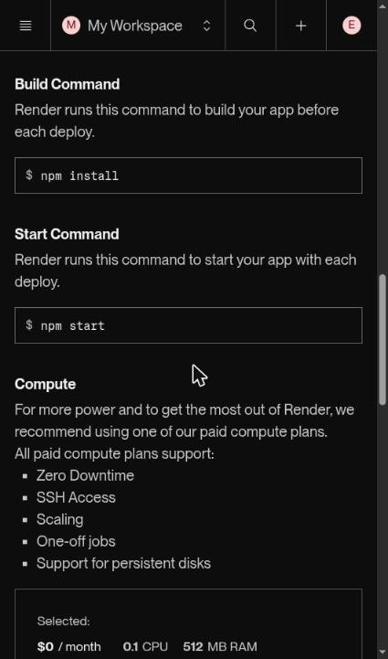
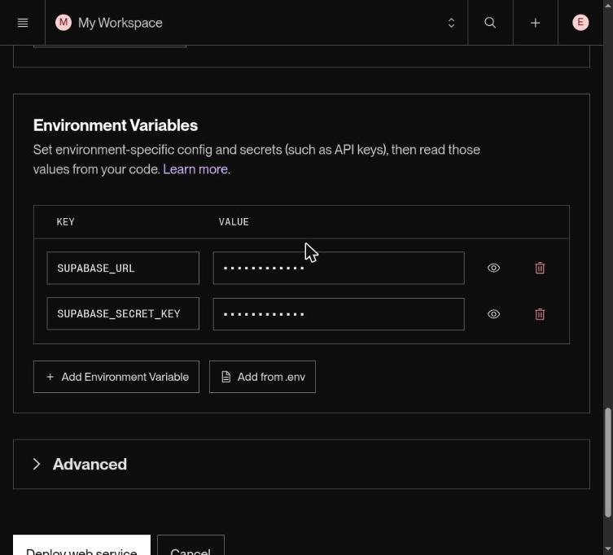
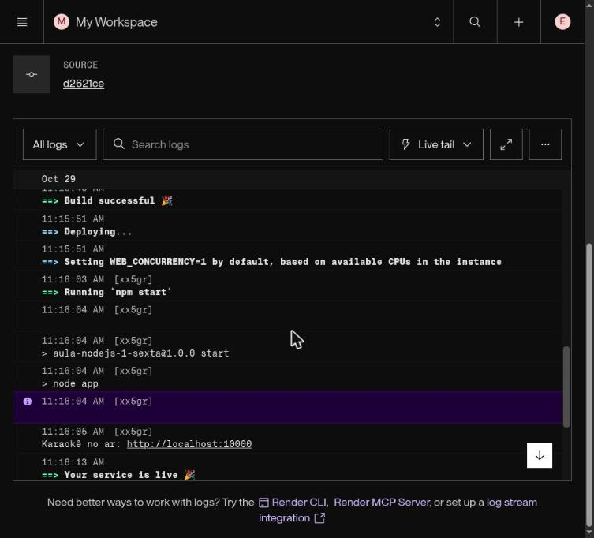
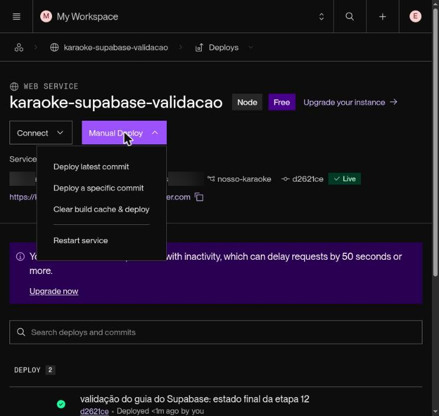

# Guia Passo a Passo — Colocando o Karaokê no Ar com a Render.com

**Disciplina:** Programação III

**Curso:** Ensino Médio Integrado — Técnico em Informática

**Professor:** Elder Francisco Fontana Bernardi

**Instituição:** IFSul — Campus Passo Fundo

**Material de apoio** · Projeto usado como exemplo: o Karaokê com banco de dados construído no Guia passo a passo do Supabase (disponível no Classroom da disciplina), que é a base do projeto "O repertório da turma"

Hoje o projeto de vocês só funciona no computador de vocês. Para alguém ver o karaokê, precisa estar ali do lado, com o `npm start` rodando.

Quando vocês terminarem este guia, o projeto vai ter um endereço na internet, tipo `karaoke-turma.onrender.com`. Qualquer pessoa poderá abrir esse endereço no celular, de qualquer lugar.

A plataforma que vamos usar chama **Render.com**. Ela mantém o servidor de vocês ligado do mesmo jeito que ele fica ligado no computador de vocês, com o mesmo `app.listen()` de sempre. Por isso quase nada muda no código: praticamente tudo que vocês já sabem continua valendo.

### Como usar este guia

- Siga as etapas **na ordem**. Elas dependem umas das outras.
- Cada etapa termina com um teste. **Se o teste falhar, não avance.** Vá à [Etapa 10](#etapa-10--socorro-erros-mais-comuns) e resolva antes.
- Não decore os cliques. Entenda o motivo de cada um — é isso que vai ser cobrado na apresentação.

### Quando chamar o professor

Este guia foi escrito para vocês conseguirem ir sozinhos do começo ao fim. Mesmo assim, alguns pontos do caminho envolvem **segurança, dados de pagamento ou risco de perder trabalho já feito**. Nesses pontos vocês vão ver um aviso assim:

> **Chame o professor.** É melhor perguntar antes do que desfazer depois.

Chamem sem constrangimento. Pedir ajuda não tira nota de ninguém. Ficar duas horas travados no mesmo erro, esse sim custa caro — em tempo e em vontade de continuar.

Chamem **imediatamente**, sem tentar resolver sozinhos, quando:

- alguma tela pedir **dados de cartão de crédito**;
- vocês perceberem que uma **senha ou chave foi para o GitHub**;
- aparecer qualquer coisa sobre **apagar, forçar ou sobrescrever** o repositório;
- o mesmo erro voltar pela **terceira vez** depois de vocês já terem tentado o que o guia manda;
- estiverem a menos de **uma hora da apresentação** com o sistema fora do ar.

**Como pedir ajuda de um jeito que funciona.** Cheguem com estas quatro informações — assim o problema costuma se resolver em minutos, e não no fim da aula:

1. Em que etapa do guia vocês estavam.
2. A mensagem de erro **copiada inteira** (print da tela do log serve).
3. O que vocês já tentaram.
4. O link do repositório no GitHub e o link do serviço na Render.

"Não funciona" não é uma descrição de problema. "Travou na Etapa 7, o log diz `Cannot find module`, já rodei `npm install` e commitei" é.

---

### Três palavras que vão aparecer o tempo todo

| Palavra | O que quer dizer |
|---|---|
| **Deploy** | Colocar a aplicação no ar. "Fazer o deploy" = publicar uma versão na internet. |
| **Produção** | O lugar onde as pessoas de verdade usam o sistema. O contrário é o computador de vocês, onde vocês desenvolvem. |
| **Servidor** | O computador que fica ligado recebendo pedidos e respondendo. Até agora, esse computador era o de vocês. |

---

## Sumário

- [Etapa 0 — O que vai acontecer](#etapa-0--o-que-vai-acontecer)
- [Etapa 1 — Conferindo o projeto antes de publicar](#etapa-1--conferindo-o-projeto-antes-de-publicar)
- [Etapa 2 — Duas mudanças no código](#etapa-2--duas-mudanças-no-código)
- [Etapa 3 — O repositório no GitHub](#etapa-3--o-repositório-no-github)
- [Etapa 4 — Criando a conta na Render](#etapa-4--criando-a-conta-na-render)
- [Etapa 5 — Criando o Web Service](#etapa-5--criando-o-web-service)
- [Etapa 6 — Configurando as senhas e chaves](#etapa-6--configurando-as-senhas-e-chaves)
- [Etapa 7 — Acompanhando o primeiro deploy](#etapa-7--acompanhando-o-primeiro-deploy)
- [Etapa 8 — Testando o sistema publicado](#etapa-8--testando-o-sistema-publicado)
- [Etapa 9 — O dia a dia depois de publicar](#etapa-9--o-dia-a-dia-depois-de-publicar)
- [Etapa 10 — Socorro: erros mais comuns](#etapa-10--socorro-erros-mais-comuns)
- [Etapa 11 — O que o plano gratuito permite](#etapa-11--o-que-o-plano-gratuito-permite)
- [Antes da apresentação](#antes-da-apresentação)
- [Checklist final de entrega](#checklist-final-de-entrega)
- [Anexo — Glossário](#anexo--glossário)

---

## Etapa 0 — O que vai acontecer

Publicar não é "mandar os arquivos para um site". Funciona assim:

A Render é um computador emprestado, ligado 24 horas por dia, dentro da internet. Só que ela **não pega os arquivos direto do computador de vocês**. Ela pega do **GitHub**.

Então o caminho é este:

```
   Computador de vocês           GitHub                       Render.com
┌────────────────────┐      ┌──────────────┐      ┌────────────────────────────┐
│ projeto karaokê    │      │ repositório  │      │ 1. copia o repositório     │
│  app.js            │─push→│  (a cópia    │─────→│ 2. instala as bibliotecas  │
│  DAO/MusicaDAO.js  │      │   oficial)   │ aviso│    (npm install)           │
│  public/           │      │              │      │ 3. liga o servidor         │
│  package.json      │      └──────────────┘      │    (npm start)             │
│  .env  (não sobe)  │                            │ 4. entrega o endereço      │
└────────────────────┘                            │    público                 │
                                                  └────────────────────────────┘
                                                        ↓
                                            https://karaoke-turma.onrender.com
```

Guardem estas três frases. Elas explicam quase todos os erros que vocês vão encontrar:

**1. A Render só enxerga o que está no GitHub.**
Arquivo que vocês não commitaram, para ela, não existe. Quando algo funciona no computador de vocês e não funciona lá, essa é sempre a primeira coisa a checar.

**2. A Render instala as bibliotecas do zero.**
Ela lê o `package.json` e baixa tudo de novo. A pasta `node_modules` do computador de vocês não vai junto (nem precisa). Se uma biblioteca não está anotada no `package.json`, ela não vai existir lá.

**3. O arquivo `.env` não sobe — e isso é de propósito.**
Senhas e chaves nunca vão para o GitHub. Como a Render precisa desses valores para funcionar, vocês vão informá-los de outro jeito: digitando no painel dela ([Etapa 6](#etapa-6--configurando-as-senhas-e-chaves)).

> **Existe um nome para isso.** Quando o código é igual em todo lugar e só os valores mudam de um ambiente para o outro, chamamos de **configuração por ambiente**. É assim que empresas de software trabalham.

---

## Etapa 1 — Conferindo o projeto antes de publicar

Antes de criar conta em qualquer lugar, o projeto precisa estar arrumado **no computador de vocês**. São seis conferências rápidas. Façam todas.

### 1.1 O projeto roda sem erro aqui

Abram o terminal na pasta do projeto e rodem:

```bash
npm install
npm start
```

Abram `http://localhost:3000` e testem as rotas com o arquivo `testes/musicas.http`. No terminal deve aparecer `Karaokê no ar: http://localhost:3000` (na base de retomada, `Karaokê disponível na porta 3000`).

Se está quebrado aqui, vai estar quebrado lá também — com a diferença de que lá vocês não têm o VS Code para procurar o problema. Arrumem agora.

> **Quem usa a base de retomada.** Este guia usa como exemplo o projeto do Guia passo a passo do Supabase. Na base de retomada, a mensagem de início é `Karaokê disponível na porta …`, o DAO fica em `karaoke/DAO/`, a mensagem de variável faltando é `Preencha SUPABASE_URL e SUPABASE_SECRET_KEY no .env ou no ambiente do servidor`, e o `.http` vem da seção 3.5 do Guia passo a passo do Supabase (disponível no Classroom da disciplina), porque a base não traz esse arquivo. O resto do caminho é o mesmo.

### 1.2 O `package.json` tem um script `start`

Abram o `package.json` e procurem o bloco `scripts`. No fim do Guia passo a passo do Supabase, o arquivo fica assim:

```json
{
  "name": "aula-nodejs-1-sexta",
  "version": "1.0.0",
  "description": "Projeto para aprender Node.js",
  "license": "ISC",
  "author": "Elder Bernardi",
  "type": "commonjs",
  "main": "index.js",
  "scripts": {
    "test": "echo \"Error: no test specified\" && exit 1",
    "start": "node app",
    "teste": "echo SCRIPT de teste! ",
    "karaoke": "node ./karaoke/player",
    "dev": "nodemon app"
  },
  "dependencies": {
    "@supabase/supabase-js": "^2.117.1",
    "chalk": "^4.1.2",
    "dotenv": "^18.0.3",
    "express": "^5.2.1"
  },
  "engines": {
    "node": ">=22"
  }
}
```

Na base de retomada, o `package.json` é outro: nome `karaoke-integrador-retomada`, versões fixas (sem o `^`), sem o `chalk` e com `"start": "node app.js"`. Os dois funcionam na Render.

Três coisas importantes:

- O `start` tem que rodar com **`node`**, nunca com `nodemon`. O `nodemon` serve para desenvolver: ele fica vigiando se vocês salvaram algum arquivo, para reiniciar sozinho. Na internet, ninguém edita arquivo — então ele não tem função ali, e ainda pode nem estar instalado. O script `dev` do exemplo usa `nodemon` e pode ficar: a Render só roda o `start`.
- O script `start` precisa apontar para o arquivo que liga o servidor. No projeto do Guia do Supabase é `node app`, que executa o `app.js`. Se o arquivo principal de vocês tiver outro nome, ajustem o script.
- Os números de versão no seu `package.json` podem ser diferentes dos do exemplo. O que importa é que as três bibliotecas que o servidor usa (`express`, `@supabase/supabase-js` e `dotenv`) estejam em `dependencies`.

**Como saber se está certo:** o comando `npm start` liga o servidor. Se aparecer `Missing script: "start"`, é porque esse script não existe. Criem.

### 1.3 As bibliotecas estão anotadas

Toda biblioteca que vocês usam com `require` (`express`, `@supabase/supabase-js` e `dotenv` neste projeto) precisa aparecer em `dependencies`, no `package.json`.

Para ver a lista do que está instalado:

```bash
npm ls --depth=0
```

Se faltar alguma, instalem assim:

```bash
npm install nome-da-biblioteca
```

Esse comando já anota a biblioteca no `package.json` sozinho.

> **Cuidado com o `-D`.** Se vocês instalarem com `npm install -D alguma-coisa`, a biblioteca vai parar numa lista chamada `devDependencies`, que serve só para ferramentas de desenvolvimento. Em produção, essa lista pode ser ignorada — e o programa quebra com `Cannot find module`. Biblioteca que o servidor usa para funcionar vai em `dependencies`, sem o `-D`.

### 1.4 O `.gitignore` está protegendo o que não pode subir

Precisa existir um arquivo chamado `.gitignore` na raiz do projeto com, no mínimo:

```
node_modules/
.env
```

Para conferir se está funcionando:

```bash
git status
```

Se aparecer `node_modules` ou `.env` na lista (o `.env.example` pode e deve aparecer: ele não tem valores reais), alguma coisa está errada: ou o `.gitignore` não está sendo lido, ou esses arquivos já foram commitados antes (nesse caso, vejam a [Etapa 3.4](#34-e-se-o-env-já-subiu-sem-querer)).

### 1.5 Maiúsculas e minúsculas nos nomes dos arquivos

Esta é a causa número 1 de erro no primeiro deploy da turma. Leiam com atenção.

No Windows e no macOS, `MusicaDAO.js` e `musicadao.js` são tratados como o **mesmo** arquivo. No Linux, são **dois arquivos diferentes**. E a Render roda Linux.

Ou seja: um `require` escrito com a letra errada funciona no computador de vocês e quebra na internet.

Confiram cada `require` do projeto:

```javascript
const musicaDAO = require('./DAO/MusicaDAO');
//                          ↑ a pasta é DAO ou dao?
//                                ↑ o arquivo é MusicaDAO ou musicaDAO?
```

Para ver o nome verdadeiro dos arquivos, usem o terminal (na base de retomada, a pasta é `karaoke/DAO/`):

```bash
ls DAO/
```

A regra: **o que está escrito no `require` tem que ser igual, letra por letra, ao que o `ls` mostrou.**

> **Chame o professor** se vocês decidirem **renomear** uma pasta ou um arquivo para arrumar isso. O Git às vezes não percebe uma renomeação que só muda maiúscula para minúscula, e o resultado é um arquivo duplicado no repositório — que quebra a publicação de um jeito difícil de enxergar. Renomear com alguém do lado leva dois minutos; descobrir esse problema sozinho leva uma aula.

### 1.6 Nenhum caminho do seu computador no código

Procurem no código por trechos como `C:\Users\aluno\...` ou `/home/aluno/...`. Essas pastas não existem na Render.

Os caminhos precisam ser relativos ao projeto:

```javascript
app.use(express.static('public'));                          // funciona
app.use(express.static(path.join(__dirname, 'public')));    // melhor ainda
```

---

## Etapa 2 — Duas mudanças no código

Só duas. E uma delas é opcional.

### 2.1 A porta precisa vir do ambiente (obrigatório)

No computador de vocês, o servidor escuta na porta 3000. Se vocês seguiram o Guia do Supabase, o `app.js` já faz a leitura certa (veja o bloco "DEPOIS" abaixo) e esta correção só precisa ser conferida. Se o seu `app.listen` ainda tem o número fixo, troquem.

Na Render é diferente: **quem escolhe a porta é ela**. A Render escolhe um número (normalmente `10000`), guarda esse número num lugar chamado *variável de ambiente*, e fica esperando o servidor de vocês atender ali. Se o servidor insistir na 3000, a Render procura, não encontra ninguém, conclui que o programa não subiu e cancela a publicação.

A correção é uma linha:

```javascript
// ANTES — só funciona no computador de vocês
app.listen(3000, () => {
    console.log('Karaokê no ar: http://localhost:3000');
});

// DEPOIS — funciona nos dois lugares
const PORT = process.env.PORT || 3000;

app.listen(PORT, (erro) => {
    if (erro) {
        console.error(`Não foi possível usar a porta ${PORT}: ${erro.message}`);
        process.exit(1);
    }
    console.log(`Karaokê no ar: http://localhost:${PORT}`);
});
```

O `||` é o coração da coisa. Ele se lê assim:

> "Use a porta que o ambiente mandou. Se ninguém mandou nada (ou seja, estou no computador do aluno), use a 3000."

Um código só, servindo para os dois lugares.

> **Um detalhe que derruba muita gente:** não escrevam `app.listen(PORT, 'localhost')`. O `localhost` significa "só aceito conexões de dentro deste próprio computador" — o que na Render impede que ela chegue até o servidor de vocês. Deixem só `app.listen(PORT)`, sem o segundo valor. O Express já faz a coisa certa sozinho.

### 2.2 Avisar qual versão do Node o projeto exige (recomendado)

Assim a Render usa uma versão compatível com a que vocês usam. O projeto exige Node 22 ou mais novo. Descubram a sua com:

```bash
node -v
```

E acrescentem no `package.json`:

```json
{
    "engines": {
        "node": ">=22"
    }
}
```

O `package.json` do Guia do Supabase já traz esse trecho; confiram se ele está no seu. Isso evita aquele problema clássico de "mas na minha máquina funciona", causado por versões diferentes.

### 2.3 Testem de novo, aqui mesmo

```bash
npm start
```

Tem que continuar funcionando em `http://localhost:3000`. As mudanças da Etapa 2 foram feitas justamente para não atrapalhar nada local.

Agora um teste que imita a Render — vocês mesmos mandam a porta pelo ambiente:

```bash
# Linux, macOS ou Git Bash
PORT=4000 npm start

# Windows (PowerShell)
$env:PORT=4000; npm start
```

O servidor deve imprimir `Karaokê no ar: http://localhost:4000` (na base de retomada, `Karaokê disponível na porta 4000`) e responder nessa porta. Se subiu, a Etapa 2 está certa.

---

## Etapa 3 — O repositório no GitHub

A Render não copia os arquivos do computador de vocês: ela copia de um repositório do GitHub.

**Vocês já têm esse repositório.** É o mesmo que vocês vêm usando desde as atividades anteriores, com o projeto do karaokê dentro. **Não criem um repositório novo.** Continuem no que já existe.

Por três motivos:

- O histórico de commits de vocês está lá. Ele faz parte da avaliação e conta a história do projeto.
- O professor já acompanha esse repositório.
- Repositório novo significa começar um histórico do zero, como se o trabalho anterior não tivesse existido.

O que esta etapa faz é preparar esse repositório para a publicação.

### 3.1 Confirmando que vocês estão no repositório certo

No terminal, dentro da pasta do projeto:

```bash
git remote -v
```

Deve aparecer o endereço do repositório de vocês, duas vezes:

```
origin  https://github.com/SEU-USUARIO/karaoke-api.git (fetch)
origin  https://github.com/SEU-USUARIO/karaoke-api.git (push)
```

Confiram também em qual branch vocês estão:

```bash
git branch --show-current
```

Normalmente vai aparecer `main`. Se aparecer `master`, anotem esse nome — vocês vão precisar dele na [Etapa 5.2](#52-preenchendo-o-formulário), no campo **Branch**.

> **O nome que vale é o que está no GitHub.** A pasta no computador de vocês pode se chamar `karaoke`, `trabalho`, `projeto final` ou qualquer outra coisa — isso não tem importância nenhuma. O que a Render enxerga é o nome do **repositório no GitHub**, aquele que aparece no endereço do site:
>
> ```
> https://github.com/SEU-USUARIO/karaoke-api
>                    └── usuário ──┘ └─ nome do repositório ─┘
> ```
>
> Anotem esse nome exatamente como ele está escrito lá, com os mesmos hífens, as mesmas maiúsculas e as mesmas minúsculas. Vocês vão usá-lo na Etapa 5 para escolher o repositório certo na Render.

> **Se o `git remote -v` não mostrar nada**, este projeto ainda não está ligado a nenhum repositório do GitHub. Vejam a [Etapa 3.5](#35-caso-especial-o-projeto-ainda-não-está-no-github).

### 3.2 Enviando as mudanças da Etapa 2

As alterações que vocês fizeram no código (a porta e o `engines`) ainda estão só no computador de vocês. Enviem para o GitHub:

```bash
git status                                        # veja o que mudou
git add .
git commit -m "Ajusta a porta para funcionar na Render"
git push
```

**Se o `git push` for recusado** com uma mensagem falando em `rejected` ou `behind`, é porque tem coisa nova no GitHub que vocês ainda não baixaram (o colega da dupla commitou, por exemplo). Resolve assim:

```bash
git pull
git push
```

**Como saber se deu certo:** o `git status` responde `nothing to commit, working tree clean` e o `git log --oneline -3` mostra o seu commit no topo.

> **Chame o professor** se o `git pull` trouxer **conflito** (mensagem com `CONFLICT` e marcações `<<<<<<<` dentro dos arquivos), ou se alguma pesquisa na internet sugerir usar `git push --force` ou `git reset --hard`.
>
> Esses três casos mexem no histórico do projeto e podem **apagar o trabalho do colega da dupla** de forma difícil de recuperar. Não é vergonha nenhuma não saber resolver conflito ainda — é assunto que a gente resolve junto, na hora, em poucos minutos.

### 3.3 A conferência que salva a nota

Abram o repositório **no navegador** e olhem a lista de arquivos. Não confiem na memória: olhem a página. É exatamente isso que a Render vai receber.

| Precisa estar lá | Não pode estar lá |
|---|---|
| `package.json` e `package-lock.json` | `node_modules/` |
| `app.js` | `.env` |
| `karaoke/`, `DAO/` (na base de retomada, `karaoke/DAO/`) e `public/` | Qualquer senha, chave ou token escrito no código |
| `.gitignore` e `.env.example` (só nomes de variáveis, sem valores) | Arquivos pessoais do computador de vocês |

Confiram também se o arquivo que vocês acabaram de editar está com a versão nova. Cliquem no `app.js` dentro do GitHub e procurem a linha com `process.env.PORT || 3000` (no projeto do Guia passo a passo do Supabase, `const PORT = process.env.PORT || 3000;`; na base de retomada, `const porta = process.env.PORT || 3000;`). Se ela não estiver lá, o commit ou o push não foram feitos.

### 3.4 E se o `.env` já subiu sem querer?

Acontece, e tem conserto. Primeiro, tirem o arquivo do controle do Git (ele continua existindo no computador de vocês):

```bash
git rm --cached .env
```

Depois, abram o `.gitignore` no VS Code e confiram que ele tem uma linha só com `.env`. Se não tiver, acrescentem essa linha e salvem. Editem pelo VS Code, e não com `echo ".env" >> .gitignore`: no PowerShell do Windows, esse comando pode gravar o texto em UTF-16, uma codificação que o Git não lê no `.gitignore`, e a proteção não funciona.

Por fim, registrem e enviem a remoção:

```bash
git add .gitignore
git commit -m "Remove o .env do repositório"
git push
```

Depois — e essa parte é a mais importante — **troquem as chaves que estavam nele**.

Por quê? Porque o Git guarda o histórico. O commit antigo ainda tem a chave antiga escrita lá dentro, e num repositório público qualquer pessoa consegue ler. No Supabase, a troca fica em **Project Settings → API Keys**: apaguem a chave vazada e criem outra.

> **Chame o professor no mesmo dia.** Chave que passou pelo GitHub é chave queimada, e quanto antes ela for trocada, menor o problema.
>
> Trocar chave vazada é rotina profissional — acontece em empresa grande toda semana. Esconder que vazou é que não é rotina, e é o único jeito de isso virar um problema sério. Ninguém perde nota por avisar; avisar é exatamente o comportamento certo.

### 3.5 Caso especial: o projeto ainda não está no GitHub

Se, e somente se, o `git remote -v` não mostrou nada, façam este caminho. Quem já tem repositório deve pular direto para a Etapa 4.

1. Em [github.com](https://github.com), cliquem no **+** (canto superior direito) → **New repository**.
2. Em **Repository name**, usem um nome que explique o projeto: `karaoke-api`. **Anotem esse nome exatamente como vocês digitaram** — vocês vão precisar dele daqui a três passos.
3. **Não marquem** "Add a README" nem "Add .gitignore" — o projeto de vocês já tem esses arquivos, e marcar isso cria um conflito no primeiro envio.
4. Cliquem em **Create repository**.
5. No terminal, dentro da pasta do projeto:

```bash
git init
git add .
git commit -m "Projeto do karaokê preparado para publicar"
git branch -M main
git remote add origin https://github.com/SEU-USUARIO/karaoke-api.git
git push -u origin main
```

> **Atenção na linha do `git remote add`.** O endereço tem que apontar para o repositório **exatamente** como ele existe no GitHub: o mesmo usuário e o mesmo nome, letra por letra.
>
> Não adianta escolher um nome novo aqui: o Git não cria repositório no GitHub, ele só aponta para um que já existe. Se o nome não bater, o `git push` responde algo como `Repository not found` — e o erro **não** aparece no `git remote add`, aparece só lá na frente, o que confunde bastante.
>
> Três armadilhas comuns:
>
> | O que vocês digitaram | O que está no GitHub | Resultado |
> |---|---|---|
> | `karaoke_api` | `karaoke-api` | `Repository not found` (traço ≠ underline) |
> | `Karaoke-API` | `karaoke-api` | `Repository not found` (o GitHub diferencia maiúsculas) |
> | `karaoke-api` do colega | o repositório da dupla | Vocês publicam no lugar errado |
>
> **O jeito seguro é não digitar nada.** Na página do repositório no GitHub, cliquem no botão verde **Code**, copiem o endereço HTTPS que aparece ali e colem no terminal. Endereço copiado não tem erro de digitação.

Depois, voltem e façam a conferência da [Etapa 3.3](#33-a-conferência-que-salva-a-nota).

---

## Etapa 4 — Criando a conta na Render

### 4.1 Fazendo o cadastro

1. Entrem em [render.com](https://render.com) e cliquem em **Get Started** (ou **Sign Up**).
2. Escolham entrar **com o GitHub**. Vale a pena: além de criar a conta, isso já adianta metade da conexão com o repositório.
   - Dá para usar e-mail e senha e conectar o GitHub depois, mas o caminho fica mais longo.
3. O GitHub vai pedir permissão para a Render (**Authorize Render**). Leiam a tela antes de aceitar: vocês estão permitindo que a Render leia seus repositórios e receba avisos quando houver commits novos. É exatamente o que a gente quer.
4. **Confirmem o e-mail.** A Render manda um link de confirmação. Sem clicar nele, a conta fica limitada. Se não chegar em alguns minutos, olhem o spam.
5. Na primeira vez, a Render pergunta o nome do *workspace* (a área de trabalho da conta) e algumas informações de perfil. Pode ser o nome de vocês ou algo como `karaoke-turma`.

> **Sobre cartão de crédito:** para criar o serviço no plano gratuito (**$0 / month** no formulário, selo **Free** na página do serviço) não é preciso cadastrar cartão.
>
> **Chame o professor** se qualquer tela pedir dados de pagamento. Provavelmente é só um plano pago selecionado sem querer (veja a Etapa 5.3), e a gente corrige em um minuto. Mas **não digitem número de cartão de ninguém** — nem de vocês, nem dos pais — para fazer um trabalho da escola. Nenhuma atividade desta disciplina exige pagar por nada.

### 4.2 Liberando o acesso aos repositórios

Façam esta parte se o repositório for privado, ou se a Render não mostrar seus repositórios na Etapa 5:

1. No painel da Render: **Settings** → **GitHub** → **Configure**.
2. O GitHub abre uma tela perguntando o que a Render pode acessar:
   - **All repositories** — mais prático;
   - **Only select repositories** — mais seguro; marquem o repositório do karaokê.
3. Cliquem em **Save** (ou **Install**).

---

## Etapa 5 — Criando o Web Service

Na Render, **Web Service** é o nome dado a "um programa que fica ligado respondendo pedidos pela internet". É exatamente o que o Express de vocês é.

### 5.1 Começando

1. No painel, criem um novo **Web Service** (botão **+ New**, no alto, ou o atalho **+** da barra superior).
2. Na aba **Git Provider**, cliquem no repositório do karaokê. O clique já abre o formulário do serviço; não há um botão separado para confirmar.
   - **Confiram o nome antes de clicar.** A Render mostra todos os repositórios da conta de vocês, e vários podem ter nomes parecidos (`karaoke`, `karaoke-api`, `karaoke-teste`, o fork de um colega). Selecionem aquele cujo nome é **exatamente igual** ao que vocês anotaram na [Etapa 3.1](#31-confirmando-que-vocês-estão-no-repositório-certo).
   - Publicar o repositório errado não dá mensagem de erro nenhuma: a Render simplesmente coloca no ar um projeto que não é o de vocês, e a confusão pode demorar bastante para ser percebida.
   - Se o repositório não aparecer na lista, voltem à [Etapa 4.2](#42-liberando-o-acesso-aos-repositórios).

### 5.2 Preenchendo o formulário

A Render tenta adivinhar vários campos quando percebe que é um projeto Node ("It looks like you're using Node, so we've autofilled some fields"). **Confiram todos mesmo assim** — adivinhação erra. No teste feito para este guia, a Render sugeriu `node index.js` no **Start Command**. O repositório da aula tem um `index.js` que **não** é o servidor do karaokê: com essa sugestão, o serviço ligaria o arquivo errado.

| Campo | O que colocar | Para que serve |
|---|---|---|
| **Name** | `karaoke-turma-XX` (só minúsculas, sem espaço e sem acento) | Vira o endereço do site: `karaoke-turma-XX.onrender.com`. Não pode repetir um nome que já exista no mundo — se der conflito, acrescentem algo. |
| **Project** *(opcional)* | deixem em branco | Serve só para organizar o painel. |
| **Language** | `Node` | Diz à Render qual linguagem o projeto usa. |
| **Branch** | `main` (ou o nome que apareceu na [Etapa 3.1](#31-confirmando-que-vocês-estão-no-repositório-certo)) | A cada `push` nessa branch, a Render publica de novo. |
| **Region** | `Ohio (US East)` ou `Oregon (US West)` | O lugar do mundo onde o servidor vai rodar. Não existe opção na América do Sul; Ohio costuma responder um pouco mais rápido para o Brasil. Escolham uma e não mudem mais. |
| **Root Directory** | deixem em branco, se o `package.json` está na raiz do repositório | Se o projeto estiver dentro de uma subpasta (`servidor/`, por exemplo), é aqui que se avisa isso. |
| **Build Command** | `npm install` (projeto do Guia passo a passo do Supabase) ou `npm ci` (base de retomada) | O que rodar **antes** de ligar o programa: baixar as bibliotecas. O `npm ci` instala exatamente as versões do `package-lock.json` (a base traz esse arquivo); o `npm install` também segue o `package-lock.json` quando ele está no repositório. Os dois funcionam. |
| **Start Command** | `npm start` (apaguem o `node index.js` que a Render sugere) | O comando que liga o servidor. O `npm start` roda o script `start` do `package.json`, que aponta para o `app.js`. Se não existe script `start`, voltem à [Etapa 1.2](#12-o-packagejson-tem-um-script-start). |

> **Qual a diferença entre Build e Start?** Isso cai em prova, então entendam agora.
>
> O **build** roda **uma vez** a cada publicação e prepara o terreno (baixar bibliotecas). Ele começa e termina.
>
> O **start** roda depois e **fica rodando** o tempo todo, enquanto o site estiver no ar. Ele nunca termina sozinho.
>
> Por isso, se vocês escreverem `npm install && npm start` no campo Build, a publicação trava para sempre: a Render fica esperando terminar um comando que, por natureza, não termina.

### 5.3 Escolhendo o plano

Na seção **Compute**, escolham a opção **$0 / month** (0.1 CPU, 512 MB RAM). Esse é o plano gratuito; a Render não escreve "Free" nessa lista.

**A Render deixa um plano pago marcado de início** (**$7 / month**). Confiram que o alto do quadro mostra **Selected: $0 / month** antes de continuar. Ao escolher o gratuito, aparece um aviso de que esse tipo de serviço "dorme" sem uso; é o comportamento descrito na Etapa 11.



> **Chame o professor** se não aparecer a opção **$0 / month**, ou se aparecer qualquer valor diferente de zero. Não sigam adiante "para ver no que dá".

O que esse plano permite (e o que não permite) está na [Etapa 11](#etapa-11--o-que-o-plano-gratuito-permite). Leiam antes de marcar a apresentação para a turma.

### 5.4 Criando

Se o projeto de vocês já usa o Supabase, **antes de clicar no botão final**, façam a [Etapa 6](#etapa-6--configurando-as-senhas-e-chaves) — o fim do próprio formulário tem a seção **Environment Variables** para isso. Se o projeto ainda guarda os dados num array na memória, sem `.env`, podem seguir direto.

Cliquem em **Deploy web service**. A Render abre a página dessa publicação, com o status (**Building**, depois **In progress**) e os logs logo abaixo.

---

## Etapa 6 — Configurando as senhas e chaves

Esta etapa é obrigatória para o projeto "O repertório da turma", porque ele usa o Supabase. Se o projeto de vocês ainda guarda tudo num array em memória, sem `.env`, podem pular para a Etapa 7.

### 6.1 Qual é o problema

O arquivo `.env` ficou de fora do GitHub, de propósito, por segurança.

Resultado: a Render não sabe qual é o endereço do banco nem a chave de acesso. O `supabaseClient.js` encontra as variáveis vazias e o servidor para na inicialização, com uma mensagem nos Logs (ver a [Etapa 10](#etapa-10--socorro-erros-mais-comuns)).

### 6.2 Como resolver

O projeto usa **somente duas** variáveis. Elas precisam ser recriadas na Render, com os **mesmos valores do `.env` de vocês**:

| Key | Value |
|---|---|
| `SUPABASE_URL` | a URL do projeto, igual à do `.env` (`https://xxxxxxxxxxxx.supabase.co`) |
| `SUPABASE_SECRET_KEY` | a **secret key** (`sb_secret_...`), igual à do `.env` |

**Durante a criação do serviço** (o caminho mais curto), no fim do formulário da Etapa 5, na seção **Environment Variables**:

1. Cliquem em **Add Environment Variable** e preencham **Key** e **Value** da primeira variável.
2. Cliquem de novo em **Add Environment Variable** para a segunda.
3. Confiram que ficaram **exatamente duas linhas**, sem nenhuma linha vazia, e voltem à Etapa 5.4.



**Depois que o serviço existe** (para corrigir um valor):

1. Na página do serviço, no menu da esquerda, cliquem em **Environment**. Com a janela do navegador estreita, esse menu fica escondido no ícone **≡**, no canto superior esquerdo.
2. Cliquem em **Edit**. Para trocar um valor, cliquem no campo **Value**, selecionem tudo (`Ctrl+A`) e colem o novo. Para criar uma variável, usem **Add variable**.
3. Salvem com **Save, rebuild, and deploy**: grava as variáveis e publica o serviço de novo. Evitem a opção **Save only**, na setinha do mesmo botão: como o nome diz, ela só grava, sem publicar de novo; o servidor só lê as variáveis quando liga (veja o quadro no fim da Etapa 6.3).

Existe um atalho, **Add from .env**, que aceita colar o conteúdo de um arquivo `.env` de uma vez. Se usarem, apaguem depois qualquer linha que não seja `SUPABASE_URL` ou `SUPABASE_SECRET_KEY`: a linha do `PORT` e também as linhas que o Supabase mostra junto quando se copia o trecho do botão **Connect** (como `SUPABASE_PUBLISHABLE_KEY`).

> **Os nomes na Render têm que ser iguais aos do código.** O `supabaseClient.js` lê `process.env.SUPABASE_URL` e `process.env.SUPABASE_SECRET_KEY`. Qualquer outro nome faz o servidor parar na inicialização.

### 6.3 Cuidados

- **Copiem do `.env` de vocês, não de outro projeto.** Se a conta do Supabase tem mais de um projeto (o da Unidade 3, um de teste, o da dupla), é fácil copiar a URL e a chave do projeto errado. A Render publica sem reclamar, e o sintoma só aparece depois: a página mostra músicas diferentes das que vocês têm no computador, ou alguma rota responde erro 500. O `.env` é a referência, porque foi com ele que vocês testaram tudo na máquina.
- **Copiem e colem com precisão.** Espaço sobrando no fim, aspas em volta do valor ou o nome da variável repetido dentro do campo são as três causas mais comuns de "coloquei a chave e mesmo assim não funciona". No campo **Value** vai só o valor puro: sem aspas, sem `SUPABASE_URL=` na frente.
- **Não criem uma variável chamada `PORT`.** A Render define a porta sozinha, e o `app.js` já lê `process.env.PORT`. O `PORT` do `.env` serve só para o computador de vocês. Uma variável `PORT` criada à mão, com outro número, pode fazer a Render não encontrar o servidor.
- **Só a secret key vai para o servidor.** Nunca usem a **publishable key** no servidor: o `supabaseClient.js` do projeto foi escrito para a secret key, e a publishable key tem outro nível de acesso. Também não coloquem nenhuma chave no `player.js` nem em arquivo da pasta `public/`.
- **Chave continua sendo segredo.** O valor que aparece nessa tela não pode ir para print no grupo da turma, slide de apresentação, README ou conversa com o agente de IA.

> **Chame o professor** se ficarem em dúvida sobre **qual** chave copiar do Supabase. A **secret key** (`sb_secret_...`) dá acesso total ao banco: quem tem ela na mão pode apagar tudo. Copiar a chave errada para o lugar errado é o tipo de erro que só aparece depois, quando já é problema. Vale a pergunta de trinta segundos.

- **O `dotenv` continua no código, sem problema.** Ele lê o `.env` quando o arquivo existe (no computador de vocês) e não faz nada quando não existe (na Render). Nos dois casos, o `process.env.SUPABASE_URL` chega ao código do mesmo jeito.

> **Por que a Render precisa publicar de novo depois que eu mudo uma variável?**
>
> Porque o programa lê as variáveis **na hora em que liga**. Mudar o valor com o programa já rodando não muda nada: é preciso desligar e ligar de novo.
>
> É igual ao computador de vocês: se alterarem o `.env`, precisam parar o servidor (`Ctrl+C`) e subir de novo.

---

## Etapa 7 — Acompanhando o primeiro deploy

Assim que o serviço é criado, a Render mostra a página da publicação: o status no alto e, embaixo, os logs, com o relato do que está acontecendo, linha por linha. Os mesmos logs ficam depois na aba **Logs** do menu do serviço.

**Leiam esses logs.** Não é enfeite: é a única janela que vocês têm para dentro daquele computador. Saber ler log é conteúdo da disciplina.

A publicação passa por estas fases:

| Fase | O que aparece nos logs | O que significa |
|---|---|---|
| Copiando | `==> Cloning from https://github.com/...` e `==> Checking out commit ... in branch main` | A Render está baixando o repositório. Confiram o nome do repositório e da branch. |
| Escolhendo o Node | `==> Requesting Node.js version >=22` e `==> Using Node.js version ...` | A Render leu o `engines` da [Etapa 2.2](#22-avisar-qual-versão-do-node-o-projeto-exige-recomendado). |
| Instalando | `==> Running build command 'npm install'...` (ou `'npm ci'`) | Baixando as bibliotecas. |
| Empacotando | `==> Uploading build...` e `==> Build successful 🎉` | O build terminou. |
| Publicando | `==> Deploying...` | A Render prepara o servidor que vai ficar ligado. |
| Ligando | `==> Running 'npm start'` | Ligando o servidor. É aqui que aparece a mensagem do `app.js`: `Karaokê no ar: http://localhost:10000` (o texto diz `localhost`, mas a porta é a que a Render escolheu; na base de retomada, `Karaokê disponível na porta 10000`). Esta é a linha mais importante: ela prova que o `app.js` de vocês ligou. |
| Pronto | `==> Your service is live 🎉` e `==> Available at your primary URL https://...onrender.com` | Está no ar, neste endereço. |

Durante a instalação pode aparecer algo como `3 vulnerabilities (1 moderate, 1 high, 1 critical)`. É um aviso do `npm` sobre versões de bibliotecas, não um erro: a publicação continua.



Na página do serviço, o status muda para **Live**, em verde. Do lado do nome do serviço aparece o endereço público, algo como `https://karaoke-turma-XX.onrender.com`.

Se aparecer `==> Port scan timeout reached, no open ports detected`, o problema é a porta: revejam a [Etapa 2.1](#21-a-porta-precisa-vir-do-ambiente-obrigatório). Outros erros estão na [Etapa 10](#etapa-10--socorro-erros-mais-comuns).

> O primeiro deploy costuma levar de 2 a 5 minutos. Se demorar bem mais que isso sem nada novo nos logs, atualizem a página antes de achar que travou.

> **Chame o professor** se o deploy falhar **três vezes seguidas** e a mensagem não estiver na tabela da Etapa 10. Três tentativas já mostram que vocês não estão sendo desatentos — o problema é outro, e ler log de deploy junto com alguém mais experiente é a forma mais rápida de aprender a ler log sozinho depois.

---

## Etapa 8 — Testando o sistema publicado

Status verde não quer dizer que está tudo funcionando. Testem de verdade, nesta ordem.

### 8.1 A página do karaokê

Abram o endereço público no navegador. A página `public/index.html` deve carregar com a lista de músicas.

Se a página vier em branco, ou a lista vazia, apertem **F12** e olhem a aba **Console**. Erros de `fetch` aparecem ali.

> **A armadilha mais comum aqui:** endereço fixo no JavaScript do front-end.
>
> Se o `player.js` tem `fetch('http://localhost:3000/api/musicas')`, ele vai continuar procurando o servidor **no computador de quem abriu a página** — e não vai encontrar nada.
>
> A correção é usar caminho relativo. Como o front-end e a API são entregues pelo mesmo endereço, funciona nos dois lugares:
>
> ```javascript
> // errado na internet
> const resposta = await fetch('http://localhost:3000/api/musicas');
>
> // certo em qualquer lugar
> const resposta = await fetch('/api/musicas');
> ```

### 8.2 A API pelo REST Client

O arquivo `testes/musicas.http` da seção 3.5 do Guia passo a passo do Supabase já serve (quem usa a base de retomada cria esse arquivo a partir dessa seção). Basta trocar o endereço no topo:

```http
# @baseUrl = http://localhost:3000
@baseUrl = https://karaoke-turma-XX.onrender.com

### --- 1. GET: Listar todas as músicas ---
GET {{baseUrl}}/api/musicas

### --- 2. POST: Criar nova música ---
POST {{baseUrl}}/api/musicas
Content-Type: application/json

{
    "nome": "Smells Like Teen Spirit",
    "artista": "Nirvana"
}
```

Rodem **todos** os testes do arquivo, inclusive os que esperam erro (404 e 400). O comportamento na internet tem que ser igual ao do computador de vocês.

Confiram os mesmos códigos de resposta do computador de vocês. A primeira requisição pode demorar até um minuto, se o serviço estiver "dormindo" ([Etapa 11](#etapa-11--o-que-o-plano-gratuito-permite)).

### 8.3 O teste que vale mais

Abram o endereço **no celular, usando dados móveis** (fora do Wi-Fi da escola).

Se abriu, está publicado de verdade: o projeto de vocês está acessível de qualquer lugar do mundo. Mandem o link para alguém de fora da turma.

### 8.4 O teste de persistência (R7)

Este teste é obrigatório. Ele prova o requisito R7 do projeto "O repertório da turma" (o enunciado está disponível no Classroom da disciplina): o CRUD funciona na URL pública, e o banco e os dados continuam lá depois de reiniciar o servidor.

Recarregar a página não prova nada, porque o servidor continua de pé. Só um reinício, que cria um processo novo com a memória vazia, separa o dado guardado no banco do dado guardado na memória.

1. Criem uma música **pela tela publicada** (o formulário da página, no endereço público). Se a página ainda não tem formulário, usem o `POST /api/musicas` do arquivo `.http`.
2. Anotem o `id` da música criada.
3. No painel da Render, reiniciem o serviço: **Manual Deploy** → **Restart service**. A Render confirma com o aviso "Your server has successfully restarted". Esperem a mensagem de início aparecer de novo nos **Logs** (`Karaokê no ar` ou, na base de retomada, `Karaokê disponível na porta`).


4. Consultem o **mesmo `id`**: `GET /api/musicas/<id>` no `.http`, ou a lista na página. A resposta precisa ser `200` com a música.
5. Removam a música de teste (`DELETE /api/musicas/<id>`) e confirmem que ela saiu da lista.
6. Registrem o resultado no `README.md`, usando o modelo do Guia passo a passo do Supabase (disponível no Classroom da disciplina). O registro por marco tem data, teste, resultado e próximo passo:

```markdown
## Prova de persistência na URL pública

- **Data:** 00/00/0000
- **Teste:** criei uma música pela tela publicada (id 0), reiniciei o serviço
  na Render (Restart service) e consultei GET /api/musicas/0 no endereço público.
- **Resultado:** a música respondeu 200 depois do reinício; removi o registro de teste.
- **Próximo passo:** conferir a seção "Antes da apresentação" deste guia.
```

Troquem os zeros pelos valores reais e escrevam o que vocês observaram, mesmo que seja diferente do esperado.

Se a música sumiu depois do reinício, os dados estão na memória e não no banco. Revejam o `MusicaDAO.js` (em `DAO/` ou, na base de retomada, em `karaoke/DAO/`; ele deve usar o `supabaseClient`) e as variáveis da [Etapa 6](#etapa-6--configurando-as-senhas-e-chaves).

---

## Etapa 9 — O dia a dia depois de publicar

### 9.1 Publicação automática

Depois que o serviço existe, o trabalho de vocês passa a ser só este:

```bash
git add .
git commit -m "Corrige a validação do POST de partes"
git push
```

A Render percebe o `push` na branch `main` e publica de novo sozinha. Dá para acompanhar pela aba **Deploys**, que lista cada publicação com a mensagem do commit.

Isso muda o peso de cada commit: **tudo que vocês enviam para a `main` vai para o ar**. Commitar só código que funciona deixa de ser conselho do professor e vira consequência prática.

### 9.2 Logs de produção

Na aba **Logs** aparece tudo que o servidor imprime: `console.log`, `console.error` e os erros que ninguém tratou.

Quando algo funciona no computador de vocês e quebra na internet (vai acontecer), é o primeiro lugar a olhar.

Aproveitem para melhorar o próprio código. Um `console.error('Erro ao listar músicas:', erro)` bem colocado dentro do `catch` é a diferença entre saber que "quebrou" e saber "quebrou aqui, por causa disso".

### 9.3 Voltar para a versão anterior (rollback)

A publicação quebrou o sistema e a apresentação é daqui a dez minutos? Dá para voltar atrás:

1. Abram a aba **Deploys** do serviço.
2. Procurem a última publicação que estava funcionando (a lista mostra a mensagem de cada commit).
3. Cliquem em **Rollback**, à direita dessa publicação.

Em cerca de um minuto o sistema volta ao que era antes.

> Atenção: isso resolve a emergência, não o problema. O commit ruim continua na `main`. Depois da apresentação, corrijam o código, testem no computador de vocês e façam o `push`.

> **Chame o professor** se o sistema estiver fora do ar faltando menos de uma hora para a apresentação. Não tentem "consertar rápido" sob pressão: é assim que um problema pequeno vira três. Chamem, expliquem o que aconteceu e a gente decide junto entre voltar a versão anterior ou apresentar rodando localmente.

### 9.4 Publicar na mão

O botão **Manual Deploy** tem quatro opções:

- **Deploy latest commit** — publica de novo o último commit.
- **Deploy a specific commit** — publica um commit escolhido da lista. Para voltar atrás numa emergência, o **Rollback** da Etapa 9.3 é mais direto.
- **Clear build cache & deploy** — refaz tudo do zero. Serve quando o erro é de biblioteca ("mas eu instalei esse pacote!") e nada mais explica.
- **Restart service** — só desliga e liga o programa, sem reinstalar nada. É o que usar para reiniciar o servidor, como no teste da [Etapa 8.4](#84-o-teste-de-persistência-r7).

---

## Etapa 10 — Socorro: erros mais comuns

Procurem a mensagem que aparece nos **Logs da Render**, não a que aparece no navegador. O navegador mostra só o sintoma; o log mostra a causa.

| Mensagem no log | O que causou | Como resolver |
|---|---|---|
| `Port scan timeout reached, no open ports detected` | O servidor não está escutando na porta que a Render escolheu | Usar `process.env.PORT` ([Etapa 2.1](#21-a-porta-precisa-vir-do-ambiente-obrigatório)). Conferir também se não escreveram `'localhost'` no `listen`. |
| `Error: Cannot find module 'express'` | A biblioteca não está no `package.json`, ou está em `devDependencies` | Rodar `npm install express` (sem `-D`), commitar o `package.json` e o `package-lock.json` e dar `push`. |
| `Error: Cannot find module './DAO/musicaDAO'` | Maiúscula ou minúscula diferente do nome real do arquivo | Corrigir o `require` para ficar igual ao que o `ls` mostra ([Etapa 1.5](#15-maiúsculas-e-minúsculas-nos-nomes-dos-arquivos)). |
| `Missing script: "start"` | Não existe script `start` no `package.json` | Criar ([Etapa 1.2](#12-o-packagejson-tem-um-script-start)). |
| `npm ERR! code ENOENT ... package.json` | A Render não achou o `package.json` na raiz | Preencher o campo **Root Directory** com a subpasta do projeto ([Etapa 5.2](#52-preenchendo-o-formulário)). |
| `Preencham SUPABASE_URL e SUPABASE_SECRET_KEY no .env (ou no ambiente da Render)` (na base de retomada, `Preencha SUPABASE_URL e SUPABASE_SECRET_KEY no .env ou no ambiente do servidor`) ou `supabaseUrl is required`, logo ao ligar | As variáveis `SUPABASE_URL` / `SUPABASE_SECRET_KEY` não foram configuradas, ou o nome está diferente do usado no código | Revisar as variáveis ([Etapa 6](#etapa-6--configurando-as-senhas-e-chaves)) e publicar de novo. |
| `Invalid API key` nas rotas | A chave foi copiada errada, incompleta ou com espaço sobrando, ou é a publishable key no lugar da secret key | Copiar de novo a secret key do Supabase e colar sem aspas e sem espaços. |
| `Não foi possível usar a porta ...` | A porta já está em uso, ou há uma variável `PORT` criada à mão na Render | Apagar a variável `PORT` do painel Environment e publicar de novo ([Etapa 6.3](#63-cuidados)). |
| A página publicada mostra músicas diferentes das que aparecem no computador de vocês | Os valores da Etapa 6 vieram de outro projeto do Supabase | Copiar de novo a URL e a chave **do `.env`** e salvar com **Save, rebuild, and deploy** ([Etapa 6.2](#62-como-resolver)). |
| Só excluir uma música que tem partes responde erro 500; as outras rotas funcionam | O banco é de um projeto antigo, sem `on delete cascade` entre partes e músicas, ou os valores da Etapa 6 são de outro projeto | Conferir primeiro de onde vieram os valores. Se o projeto é o certo, rodar nele o `diagnostico.sql` e, se aparecer `ajustar`, o `ajustes.sql` (Guia passo a passo do Supabase, Etapa 4, disponível no Classroom da disciplina). |
| As rotas respondem erro 500 e os Logs mostram falha de conexão com o Supabase, ou a lista vem vazia de repente | O projeto do Supabase foi pausado por 7 dias sem atividade | Abrir o painel do Supabase e usar **Restore** no projeto ([Antes da apresentação](#antes-da-apresentação)). |
| O build termina, mas o serviço fica "Deploying" para sempre | Colocaram `npm install && npm start` no **Build Command** | Separar: Build = `npm install` (ou `npm ci`), Start = `npm start` ([Etapa 5.2](#52-preenchendo-o-formulário)). |
| `404 Not Found` na página inicial, mas a API responde | O Express não está entregando a pasta `public` | Conferir o `app.use(express.static('public'))` e se a pasta foi commitada. |
| No console do navegador: `Failed to fetch` ou erro de CORS | O front-end está chamando `http://localhost:3000` | Trocar por caminho relativo ([Etapa 8.1](#81-a-página-do-karaokê)). |
| A primeira requisição demora quase um minuto, depois fica tudo rápido | O serviço estava dormindo (plano Free) | É o comportamento esperado ([Etapa 11](#etapa-11--o-que-o-plano-gratuito-permite)). |

**E quando o erro não está na tabela?** Sigam este método:

1. Leiam a **primeira** linha de erro do log, não a última. As de baixo costumam ser só consequência da primeira.
2. Tentem reproduzir no computador de vocês com `npm start`. Se acontecer aqui também, o problema está no código.
3. Se aqui funciona e lá não, o problema é diferença de ambiente: variável faltando, nome de arquivo, versão do Node ou biblioteca não commitada.
4. Para pedir ajuda, **copiem a mensagem de erro inteira**. "Não funciona" não ajuda ninguém a ajudar vocês.

> **Pergunte ao agente.** *"O serviço na Render mostra este erro nos Logs (colado abaixo, sem chaves). Explique a causa provável e o que devo conferir no painel Environment. Use como fonte o guia_deploy_render.md (Etapas 6 e 10), na página do trabalho: https://elderbernardiifsul.github.io/programacao-iii/integrador-2026/guia_deploy_render.md."* Colem a mensagem do log abaixo do pedido. Antes de colar, apaguem qualquer chave, URL de projeto com senha ou valor do Environment. Usem o agente para entender e diagnosticar; a correção, quem faz e confere são vocês.

> **Chame o professor** quando vocês já tiverem passado por esses quatro passos e o erro continuar. A partir daí, insistir sozinho costuma virar tentativa e erro no escuro — e tentativa e erro no escuro, num sistema publicado, tem chance de quebrar o que ainda funcionava.
>
> Levem as quatro informações combinadas na abertura do guia: etapa, mensagem copiada, o que já tentaram e os links do repositório e do serviço.

---

## Etapa 11 — O que o plano gratuito permite

O plano Free da Render é generoso, mas tem regras. Vocês precisam conhecer essas regras **antes** da apresentação, não no meio dela.

| Regra | O que isso significa na prática |
|---|---|
| **Dorme depois de 15 minutos sem acesso** | Se ninguém abrir o site por 15 minutos, a Render desliga o programa para economizar. |
| **Acordar leva cerca de 1 minuto** | A primeira pessoa que acessar depois disso vai ver uma tela de carregamento. As próximas entram normalmente. |
| **750 horas de funcionamento por mês** | Sobra para os projetos da turma. Só conta o tempo em que o serviço está acordado. |
| **Um servidor só** | Não dá para dividir a carga entre vários. Para nós, não faz diferença. |
| **Não guarda arquivos** | Arquivo que o programa gravar some na próxima publicação ou reinício. Dados vão para o banco; arquivos vão para o Storage. |
| **Sem acesso por terminal** | Vocês só conseguem investigar pelos logs. Mais um motivo para escrever bons `console.error`. |

**O que fazer no dia da apresentação:** abram o endereço **cinco minutos antes** de começar, para o serviço acordar. Começar a apresentação com um minuto de tela branca não é defeito do projeto de vocês, mas perde a atenção da turma. Evitar isso é planejamento — e planejamento também é conteúdo desta disciplina.

> **Chame o professor** se o serviço aparecer como suspenso (faixa "Suspended" com o botão **Resume service**), ou se a Render avisar que as horas do mês acabaram. Tem conserto, mas o conserto depende do que causou — e não é coisa para descobrir na véspera da entrega.

> **Não montem robôs para ficar acessando o site** de minuto em minuto só para ele não dormir. Além de contornar a regra do plano gratuito, isso gasta as 750 horas do mês muito mais rápido. Quando as horas acabam, o serviço fica desligado até o mês seguinte — provavelmente no dia da entrega.

---

## Antes da apresentação

Dois serviços gratuitos entram na cadeia, e os dois podem estar parados no dia. Confiram **na véspera** e **alguns minutos antes de começar**.

1. **Projeto do Supabase pausado.** Projetos gratuitos são pausados depois de 7 dias sem atividade. Entrem no painel do Supabase com antecedência. Se o projeto estiver pausado, usem **Restore** e esperem o status voltar a **Healthy** (pode levar alguns minutos). Não deixem para fazer isso na hora da apresentação.
2. **Serviço da Render dormindo.** O plano gratuito põe o serviço para dormir depois de 15 minutos sem acesso. Abram a URL pública alguns minutos antes e esperem a lista carregar ([Etapa 11](#etapa-11--o-que-o-plano-gratuito-permite)).
3. **Música de amostra presente.** A página publicada precisa mostrar pelo menos a música de exemplo e tocar o karaokê. Se a lista estiver vazia, o banco foi apagado ou o projeto é outro: revejam a [Etapa 6](#etapa-6--configurando-as-senhas-e-chaves).
4. **Registro de teste removido.** A música criada no teste da [Etapa 8.4](#84-o-teste-de-persistência-r7) não pode ficar na lista da apresentação.
5. **`.env.example` no repositório.** Abram o repositório no GitHub e confirmem que o `.env.example` está lá, com os nomes `SUPABASE_URL` e `SUPABASE_SECRET_KEY` e sem valores reais. Confirmem também que o `.env` não está.

---

## Checklist final de entrega

Confiram tudo antes de mandar o link para o professor:

- [ ] O endereço público abre numa aba anônima e em outra rede (celular com dados móveis).
- [ ] `GET /api/musicas` responde `200` com o JSON das músicas.
- [ ] Os testes de erro do arquivo `.http` respondem `400` e `404`, também no endereço público.
- [ ] A página publicada lista as músicas e toca o karaokê.
- [ ] O teste de persistência da Etapa 8.4 foi feito na URL pública e está registrado no `README.md` (data, teste, resultado e próximo passo).
- [ ] O projeto do Supabase está **Healthy** (não pausado) e a página lista a música de amostra.
- [ ] O repositório no GitHub **não** tem `.env` nem `node_modules/`, e **tem** o `.env.example`.
- [ ] Nenhuma chave ou senha aparece em nenhum arquivo commitado.
- [ ] O `README.md` do repositório traz o endereço público e como rodar o projeto localmente (copiar o `.env.example` para `.env` e preencher).
- [ ] O último commit da `main` é o mesmo que está publicado (confiram na aba **Deploys**).
- [ ] Vocês sabem explicar, sem olhar o guia: por que o `.env` não vai para o GitHub, e de onde a Render tira essas informações.

O último item é justamente o que costuma ser perguntado na apresentação.

---

## Anexo — Glossário

| Termo | Significado |
|---|---|
| **Deploy** | Publicar a aplicação em algum lugar. "Fazer o deploy" = colocar no ar. |
| **Build** | A preparação que acontece antes de ligar o programa. No nosso caso, o `npm install` (ou o `npm ci`). |
| **Web Service** | Nome que a Render dá a um programa que fica ligado respondendo pedidos pela internet. |
| **Variável de ambiente** | Um valor guardado fora do código, que o programa lê com `process.env`. Serve para segredos e para o que muda de um lugar para outro. |
| **Produção** | O ambiente que as pessoas usam de verdade. O oposto de "desenvolvimento", que é o computador de vocês. |
| **Cold start** | A demora da primeira resposta depois que o serviço dormiu. |
| **Rollback** | Voltar o sistema publicado para uma versão anterior. |
| **Logs** | O relato do que o servidor foi imprimindo enquanto rodava. |
| **Webhook** | O aviso automático que o GitHub manda para a Render a cada `push`, disparando uma nova publicação. |
| **Repositório** | A pasta do projeto versionada pelo Git — no GitHub, a cópia oficial do código. |

---

## Uma última coisa

Publicar um sistema pela primeira vez dá um pouco de insegurança, e isso é normal — é a primeira vez que o código de vocês sai do computador de vocês e fica exposto para o mundo. Errar aqui faz parte, e quase tudo tem conserto.

O que não vale é ficar travado em silêncio. Chamem. Perguntem na aula, perguntem no laboratório, tragam o erro copiado. Trabalhar assim — pedindo ajuda cedo, com informação organizada na mão — é exatamente como funciona uma equipe de desenvolvimento de verdade.

---

*Material de apoio da disciplina de Programação III — IFSul, Campus Passo Fundo. As telas e os nomes dos botões da Render podem mudar com o tempo; a lógica das etapas continua a mesma. Dúvida que a Etapa 10 não resolveu: tragam a mensagem de erro copiada do log.*
