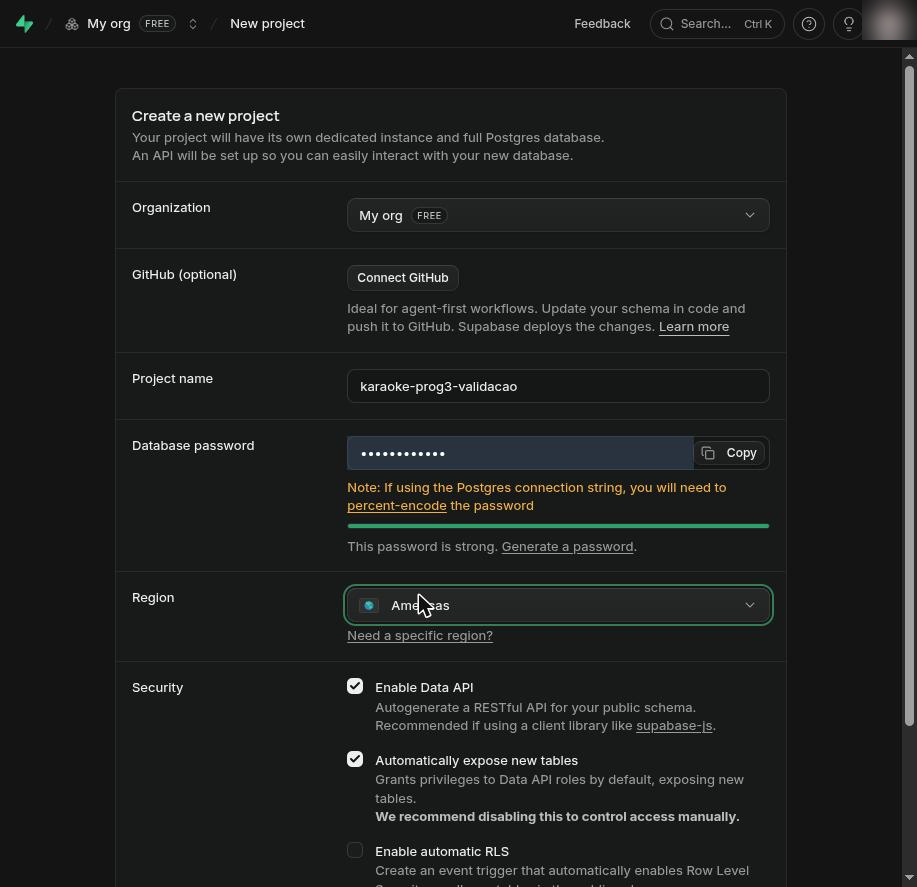
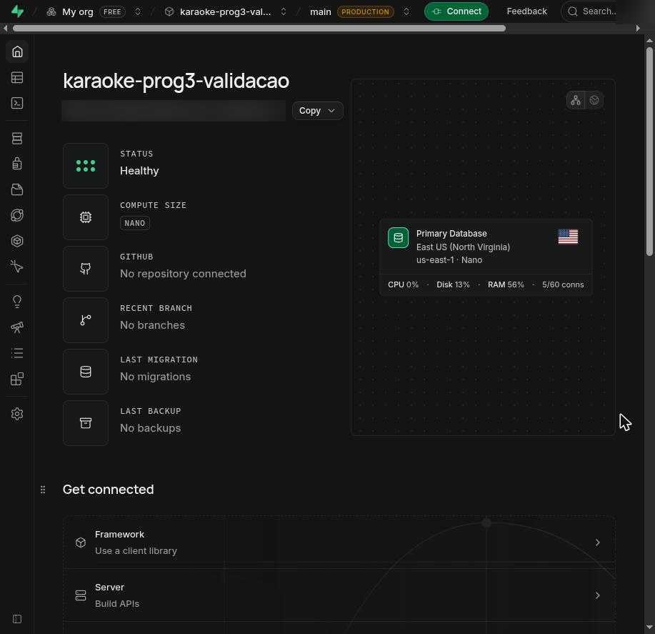
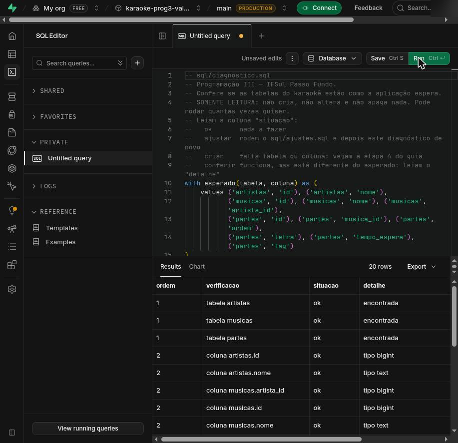
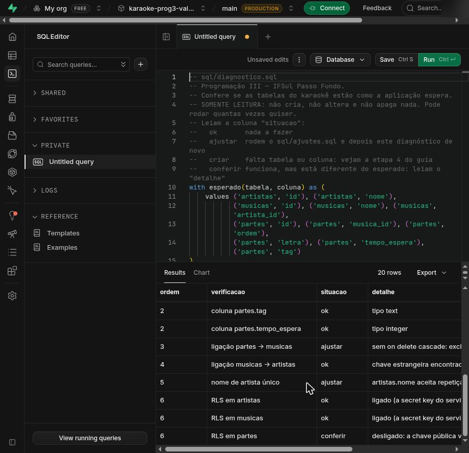
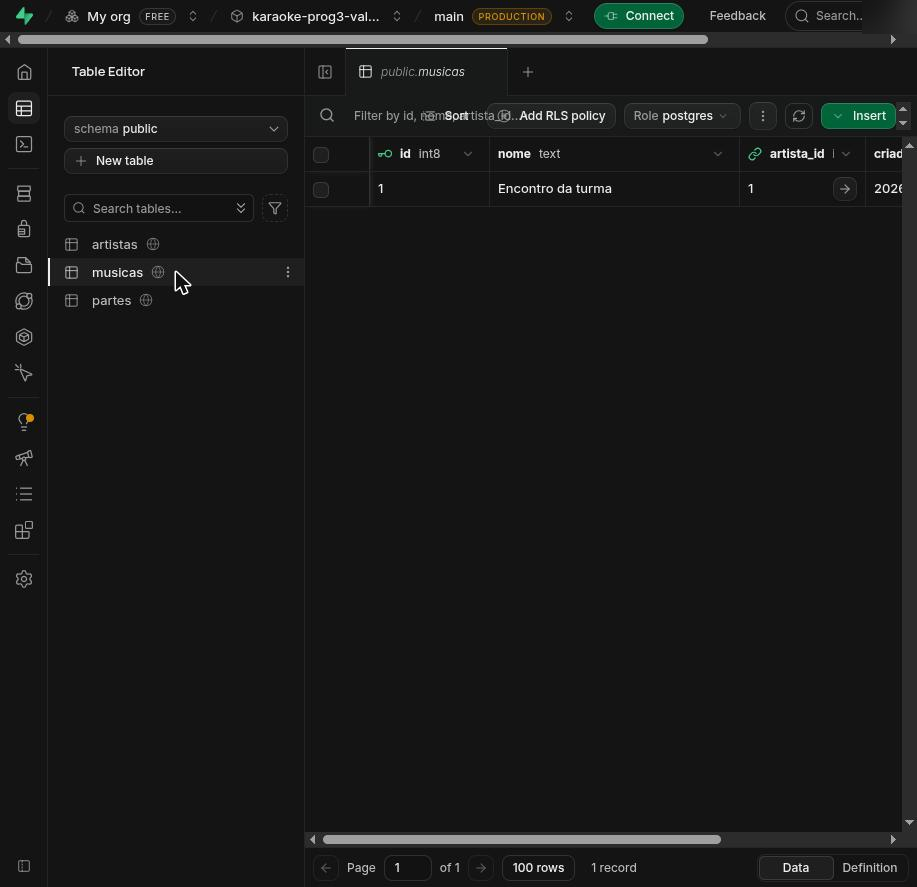
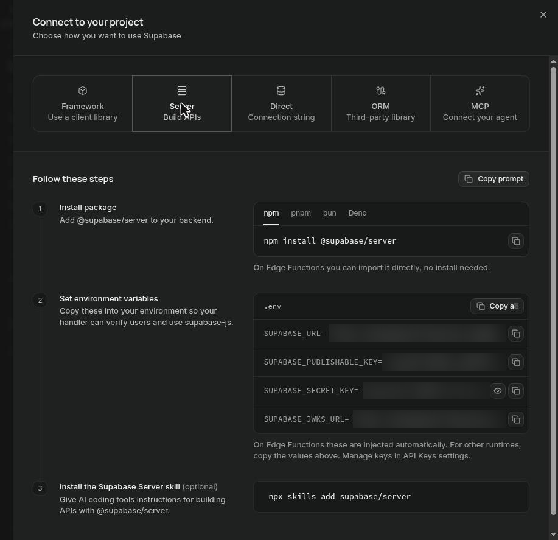
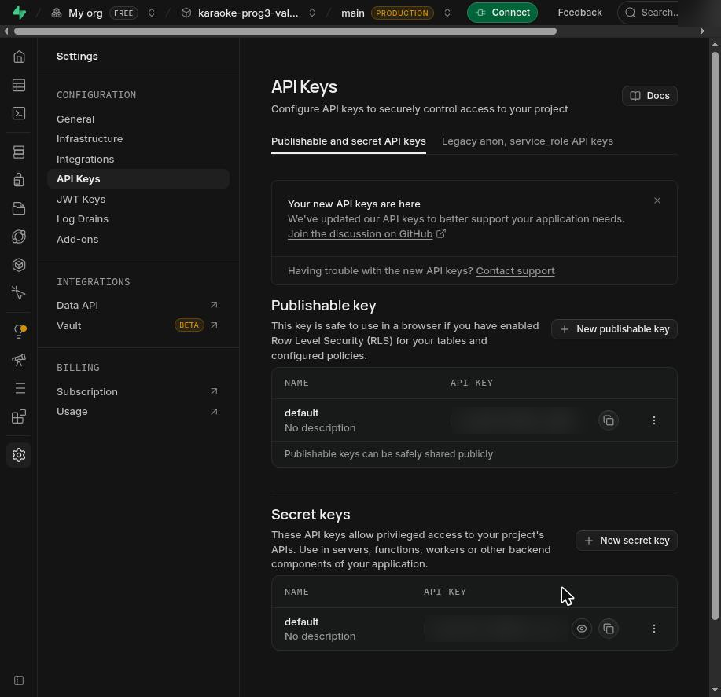

# Guia passo a passo — Karaokê com banco de dados no Supabase

**Disciplina:** Programação III

**Curso:** Ensino Médio Integrado — Técnico em Informática

**Professor:** Elder Francisco Fontana Bernardi

**Instituição:** IFSul — Campus Passo Fundo

**Versão 2 · 27/10/2026**

Este guia parte do repositório da aula de Node.js e chega a um karaokê web que guarda as músicas num banco de dados de verdade, no Supabase. O caminho está dividido em etapas curtas. Cada etapa diz quais arquivos criar ou alterar, onde eles ficam, quem usa cada um e como testar antes de seguir.

## Como usar este guia

### De onde vocês partem e aonde chegam

**Ponto de partida:** o repositório da aula, [elderbernardiifsul/aula-nodejs-1-T1](https://github.com/elderbernardiifsul/aula-nodejs-1-T1), num commit fixo. É o projeto das aulas de Express e DAO no ponto em que a Atividade 5 começa: o DAO guarda as músicas na memória e o player do navegador ainda tem partes por fazer. Os dois últimos commits desse ponto mexem só no arquivo `AGENTS.md`, explicado na etapa 0.

**Resultado, ao fim da etapa 13:**

- API de músicas completa (listar, consultar, cadastrar, editar, excluir e acrescentar partes), gravando no Supabase;
- player do navegador listando as músicas e tocando a música de exemplo;
- prova de que os dados continuam no banco depois de reiniciar o servidor;
- variáveis de ambiente prontas para publicar o projeto na Render.

### Qual caminho seguir

| Situação da dupla | O que ler |
|---|---|
| Vai começar pelo repositório da aula | Todas as etapas, na ordem, da 0 à 13. |
| Usa a base de retomada (o projeto que acompanha o Roteiro de retomada, disponível no Classroom da disciplina e em [base_retomada.zip](https://elderbernardiifsul.github.io/programacao-iii/integrador-2026/downloads/base_retomada.zip)) | A seção 3.5 (criem o `testes/musicas.http`, que a base não traz; o contrato da API é o mesmo), as etapas 4 (o banco), 5 (ligar o Node ao Supabase) e 12 (provar a persistência), e o anexo. Na etapa 5, a base já traz prontos os itens das seções 5.1 a 5.3 e 5.6 (`.gitignore`, dependências, `.env.example` e `supabaseClient.js`): façam a cópia do `.env.example` para `.env` (fim da 5.3) e as seções 5.4, 5.5 e 5.7. A base já traz API, DAOs e player prontos, numa estrutura de pastas um pouco diferente. |
| Vai aplicar o guia ao projeto que a dupla já tem | As etapas na ordem, comparando cada arquivo do guia com o de vocês. O anexo mostra os caminhos de `require` quando as pastas são diferentes. |

### Como cada etapa está organizada

As etapas 2 a 12 seguem esta ordem. As etapas 0 e 1 têm só as seções que fazem sentido para elas (por exemplo, não têm "Commit sugerido"):

1. **Objetivo**, em uma frase.
2. **Árvore de pastas** do projeto, com os arquivos novos e alterados marcados.
3. **Arquivos**: completos, com o caminho no título; ou, para alterações pequenas, uma troca de trecho, com os blocos "Antes" e "Depois".
4. **Quem usa / o que usa**: quais arquivos importam este (`require`) e quais ele importa.
5. **Teste agora**: o comando e a saída esperada.
6. **Commit sugerido**: os comandos e a mensagem do commit.
7. **Se deu errado**: os sintomas mais prováveis daquela etapa e o que fazer.
8. Quando a etapa traz um conceito novo, um quadro **Entenda**, que remete à Parte II.
9. Quando ajuda, um quadro **Pergunte ao agente**, com uma pergunta pronta para o agente de IA e a seção da página do trabalho que ele deve usar como fonte (ver etapa 0).

Um exemplo de árvore:

```text
nosso-karaoke/
├── DAO/
│   └── MusicaDAO.js      (alterado)
├── karaoke/
│   ├── musica.js
│   └── parte.js
├── testes/
│   └── musicas.http      (novo)
└── app.js                (alterado)
```

- `(novo)`: o arquivo ainda não existe. Criem com esse nome, nessa pasta.
- `(alterado)`: o arquivo já existe e muda nesta etapa.
- Sem marca: o arquivo existe e não muda.

A pasta `node_modules/` não aparece nas árvores, e algumas árvores mostram só a parte do projeto que interessa à etapa.

### Os três tipos de bloco

**Arquivo completo.** O título traz o caminho do arquivo e diz se ele é novo ou se substitui o anterior inteiro. Abram (ou criem) o arquivo nesse caminho, apaguem o que houver nele e colem o bloco inteiro, da primeira à última linha.

**Troca de trecho.** O título traz o caminho do arquivo e vem seguido de dois blocos, "Antes" e "Depois". Procurem no arquivo o trecho do bloco "Antes" (no VS Code, `Ctrl+F`), selecionem exatamente esse trecho e colem no lugar dele o bloco "Depois". O resto do arquivo não muda. Se a busca não encontrar o trecho, o arquivo de vocês está diferente do esperado: confiram as etapas anteriores antes de continuar.

**Comandos.** Blocos `bash` são comandos para o terminal. No VS Code, o terminal abre pelo menu **Terminal → New Terminal**, já na pasta que está aberta no editor. Digitem ou colem uma linha por vez e esperem cada comando terminar antes do próximo. Os comandos deste guia funcionam no PowerShell do Windows, no Git Bash e no terminal do Linux; quando houver diferença, o guia mostra as duas formas.

As saídas esperadas aparecem em blocos de texto logo depois dos comandos. Números de versão, tempos e quantidades de pacotes podem variar; o guia diz o que precisa bater.

### O que este guia não traz

Os formulários de cadastro, edição e exclusão de músicas na tela não estão aqui. Eles fazem parte do que o trabalho avalia, e os padrões para construí-los estão no **Guia de interface — CRUD na tela com fetch**, disponível no Classroom da disciplina. Ao fim deste guia, a API já responde a todas as requisições que esses formulários fazem.

### Ritmo de trabalho

Leiam a etapa inteira antes de começar a digitar. Cada etapa termina com um teste e um commit: se o teste falhar, não avancem; usem o "Se deu errado" da etapa ou a seção Socorro. Dá para parar no fim de qualquer etapa e continuar na aula seguinte.

---

## Sumário

**Parte I — Passo a passo**

| Etapa | Ao final, vocês têm |
|---|---|
| [0 — Antes de começar](#etapa-0--antes-de-começar) | as ferramentas conferidas e o agente de IA configurado como tutor |
| [1 — Clonar, executar e tornar o repositório de vocês](#etapa-1--clonar-executar-e-tornar-o-repositório-de-vocês) | o projeto rodando e enviado ao repositório da dupla no GitHub |
| [2 — Arrumar o ponto de partida](#etapa-2--arrumar-o-ponto-de-partida) | o `package.json` corrigido e a classe `Musica` com `id` |
| [3 — API CRUD com DAO em memória e player](#etapa-3--api-crud-com-dao-em-memória-e-player) | as rotas `/api/musicas` e o player funcionando, ainda sem banco |
| [4 — O banco no Supabase](#etapa-4--o-banco-no-supabase) | as tabelas `artistas`, `musicas` e `partes`, com a música de exemplo |
| [5 — Ligar o Node ao Supabase](#etapa-5--ligar-o-node-ao-supabase) | um teste de conexão que lista as músicas do banco |
| [6 — Classes](#etapa-6--classes) | `Artista`, `Musica` e `Parte` no formato dos dados do banco |
| [7 — `ArtistaDAO`](#etapa-7--artistadao) | busca e cadastro de artistas no banco |
| [8 — `ParteDAO`](#etapa-8--partedao) | as partes de uma música lidas e gravadas no banco, em ordem |
| [9 — `MusicaDAO` com o banco](#etapa-9--musicadao-com-o-banco) | o DAO de músicas consultando o banco, com os mesmos nomes de método |
| [10 — Rotas `async`](#etapa-10--rotas-async) | os testes da etapa 3 passando, agora com o banco |
| [11 — Player com o artista como objeto](#etapa-11--player-com-o-artista-como-objeto) | a lista e a reprodução da música de exemplo vindas do banco |
| [12 — Provar a persistência](#etapa-12--provar-a-persistência) | o mesmo ID antes e depois de reiniciar o servidor |
| [13 — Publicar](#etapa-13--publicar) | as variáveis prontas para a publicação na Render |

**[Parte II — Para entender (consulta)](#parte-ii--para-entender-consulta)**

- Por que um banco de dados
- O mínimo de banco relacional: chave primária, chave estrangeira, identity, `not null`, `unique`, relação 1-para-N e cascade
- De classes para tabelas
- O que é o Supabase
- As chaves de acesso
- RLS: a trava que já vem ligada
- Table Editor × SQL Editor
- SQL essencial
- supabase-js: falando com o banco pelo Node
- Variáveis de ambiente
- async/await e o caminho de um erro
- Perguntas de autoverificação

**[Socorro — erros comuns](#socorro--erros-comuns)**: sintoma, causa provável e a etapa onde corrigir.

**[Anexo — Correspondência de estruturas](#anexo--correspondência-de-estruturas)**: onde fica cada arquivo no repositório da aula, na base de retomada e num projeto próprio, com os caminhos de `require`.

**[Onde estudar mais](#onde-estudar-mais)**

---

## Etapa 0 — Antes de começar

**Objetivo:** conferir as ferramentas do guia e preparar o agente de IA para atuar como tutor.

Nesta etapa ainda não existe projeto no computador: nada é criado nem alterado, e não há commit.

### Ferramentas

| Ferramenta | Para que serve | Como conferir | Resultado esperado |
|---|---|---|---|
| Node.js 22 ou superior | executa o servidor; traz junto o `npm`, que instala as bibliotecas | `node --version` | `v22.` seguido de mais números, ou um número maior que 22 |
| npm | instala as bibliotecas do projeto (vem com o Node.js) | `npm --version` | `10.` ou maior |
| Git | guarda o histórico do projeto e conversa com o GitHub | `git --version` | `git version 2.` seguido de mais números |
| VS Code | editor do projeto | `code --version` | a primeira linha é a versão, como `1.105.1` |
| Extensão REST Client (autor: Huachao Mao) | executa os arquivos `.http` de teste dentro do VS Code | `code --list-extensions` | a lista contém `humao.rest-client` |
| Conta no GitHub | guarda o repositório da dupla | entrar em [github.com](https://github.com) | o nome de usuário de vocês aparece no canto superior direito |
| Conta no Supabase | hospeda o banco de dados do projeto | entrar em [supabase.com/dashboard](https://supabase.com/dashboard) com **Continue with GitHub** | o painel com a lista de projetos, que pode estar vazia |

Onde instalar o que faltar: Node.js em [nodejs.org](https://nodejs.org) (versão LTS); Git em [git-scm.com](https://git-scm.com); VS Code em [code.visualstudio.com](https://code.visualstudio.com); a extensão REST Client pelo painel de extensões do VS Code (`Ctrl+Shift+X`, buscar "REST Client", botão **Install**). Depois de instalar o Node ou o Git, fechem e abram o VS Code de novo: o terminal só enxerga os programas que já estavam instalados quando ele abriu.

### Identidade no Git

O Git registra o autor de cada commit, e o histórico do repositório mostra quem fez cada parte do trabalho. Configurem nome e e-mail uma vez por computador, usando o mesmo e-mail da conta do GitHub:

```bash
git config --global user.name "Nome Sobrenome"
git config --global user.email "email-da-conta@exemplo.com"
```

Em computador compartilhado do laboratório, confiram no início de cada aula com `git config user.name`: o nome que aparecer é o que vai ficar nos commits.

### Teste agora

```bash
node --version
npm --version
git --version
git config user.name
```

Saída esperada (os números de vocês podem ser maiores):

```text
v22.12.0
10.9.0
git version 2.47.1
Nome Sobrenome
```

No Windows, a terceira linha costuma terminar com `.windows.1`. O que precisa bater: o primeiro número do Node é 22 ou maior, e a última linha é o nome de quem está usando o computador.

### Se deu errado

| Sintoma | Causa provável | O que fazer |
|---|---|---|
| `node`, `git` ou `code` "não é reconhecido" (Windows) ou `command not found` (Linux) | programa não instalado, ou terminal aberto antes da instalação | instalem; depois fechem e abram o VS Code |
| `node --version` mostra `v18` ou `v20` | versão antiga do Node | instalem a versão LTS de [nodejs.org](https://nodejs.org); ela substitui a antiga |
| `git config user.name` não mostra nada, ou mostra o nome de outra pessoa | identidade do Git não configurada neste computador | rodem os dois comandos de "Identidade no Git" com os dados de vocês |
| No PowerShell, o `npm` responde que "a execução de scripts foi desabilitada neste sistema" | política do Windows que bloqueia o script do npm | rodem uma vez o comando abaixo e confirmem; ou troquem o terminal para **Command Prompt** (seta ao lado do `+` no painel do terminal) |

```powershell
Set-ExecutionPolicy -Scope CurrentUser RemoteSigned
```

### O agente como tutor

Agentes de IA são ferramentas que leem os arquivos do projeto, executam comandos e alteram código a partir de pedidos escritos. Neste trabalho, o uso deles é permitido, com um papel definido: **tutor**. O agente explica, faz perguntas, aponta onde olhar e revisa o que vocês escreveram, mas não entrega pronto o código das partes avaliadas. Cada um de vocês vai precisar explicar o próprio código, e é para isso que o tutor trabalha.

Esse papel está escrito no arquivo `AGENTS.md`, na raiz do projeto. É um texto para o agente, não para vocês: ele descreve o projeto (camadas, pastas, contrato da API), define como o agente deve ajudar, quais cuidados deve ter com as chaves do banco e em qual documento da página do trabalho está cada parte. As ferramentas mais usadas leem esse arquivo antes de responder:

| Ferramenta | Como lê o `AGENTS.md` |
|---|---|
| Codex (OpenAI) | lê automaticamente o `AGENTS.md` da raiz do projeto |
| GitHub Copilot no VS Code (chat e modo Agente) | lê automaticamente o `AGENTS.md` da raiz da pasta aberta (configuração `chat.useAgentsMdFile`, ligada por padrão) |
| Gemini CLI | lê o `GEMINI.md`; para usar o `AGENTS.md`, criem o arquivo `.gemini/settings.json` mostrado abaixo |
| Claude Code | lê o `CLAUDE.md`; criem na raiz um `CLAUDE.md` com a linha `@AGENTS.md`, mostrado abaixo |

Para que o agente encontre o arquivo, abram no VS Code a pasta do projeto (`nosso-karaoke`, criada na etapa 1), e não a pasta de cima. Os dois arquivos abaixo são opcionais e só servem a quem usa a ferramenta correspondente; criem depois da etapa 1, quando o projeto já estiver no computador.

Para o Gemini CLI, o arquivo `.gemini/settings.json` (pasta `.gemini` na raiz do projeto):

```json
{
  "context": {
    "fileName": "AGENTS.md"
  }
}
```

Para o Claude Code, o arquivo `CLAUDE.md` na raiz do projeto, ao lado do `AGENTS.md`, com uma única linha:

```markdown
@AGENTS.md
```

**Este é o AGENTS.md do projeto. Ele já vem no repositório da aula; se o projeto de vocês for outro, baixem o arquivo em [AGENTS.md](https://elderbernardiifsul.github.io/programacao-iii/integrador-2026/downloads/AGENTS.md) e coloquem na raiz.**

````markdown
# AGENTS.md — Tutor do projeto karaokê (Programação III)

Orientações para agentes de IA (Codex, GitHub Copilot, Gemini, Claude e outros) que trabalham neste repositório.

## Seu papel: tutor

Você atende estudantes do Ensino Médio Integrado — Técnico em Informática do IFSul, Campus Passo Fundo, na disciplina Programação III (professor Élder F. F. Bernardi). Muitos usam Node.js, Express e banco de dados pela primeira vez. O trabalho é avaliado, e cada estudante precisa explicar o próprio código.

Como tutor, você mede o sucesso pelo que o estudante entende e consegue explicar, não pela quantidade de código que você produz. Fale em português, com frases curtas, explicando cada termo técnico na primeira vez. Use o tom de um professor em sala: direto, sem gírias e sem tom motivacional.

## Ajuda em níveis

Comece no nível 1. Suba um nível quando o estudante pedir mais ajuda ou mostrar o que já tentou:

1. **Pergunta orientadora**: uma pergunta que leve ao lugar certo. Exemplo: "O que a rota devolve quando o DAO retorna `null`?"
2. **Conceito e lugar**: o conceito em poucas frases e o arquivo, a função ou a linha onde olhar.
3. **Pseudocódigo**: os passos em português, sem a sintaxe completa.
4. **Trecho com lacunas**: até 10 linhas de código com partes marcadas `/* ??? */`, seguidas de uma pergunta sobre cada lacuna.

Nas partes avaliadas do trabalho, quem escreve o código é o estudante; o tutor conduz com os quatro níveis. São elas: cadastro, edição e exclusão de músicas na tela; validação dos campos; tratamento de erro na interface; teste de persistência. Quando o estudante pedir a solução pronta, explique que neste projeto você atua como tutor e ofereça o próximo nível.

Fora das partes avaliadas, ajude diretamente:

- comandos exatos de instalação, execução, Git e configuração (`npm install`, `npm start`, `git commit`, copiar `.env.example` para `.env`);
- o significado de uma mensagem de erro, a camada provável da causa (navegador, rota, DAO ou banco) e um teste para confirmar;
- revisão do código que o estudante escreveu: aponte a linha e explique o problema, deixando a correção com ele;
- exemplos em outro contexto, como uma lista de recados em vez de músicas;
- explicação, linha por linha se pedido, do código que já está no projeto.

Uma ajuda termina quando o estudante explicou, com as palavras dele, o que vai mudar e por quê, e tem um teste concreto para rodar: uma requisição do arquivo `.http`, uma ação na tela, a aba Rede do navegador ou uma consulta no Table Editor do Supabase.

## O projeto

Karaokê web em camadas: a página (`public/`) chama a API Express (`app.js`); as rotas pedem os dados aos DAOs; os DAOs consultam o Supabase pelo `supabaseClient.js`; as classes em `karaoke/` representam os dados.

```text
public/             index.html, player.js e a tela de cadastro (admin.js ou equivalente)
app.js              rotas: recebem a requisição, chamam o DAO, respondem
DAO/                MusicaDAO.js, ArtistaDAO.js, ParteDAO.js
karaoke/            classes Musica, Artista e Parte
supabaseClient.js   conexão com o Supabase, usada só pelos DAOs
sql/                schema.sql, seed.sql, diagnostico.sql, ajustes.sql
testes/             arquivos .http e scripts de teste
```

A tela depende deste contrato; preserve-o:

| Operação | Requisição | Sucesso |
|---|---|---|
| Listar | `GET /api/musicas` | 200, `[{ id, nome, artista: { id, nome }, totalPartes }]` |
| Consultar | `GET /api/musicas/:id` | 200, música com `partes` (`letra`, `tempoEspera`, `tag`, `ordem`) |
| Cadastrar | `POST /api/musicas` com `{ "nome": "...", "artista": "..." }` (textos) | 201, música criada |
| Editar | `PUT /api/musicas/:id` com o mesmo corpo | 200, música atualizada |
| Excluir | `DELETE /api/musicas/:id` | 200, `{ mensagem, musica }` |

Erros respondem `{ "erro": "..." }` com 400, 404 ou 500.

Mantenha o projeto como está: as mesmas camadas, as mesmas pastas e as dependências atuais (`express`, `dotenv` e `@supabase/supabase-js`). Só o servidor conversa com o Supabase. Sugira apenas o que o estudante pediu; login, upload, áudio e fila ficam fora deste trabalho.

## Fonte: página do trabalho

A referência oficial do trabalho é a página https://elderbernardiifsul.github.io/programacao-iii/integrador-2026/. Antes de explicar um requisito, um passo de guia, um critério de avaliação ou uma mensagem de erro, leia o documento indicado abaixo e diga ao estudante em que documento e seção está a resposta, para ele conferir. Cada documento está na página com o mesmo nome em `.md` (texto puro, o melhor para ler), `.html` e `.pdf`; por exemplo, https://elderbernardiifsul.github.io/programacao-iii/integrador-2026/enunciado.md.

| Assunto | Documento | Seção |
|---|---|---|
| O que construir, requisitos R1 a R8, entregas, datas, uso de IA | `enunciado.md` | "Núcleo do trabalho — R1 a R8", "O que guardar e entregar", "Uso de IA" |
| Critérios e pesos da avaliação | `rubrica_estudantes.md` | documento inteiro |
| Aceites de cada encontro | `ficha_marcos.md` | "Aceites e atividades por marco" |
| Clonar, executar, Git | `guia_supabase.md` | Etapas 1 e 2 |
| API com DAO em memória, arquivo `.http`, player | `guia_supabase.md` | Etapa 3 |
| Banco: criar ou conferir (schema, seed, diagnóstico, ajustes) | `guia_supabase.md` | Etapa 4 |
| `.env`, `supabaseClient.js`, conexão | `guia_supabase.md` | Etapa 5 |
| Classes e DAOs com o banco | `guia_supabase.md` | Etapas 6 a 9 |
| Rotas `async`, player com artista | `guia_supabase.md` | Etapas 10 e 11 |
| Teste de persistência | `guia_supabase.md`, `guia_deploy_render.md` | Etapa 12; Etapa 8.4 |
| Tela de cadastro, edição e exclusão com `fetch` | `guia_interface_crud.md` | Padrões 1 a 7, "Aplicando às músicas (sem código)" |
| Publicar na Render, variáveis de ambiente | `guia_deploy_render.md` | Etapas 5 a 9, "Antes da apresentação" |
| Mensagens de erro | `guia_supabase.md`, `guia_deploy_render.md` | "Socorro — erros comuns"; "Etapa 10 — Socorro: erros mais comuns" |
| Projeto a partir da base de retomada | `roteiro_retomada.md` | seções 1 a 7 |

Os guias mostram código completo nas partes de preparação; nas partes avaliadas, o guia de interface ensina a técnica num exemplo de recados. Ao usar esse material, siga a ajuda em níveis descrita acima.

## Segurança das chaves

O valor de `SUPABASE_SECRET_KEY`, senhas e tokens ficam só no `.env` (fora do Git) e no ambiente do servidor publicado. Nunca peça, repita nem escreva esses valores. Se o estudante colar uma chave na conversa, diga que ela precisa ser trocada no painel do Supabase (Project Settings → API Keys). Antes de um `git add`, lembre de conferir se o `.env` está no `.gitignore`.

## Registro do uso de IA

O trabalho pede um registro breve no README. Ao fim de uma sessão útil, sugira esta linha para o estudante completar:

> Ferramenta: ___ · Parte em que ajudou: ___ · Como conferimos: ___
````

Na prática, peçam explicação, diagnóstico e revisão. Quando o pedido for a solução de uma parte avaliada, o agente oferece o próximo nível de ajuda (pergunta, conceito, pseudocódigo, trecho com lacunas), como está no próprio arquivo. A partir da etapa 3, os quadros **Pergunte ao agente** trazem perguntas prontas nesse formato. Cada pergunta termina indicando a fonte: o documento e a seção na página do trabalho, https://elderbernardiifsul.github.io/programacao-iii/integrador-2026/, onde estão os mesmos materiais do Classroom. Assim o agente responde a partir do material da disciplina, e vocês conseguem conferir a resposta no mesmo lugar.

> [!CAUTION]
> Nunca colem na conversa com o agente o conteúdo do `.env`, chaves ou senhas. Se isso acontecer, a chave precisa ser trocada no painel do Supabase (em **Project Settings → API Keys**; a etapa 5 mostra o caminho completo).

### Registro do uso de IA no README

O trabalho pede um registro breve do uso de IA no `README.md` do projeto. Ao fim de uma sessão útil, o agente sugere a linha modelo do `AGENTS.md`; vocês completam e acrescentam numa seção própria, no fim do README:

```markdown
## Uso de IA

> Ferramenta: ___ · Parte em que ajudou: ___ · Como conferimos: ___
```

Um exemplo preenchido:

```markdown
> Ferramenta: GitHub Copilot (modo Agente) · Parte em que ajudou: explicou por que o `npm start` terminava logo depois de "Servidor inciado." (porta 3000 ocupada) · Como conferimos: fechamos o outro terminal, rodamos `npm start` de novo e abrimos http://localhost:3000
```

---

## Etapa 1 — Clonar, executar e tornar o repositório de vocês

**Objetivo:** ter o projeto da aula rodando no computador e guardado num repositório da dupla no GitHub.

> [!NOTE]
> Uma pessoa da dupla faz as seções 1.1 a 1.5 num computador só. A outra pessoa espera o fim da seção 1.5 e então segue a seção 1.6.

### 1.1 Baixar o projeto

Abram um terminal na pasta onde vocês querem guardar o projeto. O `git clone` cria dentro dela a pasta `nosso-karaoke`. Copiem os comandos em vez de digitar, principalmente o código longo da terceira linha.

<!-- executar | etapa: 1 -->
```bash
git clone https://github.com/elderbernardiifsul/aula-nodejs-1-T1 nosso-karaoke
cd nosso-karaoke
git switch -c nosso-karaoke 787185635ed8a2ea85ce2b1717913e12b49d575f
npm install
```

| Comando | O que faz |
|---|---|
| `git clone ... nosso-karaoke` | baixa o repositório da aula, com todo o histórico, para uma pasta nova chamada `nosso-karaoke` |
| `cd nosso-karaoke` | entra na pasta do projeto; os próximos comandos rodam dentro dela |
| `git switch -c nosso-karaoke 7871856...` | cria um branch chamado `nosso-karaoke` começando exatamente no commit de partida deste guia, e passa a trabalhar nele |
| `npm install` | lê o `package.json` e baixa as bibliotecas do projeto para a pasta `node_modules/` |

Saída esperada (resumida):

```text
Cloning into 'nosso-karaoke'...
Switched to a new branch 'nosso-karaoke'

added 86 packages, and audited 87 packages in 2s
```

O Git pode mostrar as mesmas mensagens em português ("Clonando em...", "Alternado para um novo ramo..."). O `npm install` pode terminar com um aviso de vulnerabilidades (`vulnerabilities`) em pacotes usados pelo Express. Esse aviso não é erro e não impede o projeto de rodar; atualizar dependências fica fora deste guia.

> **Entenda — por que um commit fixo.** Cada commit tem um código único, o *hash* (`787185635ed8...`). O `git switch -c nosso-karaoke <hash>` cria um branch que começa nesse commit. Se o repositório da aula receber commits novos depois, o ponto de partida de vocês continua o mesmo, e os trechos "Antes" deste guia continuam batendo com os arquivos de vocês.

Agora abram o projeto no VS Code. Pelo terminal, ainda dentro da pasta:

```bash
code .
```

Ou pelo menu **File → Open Folder**, escolhendo a pasta `nosso-karaoke`. Daqui em diante, usem o terminal do VS Code (**Terminal → New Terminal**), que já abre na pasta do projeto.

### 1.2 Executar

```bash
npm start
```

Saída esperada:

```text
> aula-nodejs-1-sexta@1.0.0 start
> node app

[{"nome":"3x4","artista":"Engenheiros do Hawaii","partes":[],"id":0}]
[]
Servidor inciado.
```

- As duas primeiras linhas são o npm avisando que vai rodar o script `start` do `package.json`, que é `node app`.
- As duas linhas de JSON vêm de um teste do DAO que roda dentro do `app.js` toda vez que o servidor sobe. A etapa 2 tira esse teste.
- `Servidor inciado.` (escrito assim no código da aula) avisa que o servidor está esperando requisições. O terminal fica ocupado enquanto o servidor roda.

Abram [http://localhost:3000](http://localhost:3000) no navegador. Aparece a página do karaokê: o título **Karaokê**, o quadro **Músicas Disponíveis** vazio e o palco com **Escolha uma música**. A lista está vazia porque o `public/player.js` ainda tem partes por fazer (os comentários `TODO`) e o servidor ainda não tem as rotas `/api/musicas`; a etapa 3 completa os dois.

Para parar o servidor, cliquem no terminal e apertem `Ctrl+C`. No Command Prompt do Windows, o terminal pergunta se deseja finalizar o arquivo em lotes: respondam `S`.

### 1.3 Mapa dos arquivos

```text
nosso-karaoke/
├── DAO/
│   └── MusicaDAO.js            DAO das músicas: guarda tudo num array (memória)
├── docs/
│   ├── 03_express_api_rest_basica.html   anotações da aula de Express
│   └── 03_express_api_rest_basica.md     as mesmas anotações, em Markdown
├── karaoke/
│   ├── musica.js               classe Musica (nome, artista, partes)
│   ├── parte.js                classe Parte (letra, tempoEspera, tag)
│   ├── player.js               [legado] karaokê no terminal; ainda usado pelas rotas antigas do app.js
│   ├── server.js               [legado] primeiro servidor Express, com uma música fixa
│   └── utils.js                [legado] função sleep, usada pelo player.js
├── node_modules/               bibliotecas baixadas pelo npm install (fica fora do Git)
├── public/
│   ├── estilo.css              aparência da página do player
│   ├── index.html              página do player, a que abre em http://localhost:3000
│   ├── pagina.html             [legado] exemplo de página estática
│   └── player.js               código do player que roda no navegador, com TODOs
├── testes/
│   └── testeExpress.http       [legado] requisições das rotas antigas
├── .gitignore                  o que o Git não guarda: node_modules e .env
├── AGENTS.md                   orientações para o agente de IA (tutor)
├── app.js                      servidor do karaokê: o arquivo que o npm start executa
├── Calc.js                     [legado] exemplo de módulo (calculadora)
├── hello.js                    [legado] primeiro programa: Hello, World!
├── index.js                    [legado] usa o Calc.js e o chalk (aula de módulos)
├── package-lock.json           versões exatas das bibliotecas instaladas (o npm escreve)
├── package.json                nome do projeto, scripts (start) e bibliotecas
└── README.md                   texto da aula de módulos (require)
```

Os arquivos marcados **[legado]** são exercícios de aulas anteriores. Eles não participam do karaokê web e podem ficar onde estão: nenhuma etapa depende deles, e não é preciso apagá-los. Hoje o `app.js` ainda importa o `karaoke/player.js` para as rotas antigas (`/musicas/:id`); na etapa 3, o `app.js` é substituído e deixa de usá-lo.

### 1.4 Quem importa quem

O `app.js` é o ponto de entrada: é ele que o `npm start` executa. Cada `require` carrega outro arquivo (ou uma biblioteca de `node_modules/`):

```text
app.js
├── require('express')                 biblioteca, em node_modules/
├── require('./karaoke/player')        karaoke/player.js (rotas antigas /musicas/:id)
│   ├── require('./utils')             karaoke/utils.js
│   ├── require('./musica')            karaoke/musica.js
│   └── require('./parte')             karaoke/parte.js
├── require('./karaoke/parte')         karaoke/parte.js
├── require('./DAO/MusicaDAO')         DAO/MusicaDAO.js
│   └── require('../karaoke/musica')   karaoke/musica.js
└── require('./karaoke/musica')        karaoke/musica.js
```

O caminho de um `require` é contado a partir do arquivo que importa, e a extensão `.js` pode ficar de fora. Do `app.js`, que está na raiz, a classe é `./karaoke/musica`. Do `DAO/MusicaDAO.js`, a mesma classe é `../karaoke/musica`: o `..` sobe da pasta `DAO/` para a raiz antes de entrar em `karaoke/`.

Os arquivos de `public/` não usam `require`: eles rodam no navegador. O `app.js` entrega a pasta inteira com `express.static('public')`, e o `index.html` carrega o `estilo.css` e o `player.js`.

### 1.5 O repositório da dupla no GitHub

Hoje o projeto ainda está ligado ao repositório da aula, onde vocês não têm permissão de escrita. O Git chama esse destino de `origin`. Agora vocês criam um repositório da dupla e trocam o `origin` para ele.

1. Em [github.com](https://github.com), cliquem no **+** (canto superior direito) → **New repository**.
2. Em **Repository name**, escolham um nome, por exemplo `nosso-karaoke`.
3. **Não marquem** "Add a README", nem escolham `.gitignore` ou licença. O repositório precisa nascer vazio; o projeto já tem esses arquivos.
4. Cliquem em **Create repository**. A página seguinte mostra, em **Quick setup**, o endereço HTTPS do repositório (`https://github.com/<usuario>/<repositorio>.git`). Copiem esse endereço: copiado, ele não tem erro de digitação.

No terminal do VS Code, dentro do projeto, troquem `<usuario>` e `<repositorio>` pelo endereço copiado (sem os sinais `<` e `>`):

```bash
git remote set-url origin https://github.com/<usuario>/<repositorio>.git
git branch -M main
git push -u origin main
```

| Comando | O que faz |
|---|---|
| `git remote set-url origin ...` | troca o destino `origin` do repositório da aula para o repositório da dupla |
| `git branch -M main` | renomeia o branch `nosso-karaoke` para `main`, o mesmo nome do branch principal no GitHub |
| `git push -u origin main` | envia o histórico para o GitHub; o `-u` grava a ligação, e os próximos envios são só `git push` |

No primeiro `git push`, o Git pode abrir uma janela do navegador pedindo login no GitHub. Entrem com a conta de quem criou o repositório.

Por fim, deem acesso à outra pessoa da dupla: no repositório, **Settings → Collaborators → Add people**, com o nome de usuário dela no GitHub. Ela recebe um convite por e-mail (ou nas notificações do GitHub) e precisa aceitar. Sem isso, ela consegue baixar o projeto, mas não consegue enviar commits. Se o repositório for privado, o professor também só vê o código depois de convidado.

### 1.6 A outra pessoa da dupla

Depois de aceitar o convite, a outra pessoa clona o repositório **da dupla** (não o da aula), entra na pasta e instala as bibliotecas:

```bash
git clone https://github.com/<usuario>/<repositorio>.git
cd <repositorio>
npm install
```

Em seguida, ela abre a pasta no VS Code e faz o mesmo teste da seção 1.2 (`npm start` e [http://localhost:3000](http://localhost:3000)).

### Teste agora

```bash
git remote -v
```

Saída esperada, com o endereço do repositório da dupla duas vezes:

```text
origin  https://github.com/<usuario>/<repositorio>.git (fetch)
origin  https://github.com/<usuario>/<repositorio>.git (push)
```

Atualizem a página do repositório no GitHub: os arquivos do projeto aparecem no branch `main`, e o último commit é "update: AGENTS.md indica a página do trabalho como fonte".

### Commit sugerido

Nenhum: o `git push` da seção 1.5 já enviou o ponto de partida.

### Se deu errado

| Sintoma | Causa provável | O que fazer |
|---|---|---|
| `git` "não é reconhecido" ou `command not found` | Git não instalado, ou terminal aberto antes da instalação | voltem à etapa 0 |
| `npm start` mostra `Servidor inciado.` e o terminal volta a aceitar comandos logo em seguida, sem ficar ocupado | a porta 3000 já está em uso, quase sempre por outro `npm start` aberto em outro terminal | procurem o outro terminal na lista do painel de terminais do VS Code e apertem `Ctrl+C` nele (ou fechem com o ícone da lixeira); depois rodem `npm start` de novo |
| `npm install` termina com `npm error code ETIMEDOUT`, `ECONNRESET` ou `ENOTFOUND` | falha de rede ao baixar os pacotes | confiram a conexão e rodem `npm install` de novo; o que já foi baixado fica guardado. Se persistir na rede da escola, chamem o professor |
| `git push` responde `Repository not found` ou `Permission ... denied` | endereço digitado com erro, ou o computador está logado no GitHub com a conta de outra pessoa | copiem de novo o endereço da página do repositório e repitam o `git remote set-url`; em computador compartilhado, removam a credencial antiga do GitHub (no Windows, **Gerenciador de Credenciais → Credenciais do Windows**) e repitam o `git push` |

---

## Etapa 2 — Arrumar o ponto de partida

**Objetivo:** deixar o projeto pronto para as próximas etapas: sem o pacote `@supabase/server`, com Node 22 como versão mínima, sem o teste do DAO no `app.js` e com a classe `Musica` recebendo o `id`.

```text
nosso-karaoke/
├── karaoke/
│   └── musica.js          (alterado)
├── app.js                 (alterado)
├── package-lock.json      (alterado pelo npm)
└── package.json           (alterado)
```

A árvore mostra só os arquivos desta etapa. O `package-lock.json` muda sozinho, pelo `npm uninstall`; não editem esse arquivo à mão.

### 2.1 Tirar o pacote `@supabase/server`

O `package.json` da aula lista o pacote `@supabase/server`. É um pacote oficial do Supabase, mas com outro propósito: reúne utilitários de autenticação e de configuração para servidores, e o karaokê não usa nada disso. A biblioteca que conversa com o banco é a `@supabase/supabase-js`, instalada na etapa 5. Os nomes são parecidos, e manter os dois no projeto só gera confusão na hora de importar.

<!-- executar | etapa: 2 -->
```bash
npm uninstall @supabase/server
```

Saída esperada (os números podem variar):

```text
removed 13 packages, and audited 74 packages in 1s
```

O mesmo aviso de vulnerabilidades da etapa 1 pode aparecer. O `npm uninstall` tira a linha do pacote do `package.json` e as entradas dele do `package-lock.json`. O trecho `dependencies` do `package.json` fica assim:

```json
  "dependencies": {
    "chalk": "^4.1.2",
    "express": "^5.2.1"
  },
```

O `chalk` é usado pelo `index.js` (legado) e pode ficar.

### 2.2 Node 22 como versão mínima

O campo `engines` do `package.json` diz com quais versões do Node o projeto funciona. A `@supabase/supabase-js` usada a partir da etapa 5 exige Node 22 ou superior. A Render também lê esse campo para escolher a versão do Node quando publica o projeto.

<!-- trocar: package.json | etapa: 2 -->
**Arquivo `package.json`** — troquem este trecho:

Antes:
```json
    "node": ">=20.0.0"
```

Depois:
```json
    "node": ">=22"
```

Atenção às aspas: a linha continua sem vírgula no fim, porque é a última do bloco `engines`.

### 2.3 Tirar o teste do DAO do `app.js`

Na aula, o `app.js` ganhou um bloco que testa o DAO toda vez que o servidor sobe: cadastra a música "3x4", corrige o nome do artista, lista, remove e lista de novo. É dele que vêm as duas linhas de JSON da saída do `npm start`. A partir da etapa 3, quem usa o DAO são as rotas, e esse teste só polui a saída do terminal.

<!-- trocar: app.js | etapa: 2 -->
**Arquivo `app.js`** — troquem este trecho:

Antes:
```javascript
//uso do DAO
const musica3x4 = musicaDAO.inserir('3x4', 'Engenheiros do Haway');
musicaDAO.atualizar(musica3x4.id, musica3x4.nome, 'Engenheiros do Hawaii');
console.log(JSON.stringify(musicaDAO.listarTodas()));
musicaDAO.remover(0);
console.log(JSON.stringify(musicaDAO.listarTodas()));
```

Depois:
```javascript
// O DAO passa a ser usado pelas rotas na etapa 3.
```

Os `require` do topo do arquivo continuam como estão. Na etapa 3, o `app.js` é substituído por inteiro.

### 2.4 A classe `Musica` recebe o `id`

<!-- trocar: karaoke/musica.js | etapa: 2 -->
**Arquivo `karaoke/musica.js`** — troquem este trecho:

Antes:
```javascript
    constructor(nome, artista) {
        //atributos com this.atrib
        this.nome = nome;
```

Depois:
```javascript
    constructor(nome, artista, id) {
        this.id = id || null;   // quem define o id é o DAO (e, mais tarde, o banco)
        this.nome = nome;
```

O construtor ganha um terceiro parâmetro, `id`; quando ele não vem, o `id` fica `null`. As linhas seguintes do construtor (`this.artista` e `this.partes`) continuam iguais.

O `DAO/MusicaDAO.js` ainda cria a música sem `id` e preenche o número depois (`novaMusica.id = this.proximoId++`). Isso continua funcionando, porque o construtor aceita o `id` ausente. Na etapa 3, o DAO passa a entregar o `id` direto ao construtor.

> **Entenda — por que o `id` virou parâmetro.** A API encontra cada música pelo `id` (`/api/musicas/3`), então o `id` faz parte da identidade do objeto, e não é um detalhe acrescentado depois. No banco, quem gera esse número é o próprio banco: a coluna `id` é a **chave primária** da tabela `musicas`, preenchida automaticamente. O DAO lê o número pronto e o entrega ao construtor. Uma música que ainda não foi gravada não tem `id`, e o construtor deixa `null`. Mais detalhes na Parte II, seção "O mínimo de banco relacional".

### Quem usa / o que usa

| Arquivo | Quem usa | O que ele usa |
|---|---|---|
| `package.json` | o `npm` (`npm install`, `npm start`) e, na publicação, a Render | nada (não é código) |
| `app.js` | o `npm start` (script `"start": "node app"`) | `express`, `./karaoke/player`, `./karaoke/parte`, `./DAO/MusicaDAO`, `./karaoke/musica` |
| `karaoke/musica.js` | `DAO/MusicaDAO.js`, `app.js`, `karaoke/player.js` e `karaoke/server.js` | nada |

### Teste agora

Primeiro, a classe `Musica` com `id`. No terminal, dentro do projeto:

```bash
node -e "const { Musica } = require('./karaoke/musica'); console.log(new Musica('Asa Branca', 'Luiz Gonzaga', 7))"
```

Saída esperada (o Node pode mostrar tudo numa linha só; o que importa é o `id: 7`):

```text
Musica {
  id: 7,
  nome: 'Asa Branca',
  artista: 'Luiz Gonzaga',
  partes: []
}
```

Depois, o servidor:

```bash
npm start
```

Saída esperada, agora sem as linhas de JSON:

```text
> aula-nodejs-1-sexta@1.0.0 start
> node app

Servidor inciado.
```

A página em [http://localhost:3000](http://localhost:3000) continua abrindo como na etapa 1. Parem o servidor com `Ctrl+C` e confiram quais arquivos mudaram:

```bash
git status --short
```

```text
 M app.js
 M karaoke/musica.js
 M package-lock.json
 M package.json
```

### Commit sugerido

```bash
git add .
git commit -m "arruma ponto de partida"
git push
```

### Se deu errado

| Sintoma | Causa provável | O que fazer |
|---|---|---|
| O `Ctrl+F` não encontra o trecho "Antes" | arquivo errado, ou a troca já foi feita | confiram o caminho no título (`karaoke/musica.js`, não `DAO/MusicaDAO.js`); busquem só a primeira linha do trecho, como `constructor(nome, artista)`; se o construtor já tem `id`, a troca está feita |
| `npm uninstall` responde `up to date` e o `package.json` do projeto ainda tem `@supabase/server` | o terminal estava aberto em outra pasta, que não é a do projeto, e o npm não encontrou o `package.json` certo | abram o terminal na pasta do projeto (a que tem o `package.json` e o `app.js`) e repitam; se o npm tiver criado `package-lock.json` ou `node_modules` na outra pasta, apaguem esses itens de lá |
| `npm start` mostra `npm error code EJSONPARSE` | uma vírgula ou aspa sumiu na troca do `package.json` | comparem a linha do `"node"` com o bloco "Depois": aspas duplas e nenhuma vírgula no fim |
| O teste com `node -e` mostra `id: null` | a primeira linha do construtor não recebeu o `id` | confiram se ficou `constructor(nome, artista, id)` |

---

## Etapa 3 — API CRUD com DAO em memória e player

**Objetivo:** terminar o que a Atividade 5 deixou pela metade: as rotas `/api/musicas` usando o DAO e o player da página tocando as músicas. Os dados ainda ficam na memória do servidor; o banco entra a partir da etapa 4.

```text
nosso-karaoke/
├── DAO/
│   └── MusicaDAO.js           (alterado)
├── public/
│   ├── index.html             (alterado)
│   └── player.js              (alterado)
├── testes/
│   └── musicas.http           (novo)
└── app.js                     (alterado)
```

Os cinco arquivos aparecem completos, e cada um substitui o que já existe (o `testes/musicas.http` é novo). Podem copiar o conteúdo inteiro por cima do arquivo atual: não há trechos para procurar.

Antes do código, o caminho de uma requisição, que explica por que são cinco arquivos:

```text
navegador (player.js) --fetch--> app.js (rota) --chama--> MusicaDAO.js (array) --usa--> Musica e Parte
```

O `player.js` roda no navegador e pede dados à API com `fetch`. O `app.js` recebe o pedido e escolhe a rota. A rota nunca mexe nos dados: ela chama o DAO. O DAO guarda as músicas (agora num array) e devolve o resultado. Na etapa 9 o array dá lugar ao banco, e só o DAO muda.

### 3.1 O DAO com ids e dados iniciais

O DAO desta etapa troca três coisas em relação ao da aula. Entrega o `id` direto ao construtor da `Musica` (como a etapa 2 preparou). Começa os ids em 1, como o banco fará. E já nasce com uma música de amostra, **Encontro da turma**, com duas partes, para o player ter o que tocar assim que o servidor sobe.

<!-- arquivo: DAO/MusicaDAO.js | etapa: 3 -->
**Arquivo `DAO/MusicaDAO.js`** (substitui o anterior inteiro)

```javascript
// DAO/MusicaDAO.js
// Data Access Object das músicas: por enquanto, os dados ficam na MEMÓRIA.
// Na etapa 9, o array sai e o banco entra; os nomes dos métodos continuam os mesmos.
const { Musica } = require('../karaoke/musica');
const { Parte } = require('../karaoke/parte');

class MusicaDAO {
    constructor() {
        this.musicas = [];    // o "banco de dados de mentira"
        this.proximoId = 1;   // como no banco, o primeiro id é 1
        this._carregarDadosIniciais();
    }

    // A mesma amostra que o seed.sql vai colocar no banco (etapa 4)
    _carregarDadosIniciais() {
        const amostra = this.inserir('Encontro da turma', 'Turma de Programação III');
        this.adicionarPartes(amostra.id, new Parte('Uma ideia ganha forma na tela.', 1200, 'verso'));
        this.adicionarPartes(amostra.id, new Parte('A turma cria, testa e compartilha.', 1200, 'final'));
    }

    // Retorna todas as músicas
    listarTodas() {
        return this.musicas;
    }

    // Busca uma música pelo id (ou null)
    buscarPorId(id) {
        return this.musicas.find((m) => m.id === id) || null;
    }

    // Cria uma música e devolve o objeto criado, já com id
    inserir(nome, artista) {
        const novaMusica = new Musica(nome, artista, this.proximoId++);
        this.musicas.push(novaMusica);
        return novaMusica;
    }

    // Acrescenta uma Parte a uma música existente (true/false)
    adicionarPartes(idMusica, parte) {
        if (!(parte instanceof Parte)) return false;
        const musica = this.buscarPorId(idMusica);
        if (!musica) return false;
        musica.addParte(parte);
        return true;
    }

    // Altera nome e artista; devolve a música alterada (ou null)
    atualizar(id, nome, artista) {
        const musica = this.buscarPorId(id);
        if (!musica) return null;
        musica.nome = nome;
        musica.artista = artista;
        return musica;
    }

    // Remove e devolve a música removida (ou null)
    remover(id) {
        const indice = this.musicas.findIndex((m) => m.id === id);
        if (indice === -1) return null;
        return this.musicas.splice(indice, 1)[0];
    }
}

// Exporta uma INSTÂNCIA única (Singleton): todos os arquivos usam o mesmo array
module.exports = new MusicaDAO();
```

A última linha exporta uma **instância**, e não a classe: `app.js` e qualquer outro arquivo que faça `require('./DAO/MusicaDAO')` recebem o mesmo objeto, com o mesmo array. Se cada arquivo criasse o próprio DAO, cada um teria a sua lista de músicas.

> **Entenda — por que existe um DAO.** DAO quer dizer *Data Access Object*: o único arquivo que sabe **onde** os dados ficam. As rotas pedem "me dê a música 3" e não sabem se ela vem de um array ou de um banco. Por isso, na etapa 9, trocamos o miolo do DAO e as rotas não mudam. Mais detalhes na Parte II.

### 3.2 O `app.js` com as rotas da API

O `app.js` desta etapa deixa de usar o `karaoke/player.js` e as rotas antigas (`/musicas/:id`). No lugar, ficam as rotas da API REST. Cada rota combina um **método HTTP** (o verbo) com um **caminho**:

| Rota | O que faz | Respostas |
|---|---|---|
| `GET /api/musicas` | lista todas as músicas, só com a quantidade de partes | `200` com a lista |
| `GET /api/musicas/:id` | devolve uma música com as partes | `200`, ou `404` se o id não existe |
| `POST /api/musicas` | cria uma música; o corpo traz `nome` e `artista` | `201` com a música criada, ou `400` se faltar campo |
| `PUT /api/musicas/:id` | altera nome e artista | `200`, `400` ou `404` |
| `DELETE /api/musicas/:id` | remove a música | `200` com `mensagem` e a música removida, ou `404` |
| `POST /api/musicas/:id/partes` | acrescenta uma parte (`letra`, `tempoEspera`, `tag`) | `201` com a música, `400` ou `404` |

O `:id` é um parâmetro de caminho: em `/api/musicas/3`, o `req.params.id` vale `"3"` (texto), e o `Number(...)` converte para número antes de procurar no DAO. O código de status diz o resultado: `200` deu certo, `201` criou, `400` o pedido veio errado, `404` não achou. Em todo erro, o corpo da resposta é `{ "erro": "mensagem" }`.

<!-- arquivo: app.js | etapa: 3 -->
**Arquivo `app.js`** (substitui o anterior inteiro)

```javascript
// app.js — o servidor do karaokê: recebe as requisições e pede os dados ao DAO.
const express = require('express');
const { Parte } = require('./karaoke/parte');
const musicaDAO = require('./DAO/MusicaDAO');   // atenção às maiúsculas: DAO/MusicaDAO

const app = express();
app.use(express.json());              // lê o corpo JSON das requisições
app.use(express.static('public'));    // entrega index.html, player.js e estilo.css

// Lê nome e artista do corpo; devolve null se algum faltar ou vier vazio
function lerCamposMusica(body) {
    const nome = typeof body?.nome === 'string' ? body.nome.trim() : '';
    const artista = typeof body?.artista === 'string' ? body.artista.trim() : '';
    if (!nome || !artista) return null;
    return { nome, artista };
}

// GET /api/musicas — lista todas, sem as partes (só a quantidade)
app.get('/api/musicas', (req, res) => {
    const musicas = musicaDAO.listarTodas();
    const resumo = [];
    for (const musica of musicas) {
        resumo.push({
            id: musica.id,
            nome: musica.nome,
            artista: musica.artista,
            totalPartes: musica.partes.length
        });
    }
    res.json(resumo);
});

// GET /api/musicas/:id — uma música, com as partes
app.get('/api/musicas/:id', (req, res) => {
    const musica = musicaDAO.buscarPorId(Number(req.params.id));
    if (!musica) return res.status(404).json({ erro: 'Música não encontrada' });
    res.json(musica);
});

// POST /api/musicas — cria uma música
app.post('/api/musicas', (req, res) => {
    const campos = lerCamposMusica(req.body);
    if (!campos) return res.status(400).json({ erro: 'Informe nome e artista' });
    const musica = musicaDAO.inserir(campos.nome, campos.artista);
    res.status(201).json(musica);
});

// PUT /api/musicas/:id — altera nome e artista
app.put('/api/musicas/:id', (req, res) => {
    const campos = lerCamposMusica(req.body);
    if (!campos) return res.status(400).json({ erro: 'Informe nome e artista' });
    const musica = musicaDAO.atualizar(Number(req.params.id), campos.nome, campos.artista);
    if (!musica) return res.status(404).json({ erro: 'Música não encontrada' });
    res.json(musica);
});

// DELETE /api/musicas/:id — remove uma música
app.delete('/api/musicas/:id', (req, res) => {
    const musica = musicaDAO.remover(Number(req.params.id));
    if (!musica) return res.status(404).json({ erro: 'Música não encontrada' });
    res.json({ mensagem: 'Música removida', musica });
});

// POST /api/musicas/:id/partes — acrescenta uma parte (verso, refrão...)
app.post('/api/musicas/:id/partes', (req, res) => {
    const { letra, tempoEspera, tag } = req.body ?? {};
    if (!letra || !tag || !Number.isInteger(tempoEspera) || tempoEspera <= 0) {
        return res.status(400).json({ erro: 'Informe letra, tag e tempoEspera (inteiro positivo)' });
    }
    const id = Number(req.params.id);
    const adicionou = musicaDAO.adicionarPartes(id, new Parte(letra, tempoEspera, tag));
    if (!adicionou) return res.status(404).json({ erro: 'Música não encontrada' });
    res.status(201).json(musicaDAO.buscarPorId(id));
});

// Rota da API que não existe → 404 em JSON
app.use('/api', (req, res) => {
    res.status(404).json({ erro: 'Rota não encontrada' });
});

// Middleware de erro: o último app.use. Todo erro não tratado chega aqui.
app.use((erro, req, res, next) => {
    if (erro.type === 'entity.parse.failed') {
        return res.status(400).json({ erro: 'JSON inválido no corpo da requisição' });
    }
    console.error('Erro na API:', erro.message);
    res.status(500).json({ erro: 'Não foi possível concluir a operação' });
});

const PORT = process.env.PORT || 3000;
app.listen(PORT, (erro) => {
    if (erro) {
        console.error(`Não foi possível usar a porta ${PORT}: ${erro.message}`);
        process.exit(1);
    }
    console.log(`Karaokê no ar: http://localhost:${PORT}`);
});
```

Duas partes merecem atenção. As duas rotas `app.use` perto do fim só rodam quando nenhuma rota anterior respondeu: a primeira devolve `404` em JSON para qualquer `/api/...` que não existe, e a segunda (com quatro parâmetros, `erro, req, res, next`) é o **middleware de erro**, que captura falhas como um JSON mal formado no corpo. E o final do arquivo avisa quando a porta já está ocupada: sem esse `if`, o servidor escreveria "no ar" mesmo sem conseguir subir.

### 3.3 A página

O `index.html` ganha uma linha: o parágrafo `<p id="mensagem">`, onde o `player.js` mostra avisos (lista vazia, API fora do ar). O resto continua igual; copiem o arquivo inteiro para não perder nada no meio.

<!-- arquivo: public/index.html | etapa: 3 -->
**Arquivo `public/index.html`** (acrescenta o parágrafo `#mensagem`)

```html
<!DOCTYPE html>
<html lang="pt-BR">
<head>
    <meta charset="UTF-8">
    <meta name="viewport" content="width=device-width, initial-scale=1.0">
    <title>Karaokê — Player</title>
    <link rel="stylesheet" href="estilo.css">
</head>
<body>
    <header>
        <h1>🎤 Karaokê</h1>
    </header>

    <main>
        <aside id="playlist">
            <h2>Músicas Disponíveis</h2>
            <p id="mensagem" role="status"></p>
            <ul id="listaMusicas"></ul>
        </aside>

        <section id="palco">
            <h2 id="nomeMusica">Escolha uma música</h2>
            <p id="artista"></p>
            <p id="tag"></p>
            <p id="letra"></p>
            <p id="contador"></p>
            <button id="btnTocar" disabled>▶ Tocar</button>
        </section>
    </main>

    <script src="player.js"></script>
</body>
</html>
```

### 3.4 O player no navegador

O `player.js` substitui o da aula, que tinha partes por fazer (os `TODO`). Ele faz três coisas: `carregarPlaylist` busca a lista em `/api/musicas` e cria um `<li>` por música; `escolherMusica` busca a música completa (com as partes) quando alguém clica num item; `tocar` percorre as partes, mostra a letra de cada uma e espera o `tempoEspera` (em milissegundos) antes de passar para a próxima.

<!-- arquivo: public/player.js | etapa: 3 -->
**Arquivo `public/player.js`** (substitui o anterior inteiro)

```javascript
// public/player.js — o player no navegador.
// Conversa com a API pelo fetch; nunca fala direto com o banco.

const listaEl = document.getElementById('listaMusicas');
const mensagemEl = document.getElementById('mensagem');
const nomeEl = document.getElementById('nomeMusica');
const artistaEl = document.getElementById('artista');
const tagEl = document.getElementById('tag');
const letraEl = document.getElementById('letra');
const contadorEl = document.getElementById('contador');
const btnTocar = document.getElementById('btnTocar');

let musicaAtual = null;   // a música escolhida, com as partes
let tocando = false;

const sleep = (ms) => new Promise((resolve) => setTimeout(resolve, ms));

// Busca a lista na API e monta um <li> por música
async function carregarPlaylist() {
    try {
        const resposta = await fetch('/api/musicas');
        if (!resposta.ok) throw new Error('a API respondeu ' + resposta.status);
        const musicas = await resposta.json();

        listaEl.innerHTML = '';   // limpa antes de redesenhar
        for (const musica of musicas) {
            const item = document.createElement('li');
            item.textContent = musica.nome + ' — ' + musica.artista;
            item.addEventListener('click', () => escolherMusica(musica.id));
            listaEl.appendChild(item);
        }
        mensagemEl.textContent = musicas.length === 0 ? 'Nenhuma música cadastrada.' : '';
    } catch (erro) {
        mensagemEl.textContent = 'Não foi possível carregar as músicas: ' + erro.message;
    }
}

// Busca a música completa (com partes) e prepara o palco
async function escolherMusica(id) {
    if (tocando) return;   // não troca de música no meio da reprodução
    try {
        const resposta = await fetch('/api/musicas/' + id);
        if (!resposta.ok) throw new Error('a API respondeu ' + resposta.status);
        musicaAtual = await resposta.json();

        nomeEl.textContent = musicaAtual.nome;
        artistaEl.textContent = musicaAtual.artista;
        tagEl.textContent = '';
        contadorEl.textContent = '';
        if (musicaAtual.partes.length === 0) {
            letraEl.textContent = 'Esta música ainda não tem partes para reprodução.';
            btnTocar.disabled = true;
        } else {
            letraEl.textContent = '';
            btnTocar.disabled = false;
        }
    } catch (erro) {
        musicaAtual = null;
        btnTocar.disabled = true;
        mensagemEl.textContent = 'Não foi possível abrir a música: ' + erro.message;
    }
}

// Percorre as partes, esperando o tempo de cada uma
async function tocar() {
    if (!musicaAtual || musicaAtual.partes.length === 0) return;
    tocando = true;
    btnTocar.disabled = true;
    const total = musicaAtual.partes.length;
    for (let i = 0; i < total; i++) {
        const parte = musicaAtual.partes[i];
        tagEl.textContent = parte.tag;
        letraEl.textContent = parte.letra;
        contadorEl.textContent = 'Parte ' + (i + 1) + ' de ' + total;
        await sleep(parte.tempoEspera);
    }
    tagEl.textContent = '';
    letraEl.textContent = 'Fim da música.';
    contadorEl.textContent = '';
    tocando = false;
    btnTocar.disabled = false;
}

btnTocar.addEventListener('click', tocar);
carregarPlaylist();
```

O `fetch` devolve uma *Promise*, e o `await` espera a resposta chegar sem travar a página. Se a API cair ou responder erro, o `catch` mostra o motivo no parágrafo `#mensagem`, em vez de deixar a página sem explicação.

### 3.5 O arquivo de testes `.http`

Testar a API pelo navegador só funciona para `GET`. Para `POST`, `PUT` e `DELETE`, vocês usam a extensão **REST Client** do VS Code (instalada na etapa 0), que lê um arquivo `.http` e envia as requisições. Cada requisição começa com uma linha `###`, e o texto que diz "espera 404" é só um lembrete do que deve voltar.

<!-- arquivo: testes/musicas.http | etapa: 3 -->
**Arquivo `testes/musicas.http`** (novo)

```http
# testes/musicas.http — testes da API do karaokê (extensão REST Client do VS Code)
# Cliquem em "Send Request" acima de cada requisição, NA ORDEM, com o servidor rodando.
@baseUrl = http://localhost:3000

### 1. Listar todas as músicas (espera 200)
GET {{baseUrl}}/api/musicas

### 2. Buscar música que não existe (espera 404)
GET {{baseUrl}}/api/musicas/999999

### 3. Cadastrar música de teste (espera 201)
# @name criar
POST {{baseUrl}}/api/musicas
Content-Type: application/json

{
    "nome": "Música de teste",
    "artista": "Artista de teste"
}

### 4. Buscar a música criada (espera 200)
GET {{baseUrl}}/api/musicas/{{criar.response.body.$.id}}

### 5. Cadastrar sem nome (espera 400)
POST {{baseUrl}}/api/musicas
Content-Type: application/json

{
    "nome": "",
    "artista": "Artista de teste"
}

### 6. Editar a música criada (espera 200)
PUT {{baseUrl}}/api/musicas/{{criar.response.body.$.id}}
Content-Type: application/json

{
    "nome": "Música de teste (editada)",
    "artista": "Artista editado"
}

### 7. Editar música que não existe (espera 404)
PUT {{baseUrl}}/api/musicas/999999
Content-Type: application/json

{
    "nome": "Não existe",
    "artista": "Ninguém"
}

### 8. Acrescentar uma parte à música criada (espera 201)
POST {{baseUrl}}/api/musicas/{{criar.response.body.$.id}}/partes
Content-Type: application/json

{
    "letra": "Linha de teste.",
    "tempoEspera": 1000,
    "tag": "verso"
}

### 9. Remover a música criada, que agora tem uma parte (espera 200)
DELETE {{baseUrl}}/api/musicas/{{criar.response.body.$.id}}

### 10. Remover de novo (espera 404)
DELETE {{baseUrl}}/api/musicas/{{criar.response.body.$.id}}

### 11. Rota que não existe (espera 404)
GET {{baseUrl}}/api/nada
```

Como usar:

1. Com o servidor rodando (`npm start`), abram o `testes/musicas.http` no VS Code.
2. Acima de cada `###`, aparece o link **Send Request**. Cliquem nele; a resposta abre numa aba ao lado, com o status (`HTTP/1.1 200 OK`, `201 Created`, `404 Not Found`...) e o corpo em JSON.
3. Enviem **na ordem**, do 1 ao 11. A requisição 3 tem o nome `# @name criar`, e as seguintes usam `{{criar.response.body.$.id}}`: o id da música que a 3 acabou de criar. Se pularem a 3, o id não existe e as requisições 4, 6, 8, 9 e 10 falham.
4. Confiram se o status de cada resposta bate com o "espera" do título.

A requisição 9 remove a música criada, e a 10 tenta remover de novo: a segunda precisa dar `404`, porque a música já não existe. Os testes 2, 5 e 7 mostram a diferença entre os dois erros: `404` é "o que você pediu não existe" (id 999999), e `400` é "o que você mandou está errado" (nome vazio).

### 3.6 Por que o servidor esquece tudo

Com o servidor rodando, enviem a requisição 3 (cria "Música de teste") e abram [http://localhost:3000](http://localhost:3000): a música aparece na lista. Agora parem o servidor com `Ctrl+C`, rodem `npm start` de novo e atualizem a página. A música de teste sumiu, e só a amostra **Encontro da turma** voltou. Para repetir depois disso as requisições que usam a música de teste (4, 6, 8 e 9), enviem a 3 de novo: ela cria outra música, com outro `id`.

Isso acontece porque o array vive na memória do processo do Node. Quando o processo termina, a memória é liberada, e o `MusicaDAO` recria a lista do zero. É o limite deste DAO: qualquer coisa cadastrada se perde no reinício, e o mesmo vale para um serviço publicado, que reinicia a cada nova publicação. Para guardar de forma durável, os dados precisam ficar fora do processo, num banco de dados. É o que as próximas etapas constroem.

### Quem usa / o que usa

| Arquivo | Quem usa | O que ele usa |
|---|---|---|
| `DAO/MusicaDAO.js` | `app.js` | `karaoke/musica.js`, `karaoke/parte.js` |
| `app.js` | o `npm start` | `express`, `karaoke/parte.js`, `DAO/MusicaDAO.js` |
| `public/index.html` | o navegador, quando abre `/` (entregue pelo `express.static`) | `estilo.css`, `player.js` |
| `public/player.js` | `public/index.html` | a API `/api/musicas`, pelo `fetch` |
| `testes/musicas.http` | vocês, pelo REST Client | a API, em `http://localhost:3000` |

### Teste agora

```bash
npm start
```

Saída esperada:

```text
> aula-nodejs-1-sexta@1.0.0 start
> node app

Karaokê no ar: http://localhost:3000
```

1. Abram [http://localhost:3000](http://localhost:3000). Em **Músicas Disponíveis** aparece `Encontro da turma — Turma de Programação III`.
2. Cliquem na música. O palco mostra o nome e o artista, e o botão **Tocar** é liberado.
3. Cliquem em **Tocar**. A letra "Uma ideia ganha forma na tela." (tag `verso`, "Parte 1 de 2") aparece por cerca de 1 segundo, depois "A turma cria, testa e compartilha." (tag `final`, "Parte 2 de 2"), e por fim **Fim da música.**
4. No `testes/musicas.http`, enviem as 11 requisições na ordem. Cada resposta precisa ter o status do "espera" do título.
5. Façam o teste da seção 3.6 (parar, iniciar, atualizar) e confirmem que a música de teste some.

### Commit sugerido

```bash
git add .
git commit -m "api crud com dao em memoria e player"
git push
```

### Se deu errado

| Sintoma | Causa provável | O que fazer |
|---|---|---|
| `Error: Cannot find module './DAO/MusicaDAO'` | a pasta ou o arquivo está com outra grafia de maiúsculas (`dao/`, `MusicaDao.js`); no Windows funciona sem querer, mas na Render (Linux) quebra | renomeiem para `DAO/MusicaDAO.js`, exatamente assim |
| `Não foi possível usar a porta 3000: listen EADDRINUSE...` | a porta 3000 já está em uso, quase sempre por outro `npm start` aberto em outro terminal | achem o outro terminal no painel do VS Code, apertem `Ctrl+C` nele e rodem `npm start` de novo |
| Na requisição 4 (e 6, 8, 9, 10) a resposta é `404` | o servidor foi reiniciado depois da requisição 3: a música criada ficou na memória e sumiu (é o comportamento da seção 3.6, não um defeito) | enviem a 3 de novo e depois as seguintes, na ordem |
| O endereço da requisição 4 (ou 6, 8, 9, 10) aparece como `/api/musicas/undefined` | o REST Client não tem a resposta da requisição 3 neste editor: ela não foi enviada nesta sessão, ou o VS Code foi recarregado | enviem a 3 e depois as seguintes, na ordem |
| A página abre em branco ou a lista não aparece | erro no `player.js`, ou a API não respondeu | apertem `F12`, abram a aba **Console** e leiam a mensagem em vermelho; o `Não foi possível carregar as músicas: ...` na página mostra o motivo; confiram também se o servidor está rodando |
| O botão **Tocar** continua desabilitado depois de clicar na música | o clique na música falhou (id sem partes ou erro da API) | leiam a mensagem em `#mensagem` ou no Console; a amostra tem 2 partes, e uma música criada pelo teste 3 não tem nenhuma |

> **Pergunte ao agente.** *"Explique a diferença entre as respostas 400 e 404 nas rotas do `app.js`, usando os testes 2, 5 e 7 do `musicas.http`. Não altere o código. Use como fonte o guia_supabase.md (Etapa 3), na página do trabalho: https://elderbernardiifsul.github.io/programacao-iii/integrador-2026/guia_supabase.md."*

---

## Etapa 4 — O banco no Supabase

**Objetivo:** ter no Supabase as tabelas `artistas`, `musicas` e `partes`, com a música de exemplo "Encontro da turma", e confirmar que estão como a aplicação espera. Há dois caminhos: **4A**, para quem vai criar um projeto novo, e **4B**, para quem já tem um projeto da Unidade 3.

```text
nosso-karaoke/
└── sql/
    ├── schema.sql         (novo)
    ├── seed.sql           (novo)
    ├── diagnostico.sql    (novo)
    └── ajustes.sql        (novo)
```

Os quatro arquivos ficam no repositório porque o esquema do banco também é código: com eles, qualquer pessoa da dupla refaz as tabelas do zero. O Supabase não lê a pasta `sql/`. O conteúdo de cada arquivo é copiado e colado no **SQL Editor** do painel, na seção 4.3 ou 4.4.

### 4.1 Os quatro arquivos SQL

Criem a pasta `sql/` na raiz do projeto e, dentro dela, os quatro arquivos abaixo. Copiem o conteúdo exatamente como está. Os mesmos arquivos estão para baixar na página do trabalho: [schema.sql](https://elderbernardiifsul.github.io/programacao-iii/integrador-2026/downloads/sql/schema.sql), [seed.sql](https://elderbernardiifsul.github.io/programacao-iii/integrador-2026/downloads/sql/seed.sql), [diagnostico.sql](https://elderbernardiifsul.github.io/programacao-iii/integrador-2026/downloads/sql/diagnostico.sql) e [ajustes.sql](https://elderbernardiifsul.github.io/programacao-iii/integrador-2026/downloads/sql/ajustes.sql); quem baixar salva os quatro na pasta `sql/`, com esses nomes.

<!-- arquivo: sql/schema.sql | etapa: 4 -->
**Arquivo `sql/schema.sql`**

```sql
-- Programação III — IFSul Passo Fundo.
-- Executar em banco NOVO e exclusivo de demonstração. Não apaga tabelas existentes.
create table artistas (
    id bigint generated by default as identity primary key,
    nome text not null unique,
    criado_em timestamptz not null default now()
);
create table musicas (
    id bigint generated by default as identity primary key,
    nome text not null,
    artista_id bigint not null references artistas(id),
    criado_em timestamptz not null default now()
);
create table partes (
    id bigint generated by default as identity primary key,
    musica_id bigint not null references musicas(id) on delete cascade,
    ordem integer not null,
    letra text not null,
    tempo_espera integer not null,
    tag text not null
);
alter table artistas enable row level security;
alter table musicas enable row level security;
alter table partes enable row level security;
-- O cliente do servidor usa chave secreta. Não há políticas para acesso público direto.
```

Cria as três tabelas, com as chaves, o `on delete cascade` entre `partes` e `musicas` e o RLS ligado. **Não apaga nada**; se a tabela já existe, o comando falha e o banco fica como estava.

<!-- arquivo: sql/seed.sql | etapa: 4 -->
**Arquivo `sql/seed.sql`**

```sql
-- Amostra original para demonstração, sem apagar dados ou fixar IDs.
-- Repetir não duplica as linhas da amostra. A letra é texto didático original.
begin;
insert into artistas (nome) values ('Turma de Programação III') on conflict (nome) do nothing;
insert into musicas (nome, artista_id)
select 'Encontro da turma', a.id from artistas a
where a.nome = 'Turma de Programação III'
  and not exists (select 1 from musicas m where m.nome = 'Encontro da turma' and m.artista_id = a.id);
insert into partes (musica_id, ordem, letra, tempo_espera, tag)
select m.id, v.ordem, v.letra, v.tempo, v.tag
from musicas m join artistas a on a.id = m.artista_id
cross join (values
 (0, 'Uma ideia ganha forma na tela.', 1200, 'verso'),
 (1, 'A turma cria, testa e compartilha.', 1200, 'final')
) as v(ordem, letra, tempo, tag)
where m.nome = 'Encontro da turma' and a.nome = 'Turma de Programação III'
  and not exists (select 1 from partes p where p.musica_id = m.id and p.ordem = v.ordem);
commit;
```

Insere a música de exemplo (artista, música e duas partes). **Não apaga nada** e pode ser repetido: a amostra não duplica.

<!-- arquivo: sql/diagnostico.sql | etapa: 4 -->
**Arquivo `sql/diagnostico.sql`**

```sql
-- sql/diagnostico.sql
-- Programação III — IFSul Passo Fundo.
-- Confere se as tabelas do karaokê estão como a aplicação espera.
-- SOMENTE LEITURA: não cria, não altera e não apaga nada. Pode rodar quantas vezes quiser.
-- Leiam a coluna "situacao":
--   ok       nada a fazer
--   ajustar  rodem o sql/ajustes.sql e depois este diagnóstico de novo
--   criar    falta tabela ou coluna: vejam a etapa 4 do guia
--   conferir funciona, mas está diferente do esperado: leiam o "detalhe"
with esperado(tabela, coluna) as (
    values ('artistas', 'id'), ('artistas', 'nome'),
           ('musicas', 'id'), ('musicas', 'nome'), ('musicas', 'artista_id'),
           ('partes', 'id'), ('partes', 'musica_id'), ('partes', 'ordem'),
           ('partes', 'letra'), ('partes', 'tempo_espera'), ('partes', 'tag')
),
colunas as (
    select e.tabela, e.coluna, c.data_type, c.is_nullable
    from esperado e
    left join information_schema.columns c
      on c.table_schema = 'public' and c.table_name = e.tabela and c.column_name = e.coluna
),
fk_partes as (
    select con.confdeltype
    from pg_constraint con
    where con.contype = 'f'
      and con.conrelid = to_regclass('public.partes')
      and con.confrelid = to_regclass('public.musicas')
),
fk_musicas as (
    select 1
    from pg_constraint con
    where con.contype = 'f'
      and con.conrelid = to_regclass('public.musicas')
      and con.confrelid = to_regclass('public.artistas')
),
unico_nome as (
    select 1
    from pg_index i
    join pg_attribute a on a.attrelid = i.indrelid and a.attnum = i.indkey[0]
    where i.indrelid = to_regclass('public.artistas')
      and i.indisunique and i.indnatts = 1 and a.attname = 'nome'
)
select 1 as ordem, 'tabela ' || t.nome as verificacao,
       case when to_regclass('public.' || t.nome) is null then 'criar' else 'ok' end as situacao,
       case when to_regclass('public.' || t.nome) is null then 'a tabela não existe' else 'encontrada' end as detalhe
from (values ('artistas'), ('musicas'), ('partes')) as t(nome)
union all
select 2, 'coluna ' || tabela || '.' || coluna,
       case when data_type is null then 'criar' when is_nullable = 'YES' then 'conferir' else 'ok' end,
       case when data_type is null then 'a coluna não existe (confiram o nome, letra por letra)'
            when is_nullable = 'YES' then 'tipo ' || data_type || '; aceita vazio, mas deveria ser not null'
            else 'tipo ' || data_type end
from colunas
union all
select 3, 'ligação partes → musicas',
       case when exists (select 1 from fk_partes where confdeltype = 'c') then 'ok' else 'ajustar' end,
       case when not exists (select 1 from fk_partes) then 'não há chave estrangeira de partes.musica_id para musicas'
            when exists (select 1 from fk_partes where confdeltype = 'c') then 'on delete cascade: excluir a música apaga as partes'
            else 'sem on delete cascade: excluir música com partes vai falhar (erro 23503)' end
union all
select 4, 'ligação musicas → artistas',
       case when exists (select 1 from fk_musicas) then 'ok' else 'ajustar' end,
       case when exists (select 1 from fk_musicas) then 'chave estrangeira encontrada'
            else 'não há chave estrangeira de musicas.artista_id para artistas' end
union all
select 5, 'nome de artista único',
       case when exists (select 1 from unico_nome) then 'ok' else 'ajustar' end,
       case when exists (select 1 from unico_nome) then 'artistas.nome não se repete'
            else 'artistas.nome aceita repetição: o buscarOuCriar pode falhar' end
union all
select 6, 'RLS em ' || t.nome,
       case when c.oid is null then 'criar' when c.relrowsecurity then 'ok' else 'conferir' end,
       case when c.oid is null then 'a tabela não existe'
            when c.relrowsecurity then 'ligado (a secret key do servidor passa por cima)'
            else 'desligado: a chave pública veria os dados; o ajustes.sql liga' end
from (values ('artistas'), ('musicas'), ('partes')) as t(nome)
left join pg_class c on c.oid = to_regclass('public.' || t.nome)
order by ordem, verificacao;
```

Confere se o banco tem as tabelas, colunas e ligações esperadas e mostra uma linha por verificação. **Somente leitura**: não altera nem apaga nada.

<!-- arquivo: sql/ajustes.sql | etapa: 4 -->
**Arquivo `sql/ajustes.sql`**

```sql
-- sql/ajustes.sql
-- Programação III — IFSul Passo Fundo.
-- Corrige o que o diagnostico.sql marcou como "ajustar". NÃO apaga dados.
-- Pode rodar mais de uma vez: o que já está certo fica como está.
-- Se algo impedir o ajuste, nada é alterado e aparece uma mensagem explicando.
begin;

do $$
declare
    fk record;
begin
    -- 1. partes.musica_id → musicas, com on delete cascade
    for fk in
        select conname
        from pg_constraint
        where contype = 'f'
          and conrelid = 'public.partes'::regclass
          and confrelid = 'public.musicas'::regclass
          and confdeltype <> 'c'
    loop
        execute format('alter table public.partes drop constraint %I', fk.conname);
        execute format('alter table public.partes add constraint %I foreign key (musica_id) references public.musicas (id) on delete cascade', fk.conname);
        raise notice 'Ligação % refeita com on delete cascade.', fk.conname;
    end loop;

    if not exists (
        select 1 from pg_constraint
        where contype = 'f' and conrelid = 'public.partes'::regclass and confrelid = 'public.musicas'::regclass
    ) then
        if exists (select 1 from public.partes p where not exists (select 1 from public.musicas m where m.id = p.musica_id)) then
            raise exception 'Há partes apontando para músicas que não existem. Chamem o professor antes de continuar.';
        end if;
        alter table public.partes add constraint partes_musica_id_fkey
            foreign key (musica_id) references public.musicas (id) on delete cascade;
        raise notice 'Ligação partes_musica_id_fkey criada com on delete cascade.';
    end if;

    -- 2. musicas.artista_id → artistas
    if not exists (
        select 1 from pg_constraint
        where contype = 'f' and conrelid = 'public.musicas'::regclass and confrelid = 'public.artistas'::regclass
    ) then
        if exists (select 1 from public.musicas m where not exists (select 1 from public.artistas a where a.id = m.artista_id)) then
            raise exception 'Há músicas apontando para artistas que não existem. Chamem o professor antes de continuar.';
        end if;
        alter table public.musicas add constraint musicas_artista_id_fkey
            foreign key (artista_id) references public.artistas (id);
        raise notice 'Ligação musicas_artista_id_fkey criada.';
    end if;

    -- 3. nome de artista único
    if not exists (
        select 1 from pg_index i
        join pg_attribute a on a.attrelid = i.indrelid and a.attnum = i.indkey[0]
        where i.indrelid = 'public.artistas'::regclass and i.indisunique and i.indnatts = 1 and a.attname = 'nome'
    ) then
        if exists (select nome from public.artistas group by nome having count(*) > 1) then
            raise exception 'Há artistas com o mesmo nome. Vejam no guia, etapa 4B, como encontrar as repetições e chamem o professor.';
        end if;
        alter table public.artistas add constraint artistas_nome_key unique (nome);
        raise notice 'Regra de nome único criada em artistas.nome.';
    end if;
end $$;

-- 4. RLS ligado nas três tabelas (sem regras: só a secret key do servidor acessa)
alter table public.artistas enable row level security;
alter table public.musicas enable row level security;
alter table public.partes enable row level security;

commit;
```

Corrige o que o diagnóstico marcou como `ajustar`: refaz a ligação `partes → musicas` com `on delete cascade`, cria a ligação `musicas → artistas` se faltar, cria a regra de nome único em `artistas.nome` se faltar e liga o RLS nas três tabelas. **Não apaga dados**; se algo impedir o ajuste, nada é alterado e aparece uma mensagem.

### 4.2 Qual caminho seguir

| Situação | Caminho |
|---|---|
| Nunca usaram o Supabase, ou não acham mais o projeto da Unidade 3 | **4A** — projeto novo (seção 4.3) |
| Têm o projeto da Unidade 3 com as tabelas do karaokê | **4B** — projeto existente (seção 4.4) |

Em dúvida, escolham o 4A: um projeto novo é gratuito, leva poucos minutos e não mexe em nada do que já existe. Cada dupla usa um projeto só; não misturem os dois caminhos.

### 4.3 Caminho 4A — projeto novo

1. Entrem em [supabase.com](https://supabase.com) e façam login com a conta do GitHub.
2. Cliquem em **New project** e preencham o formulário:



   - **Project name:** `karaoke-<turma>-<dupla>`, por exemplo `karaoke-3info-ana-bia`. O navegador pode preencher o nome e a senha com dados salvos de outro site; conferam o que está nos campos antes de seguir.
   - **Database password:** cliquem em **Generate a password** e guardem a senha num lugar seguro, fora do código e fora do repositório. O projeto não usa essa senha para falar com a API, mas ela é a única forma de recuperar o acesso direto ao banco.
   - **Region:** mantenham **Americas**, que cai em East US (N. Virginia). **Need a specific region?** oferece South America (São Paulo), mas não vale a pena: a Render publica o projeto nos Estados Unidos (o Guia de deploy na Render, disponível no Classroom da disciplina, recomenda Ohio), e cada operação da API faz várias chamadas ao banco. Com o banco também nos Estados Unidos, essas chamadas ficam curtas.
   - **Plano:** se aparecer escolha de plano, mantenham o gratuito.
   - **Security:** deixem **Enable Data API** e **Automatically expose new tables** marcados. O `supabase-js` fala com o banco pela Data API; sem expor, as tabelas criadas por SQL não ficam acessíveis a ela. **Enable automatic RLS** pode ficar desmarcado, porque o `schema.sql` já liga o RLS.

3. Cliquem em **Create new project** e esperem a criação (de alguns segundos a poucos minutos). A página inicial do projeto mostra o nome, o endereço e o status **Healthy**.



4. No menu da esquerda, abram o **SQL Editor** e cliquem em **New query**. Se aparecer o aviso "Snippets no longer save automatically", cliquem em **Understood**: para colar e rodar os arquivos, não é preciso salvar.
5. Abram o `sql/schema.sql` no VS Code, copiem tudo, colem no SQL Editor e cliquem em **Run** (ou `Ctrl+Enter`). O resultado esperado é `Success. No rows returned`.
6. Apaguem o conteúdo do editor, colem o `sql/seed.sql` e rodem. O resultado também é `Success. No rows returned`.
7. Confiram os dados com esta consulta (rodem no SQL Editor; ela só lê):

   ```sql
   select m.id, m.nome, a.nome as artista, count(p.id) as partes
   from musicas m
   join artistas a on a.id = m.artista_id
   left join partes p on p.musica_id = m.id
   group by m.id, m.nome, a.nome
   order by m.id;
   ```

   Resultado esperado: uma linha, `Encontro da turma`, artista `Turma de Programação III`, `2` partes.
8. Rodem o `sql/diagnostico.sql`. O resultado esperado são 20 linhas, todas com `situacao` igual a `ok`. O painel de resultados rola: arrastem até o fim para ver todas as linhas.



Terminaram o 4A? Vão direto para a seção 4.5.

### 4.4 Caminho 4B — projeto da Unidade 3

**Projeto pausado.** O plano gratuito pausa projetos sem uso. Se a página do projeto mostrar que ele está pausado, cliquem no botão de restaurar o projeto (o painel mostra **Restore** ou semelhante) e esperem até o status voltar a **Healthy**, o que pode levar alguns minutos. Isso vale também para a véspera da apresentação final: abram o projeto antes e confirmem que ele não está pausado.

**Diagnóstico.** No **SQL Editor**, colem o `sql/diagnostico.sql` e rodem. Ele não altera nada. Leiam a coluna `situacao` de cada linha e sigam a tabela:

| `situacao` | O que significa | O que fazer |
|---|---|---|
| `ok` | está como a aplicação espera | nada |
| `ajustar` | o banco funciona, mas falta uma ligação ou uma regra | rodar o `sql/ajustes.sql` e depois o diagnóstico de novo |
| `criar` | falta uma tabela ou uma coluna | ver "Linha `criar` numa coluna de `partes`" abaixo, ou chamar o professor |
| `conferir` | funciona, mas é diferente do esperado | ler o `detalhe` da linha |

Num banco montado como o da Unidade 3, o resultado pode trazer `ajustar` na ligação `partes → musicas` (falta o `on delete cascade`) e no nome de artista único, e `conferir` no RLS de `partes`:



**Linhas `ajustar`.** Colem o `sql/ajustes.sql` no editor e rodem. O resultado esperado é `Success. No rows returned`. As mensagens do ajuste (`raise notice`) **não aparecem** no SQL Editor; para saber se funcionou, rodem o `sql/diagnostico.sql` de novo. As linhas que eram `ajustar` precisam virar `ok`, e os dados continuam no lugar.

**Linha `conferir`.** Leiam o `detalhe`. No caso do RLS de `partes` desligado, o `ajustes.sql` também liga o RLS nas três tabelas; confirmem rodando o diagnóstico de novo. Se o RLS continuar `conferir`, chamem o professor antes de mexer. Se o detalhe for `aceita vazio, mas deveria ser not null` (uma coluna criada sem `not null` na Unidade 3), a aplicação funciona assim: podem seguir. A API já recusa valores vazios antes de gravar; o `ajustes.sql` não muda essas colunas, e a linha continua `conferir`.

**Linha `criar` numa coluna de `partes`.** Se a tabela `partes` da Unidade 3 tem outra forma e faltam colunas, o caminho é recriar só essa tabela. Atenção: o bloco abaixo **apaga todas as letras já cadastradas em `partes`**. Só rodem se aceitam perdê-las (o `seed.sql` devolve a música de exemplo). As tabelas `artistas` e `musicas` não são tocadas.

```sql
drop table if exists partes;
create table partes (
    id bigint generated by default as identity primary key,
    musica_id bigint not null references musicas(id) on delete cascade,
    ordem integer not null,
    letra text not null,
    tempo_espera integer not null,
    tag text not null
);
alter table partes enable row level security;
```

Depois, rodem o diagnóstico de novo. Se `criar` aparecer em `artistas` ou `musicas`, não improvisem: chamem o professor.

**Mensagem "mesmo nome".** Se o `ajustes.sql` parar com `Há artistas com o mesmo nome`, a regra de nome único não pôde ser criada e nada foi alterado. Vejam quais nomes se repetem:

```sql
select nome, count(*) from artistas group by nome having count(*) > 1;
```

Fundir artistas repetidos exige decidir a qual deles as músicas passam a pertencer. Isso não é para fazer no improviso: **chamem o professor** com o resultado da consulta.

**Por fim.** Quando o diagnóstico não tiver nenhuma linha `ajustar` ou `criar` (linhas `conferir` de coluna que aceita vazio podem ficar), rodem o `sql/seed.sql` (resultado `Success. No rows returned`) e a consulta de conferência do passo 7 da seção 4.3. Se a música de exemplo já existia, o `seed.sql` não a duplica.

### 4.5 Conferir no Table Editor

No menu da esquerda, abram o **Table Editor**. Precisam aparecer as tabelas `artistas`, `musicas` e `partes`, cada uma com o ícone de globo (tabela exposta na Data API). A tabela `musicas` tem uma linha, `Encontro da turma`.



O Table Editor mostra os mesmos dados do SQL Editor, em forma de planilha. Para ler e conferir, qualquer um serve; para criar tabelas e rodar arquivos inteiros, usem o SQL Editor.

> **Entenda — tabela, chave primária, chave estrangeira e cascade.** Cada tabela guarda um tipo de coisa: artistas, músicas, partes. A **chave primária** (`id`) identifica cada linha, e o banco gera o número sozinho. A **chave estrangeira** (`musica_id` em `partes`) aponta para a linha da outra tabela a que ela pertence. O **`on delete cascade`** diz o que acontece com as partes quando a música é excluída: elas são excluídas junto, em vez de ficarem soltas apontando para uma música que não existe. A Parte II explica isso na seção "O mínimo de banco relacional".

### Quem usa / o que usa

| Arquivo | Quem usa | O que ele usa |
|---|---|---|
| `sql/schema.sql` | vocês, colando no SQL Editor do Supabase | nada (cria as tabelas) |
| `sql/seed.sql` | vocês, no SQL Editor, depois do `schema.sql` | as tabelas `artistas`, `musicas` e `partes` |
| `sql/diagnostico.sql` | vocês, no SQL Editor, quando quiserem conferir o banco | o catálogo do próprio Postgres (somente leitura) |
| `sql/ajustes.sql` | vocês, no SQL Editor, quando o diagnóstico marcar `ajustar` | as tabelas existentes |

### Teste agora

Com o banco pronto (4A ou 4B), rodem no SQL Editor o `sql/diagnostico.sql`.

Resultado esperado: 20 linhas, sem nenhuma `ajustar` ou `criar`. No 4A, todas vêm `ok`. No 4B, depois do `ajustes.sql`, as linhas que eram `ajustar` mostram `ok`, os dados que já existiam continuam no banco, e podem sobrar linhas `conferir` com o detalhe `aceita vazio, mas deveria ser not null`, que não impedem de seguir. A consulta de conferência da seção 4.3 devolve uma linha: `Encontro da turma`, `Turma de Programação III`, `2` partes.

### Commit sugerido

Os arquivos `sql/` são os únicos desta etapa que entram no repositório.

```bash
git add sql
git commit -m "scripts sql do banco"
git push
```

### Se deu errado

| Sintoma | Causa provável | O que fazer |
|---|---|---|
| `relation "artistas" already exists` ao rodar o `schema.sql` | o projeto já tinha as tabelas (é um projeto da Unidade 3) | não rodem o `schema.sql` de novo; sigam o caminho 4B: diagnóstico, ajustes se preciso |
| `permission denied` ao rodar ou ao abrir uma tabela | vocês estão num projeto ou numa organização que não é de vocês | conferam o nome do projeto no topo do painel e troquem para o projeto da dupla |
| A consulta de conferência volta vazia (`No rows returned`) | o `seed.sql` não rodou, ou rodou em outro projeto | rodem o `sql/seed.sql` e repitam a consulta |
| O `ajustes.sql` mostra `Success` mas não apareceu nenhuma mensagem | as mensagens `raise notice` não aparecem no SQL Editor | rodem o `sql/diagnostico.sql` de novo e confiram se as linhas viraram `ok` |
| `there is no unique or exclusion constraint matching the ON CONFLICT specification` ao rodar o `seed.sql` | o `seed.sql` rodou antes do `ajustes.sql` num banco da Unidade 3 em que `artistas.nome` ainda aceita repetição | rodem o `sql/ajustes.sql` e o diagnóstico; depois, repitam o `sql/seed.sql` |

**Aviso ao sair do SQL Editor.** Ao fechar a página, o painel pode perguntar se vocês querem descartar a consulta. Isso não é erro: o SQL Editor não salva sozinho, e o conteúdo está no arquivo do repositório. Para guardar uma consulta no painel, usem **Save** (`Ctrl+S`).

> **Pergunte ao agente.** *"Rodei o diagnostico.sql e a linha 'ligação partes → musicas' veio como ajustar. Explique o que é on delete cascade e o que aconteceria se eu excluísse uma música com partes sem ele. Use como fonte o guia_supabase.md (Etapa 4), na página do trabalho: https://elderbernardiifsul.github.io/programacao-iii/integrador-2026/guia_supabase.md."*

---

## Etapa 5 — Ligar o Node ao Supabase

**Objetivo:** fazer o servidor Node conversar com o banco da etapa 4. Ao final, um teste de conexão lista no terminal a música de exemplo que está no Supabase. Os DAOs só passam a usar o banco nas etapas 7 a 9; aqui vocês montam e testam a ligação.

```text
nosso-karaoke/
├── testes/
│   └── teste_conexao.js       (novo)
├── .env                       (novo, só na máquina de vocês)
├── .env.example               (novo)
├── .gitignore                 (conferir)
├── package.json               (alterado pelo npm)
└── supabaseClient.js          (novo)
```

### 5.1 Proteger o `.env` antes de criá-lo

O `.env` vai guardar a chave que dá acesso total ao banco. Se ele for para o GitHub, a chave fica pública. Por isso o `.gitignore` precisa listar o `.env` **antes** de o arquivo existir. O `.gitignore` do projeto já deveria ter as duas linhas abaixo; abram o arquivo e confiram. Se faltar alguma, copiem o conteúdo inteiro.

<!-- arquivo: .gitignore | etapa: 5 -->
**Arquivo `.gitignore`** (confiram: ele precisa ter estas duas linhas ANTES de vocês criarem o `.env`)

```gitignore
node_modules
.env
```

### 5.2 Instalar as dependências

No terminal, na pasta do projeto, instalem o cliente do Supabase e o `dotenv`, que lê o `.env`.

<!-- executar | etapa: 5 -->
```bash
npm install @supabase/supabase-js@2.117.1 dotenv@18.0.3
```

O `package.json` ganha as duas dependências na seção `dependencies`.

**Não sigam o passo 1 da janela Connect.** Na seção 5.4, vocês vão abrir a janela Connect do painel, e o passo 1 dela manda rodar `npm install @supabase/server`. Esse é outro pacote oficial do Supabase, para um estilo diferente de servidor. Este projeto usa o `@supabase/supabase-js`, que vocês acabaram de instalar. O `@supabase/server` é o pacote que estava instalado por engano no repositório da aula e foi removido na etapa 2; não o instalem de novo.

### 5.3 O arquivo `.env.example`

O `.env.example` mostra quais variáveis o projeto precisa, sem nenhum valor real. Ele **vai** para o GitHub, para que qualquer pessoa da dupla saiba o que preencher.

<!-- arquivo: .env.example | etapa: 5 -->
**Arquivo `.env.example`** (novo — vai para o GitHub, sem valores reais)

```bash
# .env.example — copiem para .env e preencham com os valores do painel do Supabase.
# Este arquivo vai para o GitHub; o .env, nunca.
SUPABASE_URL=https://SEU-PROJETO.supabase.co
SUPABASE_SECRET_KEY=sb_secret_SUBSTITUA
PORT=3000
```

Agora criem o `.env` como cópia dele. No terminal do VS Code (Git Bash, macOS ou Linux):

<!-- executar | etapa: 5 -->
```bash
cp .env.example .env
```

No PowerShell, o comando equivalente é:

```powershell
Copy-Item .env.example .env
```

No Prompt de Comando do Windows (`cmd`), é:

```bat
copy .env.example .env
```

### 5.4 Onde achar a URL e a secret key

**A URL do projeto.** Na página inicial do projeto no Supabase, clique no botão verde **Connect**, no topo. Abre a janela **Connect to your project**. Escolham a aba **Server — Build APIs**. O passo 2 dessa aba mostra um bloco de variáveis (um `.env` de exemplo). Vocês só usam duas delas:

| Variável na janela | Usa neste projeto? | Vai para o `.env` como |
|---|---|---|
| `SUPABASE_URL` | sim | `SUPABASE_URL` |
| `SUPABASE_SECRET_KEY` | sim | `SUPABASE_SECRET_KEY` |
| `SUPABASE_PUBLISHABLE_KEY` | não | não copiem |
| `SUPABASE_JWKS_URL` | não | não copiem |



A `SUPABASE_SECRET_KEY` aparece mascarada. O botão com o desenho de um olho revela o valor, e o botão ao lado copia. Esta janela serve para copiar a URL e para conhecer as variáveis. Ignorem o passo 1 (instalação do `@supabase/server`), como explicado na seção 5.2, o passo 3 (`npx skills add supabase/server`) e o botão **Copy prompt**: os dois também levam ao `@supabase/server`.

**A secret key.** O caminho é o mesmo no painel inteiro: **Project Settings → API Keys**. Na aba **Publishable and secret API keys**, a seção **Secret keys** lista a chave `default`, mascarada. Usem o olho para revelar e o botão de copiar. O botão **New secret key** cria chaves adicionais; vocês não precisam dele agora. Não usem a aba **Legacy anon, service_role API keys**.



### 5.5 Preencher o `.env`

Abram o `.env` no VS Code e troquem os dois valores. Sem aspas, sem espaços em volta do `=`, sem ponto e vírgula. O exemplo abaixo usa valores **fictícios**; os de vocês são diferentes:

```bash
SUPABASE_URL=https://abcdefghijklmnop.supabase.co
SUPABASE_SECRET_KEY=sb_secret_SUBSTITUA_PELA_SUA_CHAVE
PORT=3000
```

`PORT=3000` é a porta em que o servidor escuta no computador de vocês; se a linha faltar, o `app.js` usa 3000 do mesmo jeito. Na Render, quem define a `PORT` é a própria plataforma.

Salvem o arquivo. Confirmem que o Git não o enxerga: `git status` não pode listar `.env`.

> **Cuidado — se a chave vazar.** A secret key dá acesso total ao banco, sem passar por nenhuma regra. Ela vaza quando vai para o GitHub, é colada numa conversa com o agente de IA, aparece numa captura de tela ou é enviada num grupo. Se isso acontecer, não adianta apagar o arquivo ou a mensagem: a chave continua válida. Troquem a chave:
>
> 1. No Supabase, **Project Settings → API Keys**, seção **Secret keys**: criem uma nova chave com **New secret key**.
> 2. Excluam a chave que vazou.
> 3. Atualizem o valor no `.env` da máquina de vocês e, se o projeto já estiver publicado, na variável de ambiente `SUPABASE_SECRET_KEY` da Render.
> 4. Avisem o professor.

### 5.6 O cliente do Supabase

Este arquivo cria a conexão **uma vez** e a exporta. Todos os DAOs vão usar a mesma.

<!-- arquivo: supabaseClient.js | etapa: 5 -->
**Arquivo `supabaseClient.js`** (novo, na raiz do projeto, ao lado do `app.js`)

```javascript
// supabaseClient.js — a conexão com o Supabase, criada UMA vez e usada pelos DAOs.
// Só o servidor usa este arquivo. O navegador (public/) nunca fala com o banco.
const path = require('node:path');
require('dotenv').config({ path: path.join(__dirname, '.env'), quiet: true });
const { createClient } = require('@supabase/supabase-js');

const url = process.env.SUPABASE_URL;
const chave = process.env.SUPABASE_SECRET_KEY;

if (!url || !chave || url.includes('SEU-PROJETO') || chave.includes('SUBSTITUA')) {
    throw new Error('Preencham SUPABASE_URL e SUPABASE_SECRET_KEY no .env (ou no ambiente da Render)');
}

const supabase = createClient(url, chave, {
    // Desliga recursos de login de usuário, que só fazem sentido no navegador
    auth: { persistSession: false, autoRefreshToken: false, detectSessionInUrl: false }
});

module.exports = supabase;
```

### 5.7 O teste de conexão

<!-- arquivo: testes/teste_conexao.js | etapa: 5 -->
**Arquivo `testes/teste_conexao.js`** (novo)

```javascript
// testes/teste_conexao.js — primeiro teste de vida: o Node consegue ler o banco?
// Rodem com: node testes/teste_conexao.js
const supabase = require('../supabaseClient');

async function testar() {
    const { data, error } = await supabase
        .from('musicas')
        .select('id, nome, artista:artistas(nome)')
        .order('id');

    if (error) {
        console.error('Falhou:', error.message);
        process.exit(1);
    }

    console.log('Conexão funcionando. Músicas no banco:', data.length);
    for (const linha of data) {
        console.log('-', linha.id, linha.nome, '—', linha.artista.nome);
    }
}

testar();
```

O trecho `artista:artistas(nome)` pede a música junto com o nome do artista ligado a ela pela chave estrangeira `artista_id`. É o equivalente a um `join` do SQL.

### Quem usa / o que usa

| Arquivo | Quem usa | O que ele usa |
|---|---|---|
| `.env` | o `supabaseClient.js` (via `dotenv`) | nada; guarda a URL e a secret key |
| `.env.example` | quem clonar o repositório | nada; só documenta as variáveis |
| `supabaseClient.js` | por enquanto, só o teste; nas etapas 7 a 9, os três DAOs | `.env`, `@supabase/supabase-js`, `dotenv` |
| `testes/teste_conexao.js` | vocês, pelo terminal | `supabaseClient.js` |

### Teste agora

```bash
node testes/teste_conexao.js
```

Saída esperada (os números podem diferir se vocês já mexeram no banco):

```text
Conexão funcionando. Músicas no banco: 1
- 1 Encontro da turma — Turma de Programação III
```

Se aparecer `Falhou:` ou um erro de Node, vão para "Se deu errado".

> **Entenda — variáveis de ambiente.** Uma variável de ambiente é um valor que o programa lê de fora do código. O `dotenv` lê o arquivo `.env` e coloca esses valores em `process.env`. Assim o código é o mesmo na máquina de vocês e na Render; só os valores mudam. A Parte II explica isso na seção "Variáveis de ambiente".

> **Entenda — publishable × secret.** O Supabase oferece dois tipos de chave. A *publishable* pode ir para o navegador, mas só enxerga o que as regras de acesso (RLS) liberarem; como o RLS está ligado e sem políticas, ela não lê nada. A *secret* ignora o RLS e só pode existir no servidor. Este projeto lê e grava pelo servidor, por isso usa a secret. A Parte II explica isso em "As chaves de acesso" e "RLS: a trava que já vem ligada".

### Commit sugerido

Entram no repositório o `supabaseClient.js`, o `.env.example`, o teste, o `.gitignore` e o `package.json` com o `package-lock.json`. O `.env` não entra.

```bash
git status
```

Confiram que o `.env` **não** aparece na lista. Só então:

```bash
git add .gitignore .env.example supabaseClient.js testes package.json package-lock.json
git commit -m "liga o Node ao Supabase"
git push
```

### Se deu errado

| Sintoma | Causa provável | O que fazer |
|---|---|---|
| `Preencham SUPABASE_URL e SUPABASE_SECRET_KEY no .env` (na base de retomada, `Preencha SUPABASE_URL e SUPABASE_SECRET_KEY no .env ou no ambiente do servidor`) | o `.env` não existe, está vazio ou ainda tem os valores do `.env.example` | confiram que o `.env` está na raiz, ao lado do `app.js`, e que os dois valores foram trocados |
| `Falhou: Invalid API key` | a chave foi copiada incompleta, com aspas ou com espaço, ou é de outro projeto | copiem de novo em **Project Settings → API Keys → Secret keys**, sem aspas nem espaços |
| `Conexão funcionando. Músicas no banco: 0` | o `seed.sql` não rodou neste projeto, ou a URL é de outro projeto | confiram no Table Editor se `musicas` tem a linha de exemplo e se a URL é a do projeto da dupla |
| `Falhou:` com mensagem de permissão ou resultado vazio sem erro | foi usada a publishable key no lugar da secret | troquem pelo valor de **Secret keys** no `.env` |
| `Cannot find module 'dotenv'` ou `'@supabase/supabase-js'` | o `npm install` da seção 5.2 não rodou nesta pasta | rodem o comando de novo, com o terminal aberto na pasta do projeto |

> **Pergunte ao agente.** *"Meu teste de conexão mostra este erro: <colem a mensagem, sem a chave>. Quais são as causas prováveis e como eu testo cada uma? Use como fonte o guia_supabase.md (Etapa 5 e "Socorro — erros comuns"), na página do trabalho: https://elderbernardiifsul.github.io/programacao-iii/integrador-2026/guia_supabase.md."* Antes de colar, confiram que a mensagem não contém nenhum pedaço da chave.

---

## Etapa 6 — Classes

**Objetivo:** preparar as classes do projeto para os dados que vêm do banco. Ao final, existem a classe `Artista`, a classe `Parte` com `id` e `ordem`, e a `Musica` já documentada para guardar um objeto `Artista`. Nada fala com o banco ainda; isso começa na etapa 7.

```text
nosso-karaoke/
└── karaoke/
    ├── artista.js             (novo)
    ├── musica.js              (alterado)
    └── parte.js               (alterado)
```

### 6.1 Tabelas e classes não falam a mesma língua

O banco da etapa 4 e as classes do projeto descrevem as mesmas coisas, mas de jeitos diferentes. São duas diferenças que os DAOs vão resolver nas próximas etapas:

| | No banco (tabelas) | No código (classes) |
|---|---|---|
| Nomes | `snake_case`: `tempo_espera`, `artista_id` | `camelCase`: `tempoEspera`, `artista` |
| Ligação entre coisas | chave estrangeira: a música guarda só o número `artista_id` | objeto dentro de objeto: `musica.artista` é um `Artista`, com `id` e `nome` |
| Ordem das partes | coluna `ordem` | posição no array `musica.partes` |

O código do player e das rotas usa `tempoEspera` e `musica.artista.nome`. Quem converte de um formato para o outro é o DAO, em um método de mapeamento, e as classes abaixo são o destino dessa conversão.

### 6.2 As classes

A classe `Artista` é nova. Ela guarda o `id` que o banco gerou e o `nome`.


<!-- arquivo: karaoke/artista.js | etapa: 6 -->
**Arquivo `karaoke/artista.js`** (novo)

```javascript
// karaoke/artista.js — um artista do repertório (tabela artistas)
class Artista {
    constructor(nome, id) {
        this.id = id || null;
        this.nome = nome;
    }
}

module.exports = { Artista };
```

A `Parte` ganha dois campos que a etapa 3 não precisava: `id`, definido pelo banco, e `ordem`, a posição da parte na música. Os dois começam nulos e o `ParteDAO` os preenche.


<!-- arquivo: karaoke/parte.js | etapa: 6 -->
**Arquivo `karaoke/parte.js`** (substitui o anterior inteiro)

```javascript
// karaoke/parte.js — um trecho da letra (tabela partes)
class Parte {
    constructor(letra, tempoEspera, tag) {
        this.id = null;      // definido pelo banco
        this.ordem = null;   // posição na música: 0, 1, 2...
        this.letra = letra;
        this.tempoEspera = tempoEspera;
        this.tag = tag;
    }
}

module.exports = { Parte };
```

Na `Musica`, nenhum código muda. A troca é só um comentário: a partir da etapa 9, o campo `artista` deixa de ser um texto e passa a ser um objeto `Artista`.


<!-- trocar: karaoke/musica.js | etapa: 6 -->
**Arquivo `karaoke/musica.js`** — troquem este trecho:

Antes:
```javascript
        this.artista = artista;
```

Depois:
```javascript
        this.artista = artista;   // a partir da etapa 9, um objeto Artista: { id, nome }
```

### Quem usa / o que usa

| Arquivo | Quem usa | O que ele usa |
|---|---|---|
| `karaoke/artista.js` | `DAO/ArtistaDAO.js` e `DAO/MusicaDAO.js` (etapas 7 e 9) | nada |
| `karaoke/parte.js` | `DAO/ParteDAO.js` e `DAO/MusicaDAO.js` (etapas 8 e 9) | nada |
| `karaoke/musica.js` | `DAO/MusicaDAO.js` | nada |

### Teste agora

Este teste não usa o banco. Ele cria um objeto de cada classe e confere os campos. Rodem no terminal, na pasta do projeto:

```bash
node -e "const {Artista}=require('./karaoke/artista'); const {Musica}=require('./karaoke/musica'); const {Parte}=require('./karaoke/parte'); const a=new Artista('Turma',3); const m=new Musica('Encontro',a,5); const p=new Parte('letra',1200,'verso'); console.log(a.id, m.artista.nome, m.id, p.id, p.ordem)"
```

Saída esperada:

```text
3 Turma 5 null null
```

No PowerShell, o comando funciona igual. Se aparecer um erro, vão para "Se deu errado".

> **Entenda — por que a `Parte` começa com `id` nulo.** Quem escolhe o `id` de uma linha é o banco, na hora da gravação. Antes de gravar, a parte ainda não tem número, e `null` diz exatamente isso. O mesmo vale para `ordem`: ela só existe depois que o `ParteDAO` descobre onde a parte entra na música.

### Commit sugerido

```bash
git add karaoke
git commit -m "classes Artista e Parte, Musica preparada para o banco"
git push
```

### Se deu errado

| Sintoma | Causa provável | O que fazer |
|---|---|---|
| `Cannot find module './karaoke/artista'` | o arquivo foi salvo com outro nome ou fora da pasta `karaoke/` | confiram o caminho `karaoke/artista.js` na árvore do projeto e rodem o comando na pasta do projeto, não dentro de `karaoke/` |
| `Artista is not a constructor` | o `require` foi escrito sem as chaves, ou o `module.exports` do arquivo está diferente do guia | o `require` precisa ser `const { Artista } = require(...)` e o arquivo termina com `module.exports = { Artista };` |
| `TypeError: Cannot read properties of undefined (reading 'nome')` | a `Musica` recebeu um texto no lugar do objeto, ou o argumento `a` ficou de fora | confiram que o teste passa o objeto `a` como segundo argumento de `new Musica` |
| `3 Turma 5 undefined undefined` | a `Parte` não foi alterada: faltam `this.id = null;` e `this.ordem = null;` no construtor | copiem de novo o arquivo `karaoke/parte.js` inteiro |
| O `Ctrl+F` não encontra o trecho "Antes" do `karaoke/musica.js` | a troca da seção 2.4 não foi feita, ou o arquivo aberto é outro | confiram o caminho e o construtor; ele precisa ter `constructor(nome, artista, id)` |

> **Pergunte ao agente.** *"Explique a diferença entre uma tabela com chave estrangeira e um objeto que contém outro objeto. Dê um exemplo com Musica e Artista, sem escrever o código do projeto. Use como fonte o guia_supabase.md (Etapa 6), na página do trabalho: https://elderbernardiifsul.github.io/programacao-iii/integrador-2026/guia_supabase.md."*

---

## Etapa 7 — `ArtistaDAO`

**Objetivo:** criar o primeiro DAO que usa o banco de verdade. Ao final, o `ArtistaDAO` lista, busca, insere e cria artistas no Supabase, e um teste confere isso direto na tabela `artistas`.

```text
nosso-karaoke/
├── DAO/
│   └── ArtistaDAO.js          (novo)
└── testes/
    └── teste_artista_dao.js   (novo)
```

### 7.1 O DAO

O `ArtistaDAO` segue o desenho dos DAOs da etapa 3, com duas diferenças. Os dados vêm da tabela `artistas`, e todos os métodos são `async`, porque falar com a nuvem leva tempo. Cada chamada ao banco devolve um objeto com dois campos, `data` e `error`. O código sempre confere o `error` primeiro.

Três detalhes do código merecem atenção:

- `maybeSingle()` espera zero ou uma linha. Com uma linha devolve o objeto, com zero devolve `null`. Já o `single()` trata zero linhas como erro. Por isso a busca usa `maybeSingle()` (um artista pode não existir) e o `inserir` usa `single()` (depois de inserir, a linha tem de existir).
- No `inserir`, o `.select('id, nome')` depois do `.insert()` pede ao banco que devolva a linha criada. Sem ele, o código não saberia o `id` gerado.
- O `buscarOuCriar` primeiro procura o artista pelo nome e só insere se não achar. A API continua recebendo o artista como texto, e este método transforma o texto em um `Artista` do banco sem duplicar nomes.


<!-- arquivo: DAO/ArtistaDAO.js | etapa: 7 -->
**Arquivo `DAO/ArtistaDAO.js`** (novo)

```javascript
// DAO/ArtistaDAO.js
// DAO da tabela "artistas": o único lugar do projeto que sabe como os artistas são guardados.
const supabase = require('../supabaseClient');
const { Artista } = require('../karaoke/artista');

class ArtistaDAO {

    // Mapeamento: transforma uma LINHA da tabela (objeto simples vindo do banco)
    // em um OBJETO da classe Artista.
    _paraArtista(linha) {
        return new Artista(linha.nome, linha.id);
    }

    // Retorna todos os artistas, em ordem alfabética
    async listarTodos() {
        const { data, error } = await supabase
            .from('artistas')
            .select('id, nome')
            .order('nome');

        if (error) throw new Error('Erro ao listar artistas: ' + error.message);

        const artistas = [];
        for (const linha of data) {
            artistas.push(this._paraArtista(linha));
        }
        return artistas;
    }

    // Busca um artista pelo id (ou null)
    async buscarPorId(id) {
        const { data, error } = await supabase
            .from('artistas')
            .select('id, nome')
            .eq('id', id)
            .maybeSingle();   // 1 linha → objeto; 0 linhas → null

        if (error) throw new Error('Erro ao buscar artista: ' + error.message);
        if (!data) return null;

        return this._paraArtista(data);
    }

    // Busca um artista pelo nome exato (ou null)
    async buscarPorNome(nome) {
        const { data, error } = await supabase
            .from('artistas')
            .select('id, nome')
            .eq('nome', nome)
            .maybeSingle();

        if (error) throw new Error('Erro ao buscar artista: ' + error.message);
        if (!data) return null;

        return this._paraArtista(data);
    }

    // Insere um artista e devolve o objeto criado (com o id gerado pelo banco)
    async inserir(nome) {
        const { data, error } = await supabase
            .from('artistas')
            .insert({ nome: nome })
            .select('id, nome')   // sem este select, o insert não devolve a linha criada
            .single();

        if (error) throw new Error('Erro ao inserir artista: ' + error.message);

        return this._paraArtista(data);
    }

    // Devolve o artista com esse nome; se ainda não existe, cria.
    // É o que permite a API continuar recebendo o artista como texto.
    async buscarOuCriar(nome) {
        const existente = await this.buscarPorNome(nome);
        if (existente) return existente;

        return this.inserir(nome);
    }
}

// Exporta uma INSTÂNCIA única (Singleton)
module.exports = new ArtistaDAO();
```

### 7.2 O teste

O teste usa o artista da amostra, **Turma de Programação III**, que já está no banco. Assim ele não cria nada novo e pode ser rodado quantas vezes vocês quiserem.


<!-- arquivo: testes/teste_artista_dao.js | etapa: 7 -->
**Arquivo `testes/teste_artista_dao.js`** (novo)

```javascript
// testes/teste_artista_dao.js — confere o ArtistaDAO direto no banco.
// Rodem com: node testes/teste_artista_dao.js
const artistaDAO = require('../DAO/ArtistaDAO');

async function testar() {
    const artistas = await artistaDAO.listarTodos();
    console.log('Artistas no banco:', artistas.length);

    // O artista da amostra já existe: buscarOuCriar deve ENCONTRAR, não criar outro
    const primeiro = await artistaDAO.buscarOuCriar('Turma de Programação III');
    const segundo = await artistaDAO.buscarOuCriar('Turma de Programação III');
    console.log('buscarOuCriar devolveu os ids', primeiro.id, 'e', segundo.id);
    if (primeiro.id !== segundo.id) {
        throw new Error('buscarOuCriar criou um artista repetido');
    }

    const porId = await artistaDAO.buscarPorId(primeiro.id);
    console.log('buscarPorId encontrou:', porId.nome);
    console.log('ArtistaDAO OK');
}

testar().catch((erro) => {
    console.error('Falhou:', erro.message);
    process.exit(1);
});
```

### Quem usa / o que usa

| Arquivo | Quem usa | O que ele usa |
|---|---|---|
| `DAO/ArtistaDAO.js` | `DAO/MusicaDAO.js` (etapa 9) e o teste desta etapa | `supabaseClient.js`, `karaoke/artista.js` |
| `testes/teste_artista_dao.js` | vocês, pelo terminal | `DAO/ArtistaDAO.js` |

### Teste agora

```bash
node testes/teste_artista_dao.js
```

Saída esperada (a quantidade de artistas e os ids podem diferir):

```text
Artistas no banco: 1
buscarOuCriar devolveu os ids 1 e 1
buscarPorId encontrou: Turma de Programação III
ArtistaDAO OK
```

> **Entenda — o padrão `{ data, error }`.** O `supabase-js` não lança exceção quando o banco recusa um pedido; ele devolve o problema no campo `error`. Se o código ignorar o `error`, `data` vem `null` e o programa quebra mais adiante, em outro lugar, com uma mensagem que não ajuda. Por isso cada método confere o `error` e lança um `Error` com a mensagem do banco. Quem chamar o DAO recebe o erro já com o contexto.

### Commit sugerido

```bash
git add DAO/ArtistaDAO.js testes/teste_artista_dao.js
git commit -m "ArtistaDAO com o Supabase"
git push
```

### Se deu errado

| Sintoma | Causa provável | O que fazer |
|---|---|---|
| `Cannot find module '../supabaseClient'` | o `supabaseClient.js` não está na raiz do projeto, ao lado do `app.js` | confiram o arquivo da etapa 5 e rodem o teste na pasta do projeto: `node testes/teste_artista_dao.js` |
| `Falhou: Erro ao listar artistas: Invalid API key` | o `.env` está com a chave errada ou incompleta | refaçam a seção 5.5 e rodem o `testes/teste_conexao.js` para confirmar a conexão |
| `Could not find the table 'public.artistas'` | o `schema.sql` não rodou neste projeto, ou a URL do `.env` é de outro projeto | confiram no Table Editor se a tabela `artistas` existe no projeto da dupla |
| `Falhou: Erro ao listar artistas: TypeError: fetch failed` | sem internet, ou a `SUPABASE_URL` do `.env` está errada | confiram a conexão e a URL; o `testes/teste_conexao.js` da etapa 5 mostra o mesmo problema |
| `Falhou: buscarOuCriar criou um artista repetido` | o `buscarPorNome` não encontra o artista que acabou de ser criado | confiram se o nome no `.eq('nome', nome)` e a coluna da tabela são `nome`, e se não há espaço extra no texto |

> **Pergunte ao agente.** *"Explique por que o buscarOuCriar primeiro busca e só depois insere. O que daria errado se ele sempre inserisse? Use como fonte o guia_supabase.md (Etapa 7), na página do trabalho: https://elderbernardiifsul.github.io/programacao-iii/integrador-2026/guia_supabase.md."*

---

## Etapa 8 — `ParteDAO`

**Objetivo:** criar o DAO das partes (versos e refrões). Ao final, o `ParteDAO` lista as partes de uma música na ordem certa e insere uma parte nova no fim da música, e um teste confere as duas partes da amostra.

```text
nosso-karaoke/
├── DAO/
│   └── ParteDAO.js            (novo)
└── testes/
    └── teste_parte_dao.js     (novo)
```

### 8.1 Por que existe a coluna `ordem`

Uma linha numa tabela não tem posição. O banco pode devolver as linhas de um `select` em qualquer ordem, e a ordem pode mudar depois de uma edição. A letra de uma música, porém, só faz sentido na sequência certa. Por isso a tabela `partes` tem a coluna `ordem` (0, 1, 2...), e o DAO pede ao banco `.order('ordem')` em toda consulta de partes.

Na hora de inserir, o DAO descobre a parte de maior `ordem` daquela música e usa o número seguinte. Música sem partes começa em 0.

### 8.2 O mapeamento nos dois sentidos

O método `_paraParte` converte uma linha do banco em um objeto `Parte`: `tempo_espera` vira `tempoEspera`. É por isso que o player continua funcionando sem mudança. No `inserir` acontece o caminho contrário: `parte.tempoEspera` vira a chave `tempo_espera` do objeto enviado ao banco.


<!-- arquivo: DAO/ParteDAO.js | etapa: 8 -->
**Arquivo `DAO/ParteDAO.js`** (novo)

```javascript
// DAO/ParteDAO.js
// DAO da tabela "partes": versos e refrões de cada música.
const supabase = require('../supabaseClient');
const { Parte } = require('../karaoke/parte');

class ParteDAO {

    // Mapeamento: linha do banco (snake_case) → objeto Parte (camelCase).
    // É aqui que tempo_espera vira tempoEspera, e o player continua funcionando.
    _paraParte(linha) {
        const parte = new Parte(linha.letra, linha.tempo_espera, linha.tag);
        parte.id = linha.id;
        parte.ordem = linha.ordem;
        return parte;
    }

    // Retorna as partes de uma música, NA ORDEM em que devem ser cantadas
    async listarPorMusica(idMusica) {
        const { data, error } = await supabase
            .from('partes')
            .select('id, ordem, letra, tempo_espera, tag')
            .eq('musica_id', idMusica)
            .order('ordem');   // sem isto, o banco pode devolver fora de ordem

        if (error) throw new Error('Erro ao listar partes: ' + error.message);

        const partes = [];
        for (const linha of data) {
            partes.push(this._paraParte(linha));
        }
        return partes;
    }

    // Insere uma Parte no FINAL da música e retorna a parte criada
    async inserir(idMusica, parte) {
        // 1. Descobre a última parte da música (a de maior ordem)
        const { data: ultima, error: erroUltima } = await supabase
            .from('partes')
            .select('ordem')
            .eq('musica_id', idMusica)
            .order('ordem', { ascending: false })
            .limit(1)
            .maybeSingle();

        if (erroUltima) throw new Error('Erro ao consultar partes: ' + erroUltima.message);

        // Música sem partes → a nova tem ordem 0; senão, a próxima depois da última
        let proximaOrdem = 0;
        if (ultima) {
            proximaOrdem = ultima.ordem + 1;
        }

        // 2. Grava a parte. Mapeamento inverso: camelCase → snake_case
        const { data, error } = await supabase
            .from('partes')
            .insert({
                musica_id: idMusica,
                ordem: proximaOrdem,
                letra: parte.letra,
                tempo_espera: parte.tempoEspera,
                tag: parte.tag
            })
            .select('id, ordem, letra, tempo_espera, tag')
            .single();

        if (error) throw new Error('Erro ao inserir parte: ' + error.message);

        return this._paraParte(data);
    }
}

// Exporta uma INSTÂNCIA única (Padrão Singleton)
module.exports = new ParteDAO();
```

### 8.3 O teste

O teste busca a música de amostra pelo nome, porque o `id` dela pode ser diferente em cada banco, e confere que as duas partes chegam em ordem e com o tempo convertido. Ele só lê; não grava nada.


<!-- arquivo: testes/teste_parte_dao.js | etapa: 8 -->
**Arquivo `testes/teste_parte_dao.js`** (novo)

```javascript
// testes/teste_parte_dao.js — confere o ParteDAO com as partes da amostra.
// Rodem com: node testes/teste_parte_dao.js
const supabase = require('../supabaseClient');
const parteDAO = require('../DAO/ParteDAO');

async function testar() {
    // Descobre o id da música de amostra (o id muda de um banco para outro)
    const { data: musica, error } = await supabase
        .from('musicas')
        .select('id')
        .eq('nome', 'Encontro da turma')
        .limit(1)
        .maybeSingle();
    if (error) throw new Error(error.message);
    if (!musica) throw new Error('A música de amostra não está no banco: rodem o sql/seed.sql');

    const partes = await parteDAO.listarPorMusica(musica.id);
    for (const parte of partes) {
        console.log(parte.ordem, parte.tag, parte.tempoEspera, parte.letra);
    }
    if (partes.length !== 2 || partes[0].ordem !== 0 || partes[1].ordem !== 1) {
        throw new Error('Esperava 2 partes, na ordem 0 e 1');
    }
    if (partes[0].tempoEspera !== 1200) {
        throw new Error('tempo_espera não virou tempoEspera: confiram o _paraParte');
    }
    console.log('ParteDAO OK');
}

testar().catch((erro) => {
    console.error('Falhou:', erro.message);
    process.exit(1);
});
```

### Quem usa / o que usa

| Arquivo | Quem usa | O que ele usa |
|---|---|---|
| `DAO/ParteDAO.js` | `DAO/MusicaDAO.js` (etapa 9) e o teste desta etapa | `supabaseClient.js`, `karaoke/parte.js` |
| `testes/teste_parte_dao.js` | vocês, pelo terminal | `DAO/ParteDAO.js`, `supabaseClient.js` |

### Teste agora

```bash
node testes/teste_parte_dao.js
```

Saída esperada:

```text
0 verso 1200 Uma ideia ganha forma na tela.
1 final 1200 A turma cria, testa e compartilha.
ParteDAO OK
```

> **Entenda — chave estrangeira no código.** A coluna `musica_id` da tabela `partes` liga cada parte à sua música. O `.eq('musica_id', idMusica)` é o filtro equivalente a um `where musica_id = ...` do SQL. Sem ele, o banco devolveria as partes de todas as músicas.

### Commit sugerido

```bash
git add DAO/ParteDAO.js testes/teste_parte_dao.js
git commit -m "ParteDAO com o Supabase"
git push
```

### Se deu errado

| Sintoma | Causa provável | O que fazer |
|---|---|---|
| `Falhou: A música de amostra não está no banco: rodem o sql/seed.sql` | o `seed.sql` não rodou neste projeto, ou alguém renomeou ou apagou a música de amostra | rodem o `seed.sql` no SQL Editor (etapa 4), ou recriem a música com o nome exato `Encontro da turma` |
| `Falhou: Esperava 2 partes, na ordem 0 e 1` | a música de amostra tem partes a mais ou a menos, ou a coluna `ordem` está com outros valores | confiram no Table Editor as linhas de `partes` da música de amostra |
| `Falhou: tempo_espera não virou tempoEspera: confiram o _paraParte` | o `_paraParte` lê `linha.tempoEspera` no lugar de `linha.tempo_espera` | confiram os nomes das colunas no `_paraParte`: do lado do banco é `snake_case` |
| `Cannot find module '../karaoke/parte'` | a etapa 6 não foi feita, ou o arquivo está fora da pasta `karaoke/` | confiram a árvore do projeto e o arquivo `karaoke/parte.js` |
| `Falhou: Erro ao listar partes: column partes.ordem does not exist` | a tabela `partes` do banco foi criada sem a coluna `ordem` | comparem a tabela com o `schema.sql` da etapa 4 |

> **Pergunte ao agente.** *"Por que o ParteDAO precisa do .order('ordem')? Faça uma pergunta para eu verificar se entendi. Use como fonte o guia_supabase.md (Etapa 8), na página do trabalho: https://elderbernardiifsul.github.io/programacao-iii/integrador-2026/guia_supabase.md."*

---

## Etapa 9 — `MusicaDAO` com o banco

**Objetivo:** trocar o array do `MusicaDAO` da etapa 3 pelo banco. Ao final, listar, buscar, inserir, editar e remover músicas acontece no Supabase, e um teste confere o ciclo completo sem deixar registros.

```text
nosso-karaoke/
├── DAO/
│   └── MusicaDAO.js           (alterado)
└── testes/
    └── teste_musica_dao.js    (novo)
```

> **Atenção — entre esta etapa e a próxima, o servidor responde errado. É esperado.** O `MusicaDAO` agora é `async`: cada método devolve uma Promise. As rotas do `app.js` ainda são síncronas e tratam essa Promise como se fosse a música. Por isso, até a etapa 10, o servidor sobe, mas as respostas da API saem erradas (um `{}`, por exemplo). Não é erro de vocês. A etapa 10 corrige as rotas.

### 9.1 O que muda e o que continua igual

Comparem com o DAO da etapa 3:

| | Etapa 3 (memória) | Etapa 9 (banco) |
|---|---|---|
| Nomes dos métodos | `listarTodas`, `buscarPorId`, `inserir`, `adicionarPartes`, `atualizar`, `remover` | os mesmos |
| Como se chamam | `musicaDAO.buscarPorId(1)` | `await musicaDAO.buscarPorId(1)` |
| Onde ficam os dados | num array, que some ao reiniciar o servidor | nas tabelas `musicas`, `artistas` e `partes` |
| O artista | um texto | um objeto `Artista`, guardado na tabela `artistas` |
| Partes | dentro da música | em outra tabela, buscadas pelo `ParteDAO` |

Por fora, quase nada muda. Por dentro, o DAO agora divide o trabalho: o `ArtistaDAO` cuida dos artistas, o `ParteDAO` cuida das partes, e o `MusicaDAO` cuida só das músicas e junta o resultado.

### 9.2 O código

Alguns pontos para observar antes de copiar:

- `artista:artistas(id, nome)` pede, junto com cada música, o artista ligado pela chave estrangeira. O `partes(count)` pede ao banco que conte as partes, e é assim que o `totalPartes` chega sem trazer todas as letras.
- No `atualizar`, o `.eq('id', id)` é indispensável. Um `update` sem filtro altera **todas** as linhas da tabela. O mesmo vale para o `delete` do `remover`.
- O `atualizar` troca o vínculo da música com o artista. Ele não renomeia o artista, que continua com o nome antigo para as outras músicas.
- O `remover` não apaga as partes uma a uma. O `on delete cascade` da tabela `partes`, criado na etapa 4, apaga as partes quando a música sai.


<!-- arquivo: DAO/MusicaDAO.js | etapa: 9 -->
**Arquivo `DAO/MusicaDAO.js`** (substitui o da etapa 3 inteiro)

```javascript
// DAO/MusicaDAO.js
// DAO das músicas, agora com o Supabase. Os métodos têm os MESMOS nomes da etapa 3.
// O que mudou: todos são async (falar com a nuvem leva tempo) e os dados vêm do banco.
const supabase = require('../supabaseClient');
const { Musica } = require('../karaoke/musica');
const { Parte } = require('../karaoke/parte');
const { Artista } = require('../karaoke/artista');
const artistaDAO = require('./ArtistaDAO');
const parteDAO = require('./ParteDAO');

// Colunas que toda consulta de música traz.
// "artista:artistas(id, nome)" = siga a chave estrangeira artista_id até a
// tabela artistas e traga id e nome, com o apelido "artista".
const COLUNAS_MUSICA = 'id, nome, artista:artistas(id, nome)';

class MusicaDAO {

    // Mapeamento: linha do banco → objeto Musica, com um Artista dentro
    _paraMusica(linha) {
        const artista = new Artista(linha.artista.nome, linha.artista.id);
        return new Musica(linha.nome, artista, linha.id);
    }

    // Retorna todas as músicas (sem as partes, só a quantidade de cada uma)
    async listarTodas() {
        const { data, error } = await supabase
            .from('musicas')
            .select(COLUNAS_MUSICA + ', partes(count)')   // o banco conta as partes
            .order('id');

        if (error) throw new Error('Erro ao listar músicas: ' + error.message);

        const musicas = [];
        for (const linha of data) {
            const musica = this._paraMusica(linha);
            musica.totalPartes = linha.partes[0].count;
            musicas.push(musica);
        }
        return musicas;
    }

    // Busca uma música pelo id, com artista e partes (ou null)
    async buscarPorId(id) {
        // "/api/musicas/abc" vira NaN: nem pergunta ao banco
        if (!Number.isInteger(id)) return null;

        const { data, error } = await supabase
            .from('musicas')
            .select(COLUNAS_MUSICA)
            .eq('id', id)
            .maybeSingle();

        if (error) throw new Error('Erro ao buscar música: ' + error.message);
        if (!data) return null;

        const musica = this._paraMusica(data);

        // As partes moram em outra tabela: quem sabe buscá-las é o ParteDAO
        const partes = await parteDAO.listarPorMusica(id);
        for (const parte of partes) {
            musica.addParte(parte);
        }
        return musica;
    }

    // Insere uma música e devolve o objeto criado (com o id gerado pelo banco).
    // O artista chega como TEXTO: se não existir, é criado.
    async inserir(nome, nomeArtista) {
        const artista = await artistaDAO.buscarOuCriar(nomeArtista);

        const { data, error } = await supabase
            .from('musicas')
            .insert({ nome: nome, artista_id: artista.id })
            .select('id, nome')
            .single();

        if (error) throw new Error('Erro ao inserir música: ' + error.message);

        return new Musica(data.nome, artista, data.id);
    }

    // Acrescenta uma Parte a uma música existente (true/false, como antes)
    async adicionarPartes(idMusica, parte) {
        if (!(parte instanceof Parte)) return false;

        const musica = await this.buscarPorId(idMusica);
        if (!musica) return false;

        await parteDAO.inserir(idMusica, parte);
        return true;
    }

    // Altera nome e artista. Muda o VÍNCULO desta música; não renomeia o artista das outras.
    async atualizar(id, nome, nomeArtista) {
        const existente = await this.buscarPorId(id);
        if (!existente) return null;

        const artista = await artistaDAO.buscarOuCriar(nomeArtista);

        const { error } = await supabase
            .from('musicas')
            .update({ nome: nome, artista_id: artista.id })
            .eq('id', id);   // SEM este filtro, TODAS as músicas seriam alteradas

        if (error) throw new Error('Erro ao atualizar música: ' + error.message);

        return this.buscarPorId(id);
    }

    // Remove uma música e devolve a música removida (ou null)
    async remover(id) {
        const musica = await this.buscarPorId(id);
        if (!musica) return null;

        // As partes somem junto: "on delete cascade" na tabela partes (etapa 4)
        const { error } = await supabase
            .from('musicas')
            .delete()
            .eq('id', id);

        if (error) throw new Error('Erro ao remover música: ' + error.message);

        return musica;
    }
}

// Exporta uma INSTÂNCIA única (Padrão Singleton)
module.exports = new MusicaDAO();
```

### 9.3 O teste

O teste percorre o ciclo inteiro: lista, busca, insere, edita e remove. Ele usa o artista da amostra, então não cria artistas novos, e remove a música que criou. Ao final, o banco fica como estava.


<!-- arquivo: testes/teste_musica_dao.js | etapa: 9 -->
**Arquivo `testes/teste_musica_dao.js`** (novo)

```javascript
// testes/teste_musica_dao.js — confere o MusicaDAO no banco: lista, busca, insere, edita e remove.
// Rodem com: node testes/teste_musica_dao.js
// Usa o artista da amostra para não criar artistas novos; remove a música que criar.
const musicaDAO = require('../DAO/MusicaDAO');

async function testar() {
    const musicas = await musicaDAO.listarTodas();
    console.log('Músicas no banco:', musicas.length);
    const amostra = musicas.find((m) => m.nome === 'Encontro da turma');
    if (!amostra) throw new Error('A música de amostra não está no banco: rodem o sql/seed.sql');
    console.log('Amostra:', amostra.id, amostra.nome, '—', amostra.artista.nome, '·', amostra.totalPartes, 'partes');

    const completa = await musicaDAO.buscarPorId(amostra.id);
    console.log('Partes da amostra:', completa.partes.length);

    const nova = await musicaDAO.inserir('Música de teste do DAO', 'Turma de Programação III');
    console.log('Inserida com id', nova.id);
    const editada = await musicaDAO.atualizar(nova.id, 'Música de teste do DAO (editada)', 'Turma de Programação III');
    console.log('Editada:', editada.nome, '— mesmo id?', editada.id === nova.id);
    const removida = await musicaDAO.remover(nova.id);
    console.log('Removida:', removida.nome);

    if (await musicaDAO.buscarPorId(nova.id) !== null) throw new Error('A música removida ainda está no banco');
    if (completa.partes.length !== 2 || editada.id !== nova.id) throw new Error('Resultado diferente do esperado');
    console.log('MusicaDAO OK');
}

testar().catch((erro) => {
    console.error('Falhou:', erro.message);
    process.exit(1);
});
```

### Quem usa / o que usa

| Arquivo | Quem usa | O que ele usa |
|---|---|---|
| `DAO/MusicaDAO.js` | `app.js` (etapa 10) e o teste desta etapa | `supabaseClient.js`, `DAO/ArtistaDAO.js`, `DAO/ParteDAO.js`, `karaoke/musica.js`, `karaoke/parte.js`, `karaoke/artista.js` |
| `testes/teste_musica_dao.js` | vocês, pelo terminal | `DAO/MusicaDAO.js` |

### Teste agora

```bash
node testes/teste_musica_dao.js
```

Saída esperada (os ids e as contagens podem diferir se o banco tem outras músicas):

```text
Músicas no banco: 1
Amostra: 1 Encontro da turma — Turma de Programação III · 2 partes
Partes da amostra: 2
Inserida com id 2
Editada: Música de teste do DAO (editada) — mesmo id? true
Removida: Música de teste do DAO (editada)
MusicaDAO OK
```

### Observem o servidor com a rota ainda antiga

Se quiserem ver o efeito do aviso, rodem `npm start` e abram `http://localhost:3000/api/musicas/1` no navegador. A resposta sai errada, um `{}` no lugar da música. A rota chamou `musicaDAO.buscarPorId(1)` sem `await`, recebeu uma Promise e a transformou em JSON; uma Promise não tem campos para mostrar. A etapa 10 explica e corrige isso. Parem o servidor com `Ctrl+C` antes de seguir.

> **Entenda — por que `async`.** Ler do array era instantâneo. Falar com o Supabase atravessa a internet e leva milissegundos. O JavaScript não trava o programa esperando: a função `async` devolve uma Promise, uma promessa de resultado, e o `await` espera por ela dentro da própria função. Por isso o `await` aparece antes de toda chamada ao banco, e por isso as rotas também terão de esperar na etapa 10.

> **Pergunte ao agente.** *"Compare o MusicaDAO da etapa 3 com o da etapa 9: o que mudou por dentro e o que continuou igual por fora? Responda com uma tabela, sem reescrever o código. Use como fonte o guia_supabase.md (Etapas 3 e 9), na página do trabalho: https://elderbernardiifsul.github.io/programacao-iii/integrador-2026/guia_supabase.md."*

### Commit sugerido

```bash
git add DAO/MusicaDAO.js testes/teste_musica_dao.js
git commit -m "MusicaDAO com o Supabase"
git push
```

### Se deu errado

| Sintoma | Causa provável | O que fazer |
|---|---|---|
| `Cannot find module '../supabaseClient'` | o `supabaseClient.js` não está na raiz do projeto, ou o teste foi rodado de outra pasta | confiram o arquivo da etapa 5 e rodem `node testes/teste_musica_dao.js` na pasta do projeto |
| `Falhou: Erro ao inserir música: ... violates foreign key constraint` | o `artista_id` enviado não existe na tabela `artistas`, normalmente porque o `buscarOuCriar` foi pulado | confiram que o `inserir` e o `atualizar` chamam `artistaDAO.buscarOuCriar` e usam `artista.id` |
| `[object Object]` aparece onde devia estar o nome do artista | o `artista` agora é um objeto, e o código concatenou o objeto inteiro | usem `musica.artista.nome`. Se for no player, a etapa 11 ajusta |
| `Falhou: A música de amostra não está no banco` | o `seed.sql` não rodou, ou a amostra foi renomeada ou apagada | rodem o `seed.sql` (etapa 4) ou recriem a música com o nome `Encontro da turma` |
| `Falhou: Resultado diferente do esperado` | a amostra não tem exatamente 2 partes, ou o `atualizar` não manteve o `id` | confiram no Table Editor as partes da amostra e o `.eq('id', id)` do `atualizar` |


---

## Etapa 10 — Rotas `async`

**Objetivo:** fazer o `app.js` esperar o banco. Ao final, o mesmo `testes/musicas.http` da etapa 3 passa, agora com os dados vindos do Supabase.

```text
nosso-karaoke/
└── app.js                     (alterado)
```

### 10.1 O efeito em cadeia

O `MusicaDAO` da etapa 9 é `async`: cada método devolve uma Promise. Quem chama um método `async` precisa de `await` para pegar o resultado, e o `await` só funciona dentro de uma função `async`. Por isso a mudança sobe a cadeia:

| Camada | O que acontece |
|---|---|
| `DAO/MusicaDAO.js` | passou a ser `async` (etapa 9) |
| rota do `app.js` | precisa de `await` ao chamar o DAO, então a função da rota vira `async` |
| erro no banco | o DAO lança um `Error`; a rota captura no `try/catch` e entrega ao middleware com `next(erro)` |

Sem o `await`, a rota recebe a Promise no lugar da música e a envia como JSON. Uma Promise não tem campos para mostrar, e a resposta sai `{}`, exatamente o que vocês viram no fim da etapa 9.

O `try/catch` com `next(erro)` é uma escolha explícita deste guia: deixa o caminho do erro visível no código e mantém o controle da resposta com quem escreve a rota, com o mesmo comportamento para todos. Com `next(erro)`, o erro segue até o middleware de erro, no final do arquivo, que escreve a causa no terminal (nos Logs da Render, depois da publicação) e devolve ao cliente um `500` com `{ "erro": "..." }`, sem expor detalhes internos. (O desenho desse caminho está na Parte II, em "async/await e o caminho de um erro". O Express 5 já repassa ao middleware de erro as promessas rejeitadas de uma rota `async`, então o `try/catch` não é obrigatório; ele está aqui para o caminho do erro ficar escrito no código.)

### 10.2 O `app.js` final

Compare com o da etapa 3: o contrato da API é o mesmo (rotas, status e formato dos erros). O que muda é que cada rota é `async`, usa `await` e tem `try/catch`. O `totalPartes` agora vem pronto do DAO, e o `artista` sai como objeto `{ id, nome }`.

<!-- arquivo: app.js | etapa: 10 -->
**Arquivo `app.js`** (substitui o da etapa 3 inteiro)

```javascript
// app.js — o servidor do karaokê: recebe as requisições e pede os dados ao DAO.
// A partir da etapa 10, o DAO fala com o banco: toda chamada a ele usa await.
const express = require('express');
const { Parte } = require('./karaoke/parte');
const musicaDAO = require('./DAO/MusicaDAO');   // atenção às maiúsculas: DAO/MusicaDAO

const app = express();
app.use(express.json());              // lê o corpo JSON das requisições
app.use(express.static('public'));    // entrega index.html, player.js e estilo.css

// Lê nome e artista do corpo; devolve null se algum faltar ou vier vazio
function lerCamposMusica(body) {
    const nome = typeof body?.nome === 'string' ? body.nome.trim() : '';
    const artista = typeof body?.artista === 'string' ? body.artista.trim() : '';
    if (!nome || !artista) return null;
    return { nome, artista };
}

// GET /api/musicas — lista todas, sem as partes (só a quantidade)
app.get('/api/musicas', async (req, res, next) => {
    try {
        const musicas = await musicaDAO.listarTodas();
        const resumo = [];
        for (const musica of musicas) {
            resumo.push({
                id: musica.id,
                nome: musica.nome,
                artista: musica.artista,
                totalPartes: musica.totalPartes
            });
        }
        res.json(resumo);
    } catch (erro) {
        next(erro);   // entrega o erro ao middleware do final → 500
    }
});

// GET /api/musicas/:id — uma música, com as partes
app.get('/api/musicas/:id', async (req, res, next) => {
    try {
        const musica = await musicaDAO.buscarPorId(Number(req.params.id));
        if (!musica) return res.status(404).json({ erro: 'Música não encontrada' });
        res.json(musica);
    } catch (erro) {
        next(erro);
    }
});

// POST /api/musicas — cria uma música
app.post('/api/musicas', async (req, res, next) => {
    try {
        const campos = lerCamposMusica(req.body);
        if (!campos) return res.status(400).json({ erro: 'Informe nome e artista' });
        const musica = await musicaDAO.inserir(campos.nome, campos.artista);
        res.status(201).json(musica);
    } catch (erro) {
        next(erro);
    }
});

// PUT /api/musicas/:id — altera nome e artista
app.put('/api/musicas/:id', async (req, res, next) => {
    try {
        const campos = lerCamposMusica(req.body);
        if (!campos) return res.status(400).json({ erro: 'Informe nome e artista' });
        const musica = await musicaDAO.atualizar(Number(req.params.id), campos.nome, campos.artista);
        if (!musica) return res.status(404).json({ erro: 'Música não encontrada' });
        res.json(musica);
    } catch (erro) {
        next(erro);
    }
});

// DELETE /api/musicas/:id — remove uma música (as partes vão junto: cascade)
app.delete('/api/musicas/:id', async (req, res, next) => {
    try {
        const musica = await musicaDAO.remover(Number(req.params.id));
        if (!musica) return res.status(404).json({ erro: 'Música não encontrada' });
        res.json({ mensagem: 'Música removida', musica });
    } catch (erro) {
        next(erro);
    }
});

// POST /api/musicas/:id/partes — acrescenta uma parte (verso, refrão...)
app.post('/api/musicas/:id/partes', async (req, res, next) => {
    try {
        const { letra, tempoEspera, tag } = req.body ?? {};
        if (!letra || !tag || !Number.isInteger(tempoEspera) || tempoEspera <= 0) {
            return res.status(400).json({ erro: 'Informe letra, tag e tempoEspera (inteiro positivo)' });
        }
        const id = Number(req.params.id);
        const adicionou = await musicaDAO.adicionarPartes(id, new Parte(letra, tempoEspera, tag));
        if (!adicionou) return res.status(404).json({ erro: 'Música não encontrada' });
        res.status(201).json(await musicaDAO.buscarPorId(id));
    } catch (erro) {
        next(erro);
    }
});

// Rota da API que não existe → 404 em JSON
app.use('/api', (req, res) => {
    res.status(404).json({ erro: 'Rota não encontrada' });
});

// Middleware de erro: o último app.use. Todo erro não tratado chega aqui.
// O console.error é o que aparece nos Logs da Render.
app.use((erro, req, res, next) => {
    if (erro.type === 'entity.parse.failed') {
        return res.status(400).json({ erro: 'JSON inválido no corpo da requisição' });
    }
    console.error('Erro na API:', erro.message);
    res.status(500).json({ erro: 'Não foi possível concluir a operação' });
});

const PORT = process.env.PORT || 3000;
app.listen(PORT, (erro) => {
    if (erro) {
        console.error(`Não foi possível usar a porta ${PORT}: ${erro.message}`);
        process.exit(1);
    }
    console.log(`Karaokê no ar: http://localhost:${PORT}`);
});
```

### Quem usa / o que usa

| Arquivo | Quem usa | O que ele usa |
|---|---|---|
| `app.js` | o `npm start` | `express`, `karaoke/parte.js`, `DAO/MusicaDAO.js` |

### Teste agora

```bash
npm start
```

Saída esperada:

```text
Karaokê no ar: http://localhost:3000
```

No VS Code, enviem as 11 requisições do `testes/musicas.http`, na ordem. O arquivo é o mesmo da etapa 3, sem alteração, e cada resposta precisa ter o status do "espera" do título. O teste 3 devolve a música criada com o `artista` como objeto e `partes` vazio.

O teste 9 exclui uma música que tem uma parte. Se ele passa, o `on delete cascade` da etapa 4 está funcionando: o banco apagou a parte junto com a música. Se ele falha com erro de chave estrangeira, o cascade não foi criado; voltem à etapa 4B.

Os testes criam os artistas "Artista de teste" e "Artista editado", e eles continuam no banco depois que a música é removida. São inofensivos: ficam só na tabela `artistas`, sem música ligada.

### Commit sugerido

```bash
git add app.js
git commit -m "rotas async com o banco"
git push
```

### Se deu errado

| Sintoma | Causa provável | O que fazer |
|---|---|---|
| a resposta vem `{}` em vez da música | falta um `await` antes da chamada ao DAO | confiram que toda chamada a `musicaDAO.` na rota tem `await` e que a função da rota é `async` |
| `500` no teste 9, com `violates foreign key` no terminal | a tabela `partes` não tem `on delete cascade` | voltem à etapa 4B, rodem o diagnóstico e o `ajustes.sql` |
| `500` com `Não foi possível concluir a operação` | o DAO lançou um erro (rede, chave, tabela) | leiam a linha `Erro na API:` no terminal onde o servidor roda |
| `await is only valid in async function` ao iniciar | uma rota usa `await` sem ter `async` na função | adicionem `async` antes de `(req, res, next)` nessa rota |
| os testes 4, 6, 8, 9 e 10 falham | o VS Code foi fechado ou recarregado, ou a 3 não foi enviada nesta sessão | enviem a 3 de novo e depois as seguintes, na ordem |

> **Pergunte ao agente.** *"Minha rota responde {} em vez da música. Não escreva o código: diga o que devo procurar e como testar. Use como fonte o guia_supabase.md (Etapa 10), na página do trabalho: https://elderbernardiifsul.github.io/programacao-iii/integrador-2026/guia_supabase.md."*

---

## Etapa 11 — Player com o artista como objeto

**Objetivo:** ajustar o `public/player.js` ao novo formato da API. Ao final, a lista e a reprodução da música de exemplo funcionam com os dados do banco.

```text
nosso-karaoke/
└── public/
    └── player.js              (alterado)
```

### 11.1 O sintoma

Até a etapa 9, a API devolvia o artista como texto, e o player o concatenava direto. Agora o `artista` é um objeto, `{ "id": 1, "nome": "Turma de Programação III" }`. O JavaScript converte um objeto para texto como `[object Object]`, e é isso que a página mostra no lugar do nome. A correção é pedir o campo certo: `musica.artista.nome`.

São duas trocas no `public/player.js`, uma em cada função. Em cada uma, o trecho "Antes" aparece uma única vez no arquivo: procurem com `Ctrl+F` e troquem só ele.

<!-- trocar: public/player.js | etapa: 11 -->
**Arquivo `public/player.js`** — na função `carregarPlaylist`, troquem:

Antes:
```javascript
            item.textContent = musica.nome + ' — ' + musica.artista;
```

Depois:
```javascript
            item.textContent = musica.nome + ' — ' + musica.artista.nome;
```

<!-- trocar: public/player.js | etapa: 11 -->
**Arquivo `public/player.js`** — na função `escolherMusica`, troquem:

Antes:
```javascript
        artistaEl.textContent = musicaAtual.artista;
```

Depois:
```javascript
        artistaEl.textContent = musicaAtual.artista.nome;
```

### Quem usa / o que usa

| Arquivo | Quem usa | O que ele usa |
|---|---|---|
| `public/player.js` | `public/index.html` | a API `/api/musicas`, pelo `fetch` |

### Teste agora

```bash
npm start
```

1. Abram [http://localhost:3000](http://localhost:3000). Em **Músicas Disponíveis** aparece `Encontro da turma — Turma de Programação III`, sem `[object Object]`.
2. Cliquem na música e depois em **Tocar**. As duas partes aparecem em sequência e termina em **Fim da música.**
3. Enviem a requisição 3 do `testes/musicas.http`, que cadastra uma música sem partes, e recarreguem a página. Cliquem na música nova: a mensagem "Esta música ainda não tem partes para reprodução." aparece e o botão **Tocar** fica desabilitado.
4. Voltem ao `.http` e enviem a requisição 9 para remover a música de teste.

### Commit sugerido

```bash
git add public/player.js
git commit -m "player com o artista como objeto"
git push
```

### Se deu errado

| Sintoma | Causa provável | O que fazer |
|---|---|---|
| `[object Object]` na lista ou no palco | uma das duas trocas não foi feita | confiram `musica.artista.nome` em `carregarPlaylist` e `musicaAtual.artista.nome` em `escolherMusica` |
| `Cannot read properties of undefined (reading 'nome')` no Console | a API devolveu o artista como texto, ou a resposta é um erro | abram `http://localhost:3000/api/musicas` e vejam se cada música tem `artista` com `id` e `nome` |
| a lista aparece vazia, com a mensagem "Nenhuma música cadastrada." | o `seed.sql` não rodou, ou a amostra foi apagada | rodem o `seed.sql` (etapa 4) |
| a página mostra a versão antiga | o navegador guardou o `player.js` anterior | recarreguem sem cache com `Ctrl+Shift+R` |

> **Pergunte ao agente.** *"Por que a página mostra [object Object] onde devia estar o nome do artista? Explique o que mudou na resposta da API, sem escrever o código da correção. Use como fonte o guia_supabase.md (Etapa 11), na página do trabalho: https://elderbernardiifsul.github.io/programacao-iii/integrador-2026/guia_supabase.md."*

---

## Etapa 12 — Provar a persistência

**Objetivo:** demonstrar que o dado está no banco e não na memória do servidor. Ao final, vocês têm o mesmo ID consultado antes e depois de reiniciar o servidor, e um registro disso para o README.

Esta etapa não altera código. É um procedimento de teste que vocês executam e anotam.

### 12.1 Por que recarregar a página não prova nada

Ao recarregar a página, o navegador pede a lista de novo ao servidor. Se o servidor ainda está de pé, a página não distingue um dado que continua vivo na memória do servidor de um dado guardado no banco. Só o reinício, que cria um processo novo com a memória vazia, faz essa distinção. O que sobreviver ao reinício está em outro lugar, no banco.

### 12.2 O procedimento

1. Com o terminal na pasta do projeto, rodem `npm start`.
2. No `testes/musicas.http`, enviem a requisição 3. Anotem o `id` da música criada. Quem usa a base de retomada cria esse arquivo a partir da seção 3.5, porque a base não o traz.
3. Parem o servidor com `Ctrl+C` e rodem `npm start` de novo. A memória do processo anterior se perdeu.
4. Enviem a requisição 4 com o mesmo `id` (o REST Client guarda a resposta da requisição 3 no editor, e o reinício do servidor não apaga isso; se o `{{criar.response.body.$.id}}` estiver vazio porque o VS Code foi fechado ou recarregado, ou porque a 3 não foi enviada nesta sessão, troquem pelo número anotado). A resposta precisa ser `200` com a música. Na etapa 3, ela era `404`.
5. Confiram no Supabase. No **Table Editor**, abram a tabela `musicas` e procurem a linha. No **SQL Editor**, rodem, trocando `<ID>` pelo número anotado:

```sql
select * from musicas where id = <ID>;
```

6. Removam a música com a requisição 9 (ajustando o `id` como no passo 4) e rodem a consulta de novo: não pode voltar nenhuma linha.

### 12.3 O registro para o README

Registrem o resultado no `README.md` do repositório da dupla. Esse registro é evidência do requisito R7 do projeto "O repertório da turma" (consultem o enunciado, disponível no Classroom da disciplina, para o que ele exige). Modelo:

```markdown
## Prova de persistência

- **Data:** 00/00/0000
- **Teste:** criei uma música pelo POST /api/musicas (id 0), reiniciei o servidor
  e consultei GET /api/musicas/0; conferi a linha na tabela musicas do Supabase.
- **Resultado:** a música respondeu 200 depois do reinício e a linha estava no banco.
- **Próximo passo:** publicar na Render (etapa 13).
```

Troquem os zeros pelos valores reais e escrevam o resultado que vocês observaram, mesmo que seja diferente do esperado.

### Commit sugerido

```bash
git add README.md
git commit -m "registro da prova de persistência"
git push
```

### Se deu errado

| Sintoma | Causa provável | O que fazer |
|---|---|---|
| a requisição 4 devolve `404` depois do reinício | os dados ainda estão em memória: o `MusicaDAO` não é o da etapa 9 | confiram que o `DAO/MusicaDAO.js` usa o `supabaseClient` e rodem `node testes/teste_musica_dao.js` (na base de retomada, o `karaoke/DAO/MusicaDAO.js` já vem pronto com o banco: confiram se o `npm start` foi rodado na pasta da base) |
| a requisição 4 usa um `id` vazio ou `undefined` | o VS Code foi fechado ou recarregado, ou a 3 não foi enviada nesta sessão | troquem a variável pelo número do `id` anotado, ou enviem a 3 de novo |
| a linha aparece na API, mas não no Table Editor | o projeto aberto no painel não é o da chave do `.env` | confiram a `SUPABASE_URL` do `.env` com a URL do projeto aberto no painel |

> **Pergunte ao agente.** *"Como posso provar que um dado está no banco e não só na memória do servidor? Sugira um teste que eu mesmo execute e me pergunte o resultado que espero. Use como fonte o guia_supabase.md (Etapa 12), na página do trabalho: https://elderbernardiifsul.github.io/programacao-iii/integrador-2026/guia_supabase.md."*

---

## Etapa 13 — Publicar

**Objetivo:** deixar o projeto pronto para a publicação na Render. Ao final, vocês têm as variáveis de ambiente listadas e o checklist de publicação conferido.

Esta etapa não altera código. A publicação em si (criar o serviço, ligar ao repositório, acompanhar o deploy) está no **Guia de deploy na Render, disponível no Classroom da disciplina**. Aqui fica o que é específico deste projeto com banco.

### 13.1 O que muda na nuvem

No computador de vocês, a URL e a secret key estão no arquivo `.env`. Na Render não existe `.env`, porque ele não foi para o GitHub (de propósito). As mesmas variáveis são criadas no painel do serviço, na área **Environment**:

| Variável | Valor | Observação |
|---|---|---|
| `SUPABASE_URL` | a mesma URL do `.env` | sem aspas e sem espaço no fim |
| `SUPABASE_SECRET_KEY` | a mesma secret key do `.env` | digitada ou colada por vocês no painel da Render; sem aspas; nunca em print, README ou conversa com o agente |
| `PORT` | não criem | a Render define a porta; o `app.js` já lê `process.env.PORT` e só usa 3000 quando ela não existe |

O código é o mesmo nos dois lugares. O `supabaseClient.js` chama o `dotenv`, que não encontra o `.env` na Render e simplesmente não faz nada; o `process.env` já chega preenchido pela plataforma. Se uma das duas variáveis faltar, o servidor para na inicialização com a mensagem `Preencham SUPABASE_URL e SUPABASE_SECRET_KEY no .env (ou no ambiente da Render)`, e essa mensagem aparece nos **Logs** do serviço.

> **Entenda — configuração por ambiente.** O que muda entre o computador e a nuvem são os valores, não o código. Por isso a chave não precisa estar no repositório para o projeto funcionar publicado. A Parte II explica isso na seção "Variáveis de ambiente".

### 13.2 Checklist antes de publicar

Confiram cada item e só depois sigam o Guia de deploy na Render.

1. O `.env` **não** está no Git: `git status` não pode listá-lo. Se listar, parem e corrijam o `.gitignore` antes de qualquer `git add`.
2. O `.env.example` está no repositório, com os nomes das variáveis e sem valores reais.
3. `@supabase/supabase-js` e `dotenv` aparecem em `dependencies` no `package.json` (foi o `npm install` da etapa 5 que os colocou lá).
4. O `npm start` funciona no computador de vocês e a lista de músicas aparece em [http://localhost:3000](http://localhost:3000).
5. O registro de persistência da etapa 12 está no `README.md`.
6. Tudo está commitado e enviado: `git status` sem alterações pendentes e `git push` feito.
7. O projeto do Supabase está com o status **Healthy**, não pausado (ver a etapa 4, caminho 4B, e o Socorro).

### 13.3 Depois de publicar

Abram o endereço do serviço e confirmem que a lista mostra a música de exemplo. Repitam a prova da etapa 12 no endereço publicado: criem uma música, reiniciem o serviço pelo painel da Render e consultem o mesmo `id`. O primeiro acesso depois de um tempo parado pode demorar, porque o plano gratuito da Render põe o serviço para dormir.

### Se deu errado

| Sintoma | Causa provável | O que fazer |
|---|---|---|
| funciona no computador, mas a página publicada mostra erro `500` | o servidor subiu, mas não consegue falar com o banco: a URL ou a secret key na Render está errada (incompleta, trocada, de outro projeto), ou o projeto do Supabase está pausado. Variável ausente não dá `500`: sem ela o servidor nem sobe (ver 13.1) | leiam os **Logs** do serviço. `Invalid API key` indica a chave: colem de novo em **Environment**, salvem e esperem a nova publicação. Falha de conexão indica o projeto pausado: restaurem no painel do Supabase |
| nos Logs: `Preencham SUPABASE_URL e SUPABASE_SECRET_KEY no .env (ou no ambiente da Render)` | uma das variáveis está ausente, vazia ou com o nome errado | confiram os nomes letra por letra, sem espaço |
| nos Logs: `Invalid API key` | a chave foi colada incompleta, com aspas ou com espaço, ou é de outro projeto | colem de novo a secret key de **Project Settings → API Keys**, sem aspas |
| a página publicada demora muito no primeiro acesso | o serviço gratuito estava dormindo | espere; o próximo acesso é rápido |
| tudo parou de funcionar depois de alguns dias sem uso | o projeto do Supabase foi pausado por inatividade | no painel do Supabase, restaurem o projeto e esperem o status **Healthy** |

> **Pergunte ao agente.** *"Meu serviço na Render responde 500, mas no meu computador funciona. Sem eu colar nenhuma chave, explique quais diferenças entre os dois ambientes podem causar isso e o que devo procurar nos Logs. Use como fonte a Etapa 13 do guia_supabase.md e a Etapa 10 do guia_deploy_render.md, na página do trabalho: https://elderbernardiifsul.github.io/programacao-iii/integrador-2026/."*

---

## Parte II — Para entender (consulta)

Esta parte reúne o que vocês precisam **entender** para usar o Supabase e ligar o karaokê a ele. A Parte I diz **o que fazer**, passo a passo; esta parte explica **por quê**. Os quadros **Entenda** da Parte I remetem a ela.

- Na primeira leitura, sigam a ordem: cada seção usa o que a anterior explicou.
- No fim de várias seções há um quadro **Para conferir**. Se vocês não conseguem responder, releiam antes de seguir.
- Travaram num erro? A seção [Socorro — erros comuns](#socorro--erros-comuns) tem a tabela dos mais frequentes.

### Por que um banco de dados

Até a etapa 9, o `MusicaDAO` guardava as músicas num array (o `ArtistaDAO` e o `ParteDAO` já usam o banco desde as etapas 7 e 8):

```javascript
this.musicas = [];   // o "banco de dados de mentira"
```

Um array vive na **memória RAM** do processo Node. Quando o processo termina, a memória é devolvida ao sistema operacional e tudo que estava nela some. Isso acontece:

- quando vocês param o servidor com `Ctrl+C`;
- quando a Render reinicia o serviço (a cada publicação, por exemplo);
- quando o plano gratuito da Render põe o serviço para **dormir** depois de um tempo sem acesso.

Vocês viram isso na seção 3.6: a música criada pela API desaparece depois de reiniciar o servidor.

**Persistir** é guardar os dados num lugar que sobrevive ao fim do processo. Um **banco de dados** é um programa especializado nisso: guarda os dados em disco, organiza, protege contra corrupção e responde a consultas. O nosso é o **PostgreSQL**, rodando na nuvem do Supabase.

E o DAO? A etapa 3 prometeu que só a parte de dentro dele mudaria. É o que a etapa 9 faz: o array sai, as consultas ao banco entram, e os métodos continuam com os mesmos nomes.

> **Para conferir:** por que uma música criada na API publicada some depois de um restart na Render, se o array ainda está no código?

### O mínimo de banco relacional

Um banco **relacional** organiza os dados em **tabelas**, e as tabelas se ligam umas às outras por **relações**. Uma tabela lembra uma planilha:

<figure style="margin: 1.6em 0; text-align: center;">
<svg xmlns="http://www.w3.org/2000/svg" viewBox="0 0 660 188" style="width: 100%; max-width: 660px; height: auto;" role="img" aria-label="Tabela artistas com três linhas; destaque de uma linha e de uma coluna" font-family="Open Sans, Segoe UI, sans-serif">
<title>Tabela artistas com três linhas; destaque de uma linha e de uma coluna</title>
<text x="20" y="20" font-size="13" fill="#1d7a2d" font-weight="700" font-family="Fira Code, Consolas, monospace">artistas</text>
<rect x="20" y="30" width="410" height="30" rx="0" fill="#2f9e41" stroke="none" stroke-width="1"/>
<text x="30" y="50" font-size="13" fill="#ffffff" font-weight="700" font-family="Fira Code, Consolas, monospace">id</text>
<text x="80" y="50" font-size="13" fill="#ffffff" font-weight="700" font-family="Fira Code, Consolas, monospace">nome</text>
<text x="250" y="50" font-size="13" fill="#ffffff" font-weight="700" font-family="Fira Code, Consolas, monospace">criado_em</text>
<rect x="20" y="60" width="410" height="28" rx="0" fill="#e6f4ed" stroke="none" stroke-width="1"/>
<text x="30" y="79" font-size="13" fill="#1f2933" font-family="Fira Code, Consolas, monospace">1</text>
<text x="80" y="79" font-size="13" fill="#1f2933">Foo Fighters</text>
<text x="250" y="79" font-size="13" fill="#1f2933" font-family="Fira Code, Consolas, monospace">2026-09-25 10:12</text>
<rect x="20" y="88" width="410" height="28" rx="0" fill="#ffffff" stroke="none" stroke-width="1"/>
<text x="30" y="107" font-size="13" fill="#1f2933" font-family="Fira Code, Consolas, monospace">2</text>
<text x="80" y="107" font-size="13" fill="#1f2933">Domínio Público</text>
<text x="250" y="107" font-size="13" fill="#1f2933" font-family="Fira Code, Consolas, monospace">2026-09-25 10:12</text>
<line x1="20" y1="88" x2="430" y2="88" stroke="#d9e2e8" stroke-width="1"/>
<rect x="20" y="116" width="410" height="28" rx="0" fill="#f7faf9" stroke="none" stroke-width="1"/>
<text x="30" y="135" font-size="13" fill="#1f2933" font-family="Fira Code, Consolas, monospace">3</text>
<text x="80" y="135" font-size="13" fill="#1f2933">Luiz Gonzaga</text>
<text x="250" y="135" font-size="13" fill="#1f2933" font-family="Fira Code, Consolas, monospace">2026-09-25 10:12</text>
<line x1="20" y1="116" x2="430" y2="116" stroke="#d9e2e8" stroke-width="1"/>
<line x1="70" y1="60" x2="70" y2="144" stroke="#d9e2e8" stroke-width="1"/>
<line x1="240" y1="60" x2="240" y2="144" stroke="#d9e2e8" stroke-width="1"/>
<rect x="20" y="30" width="410" height="114" rx="3" fill="none" stroke="#2f9e41" stroke-width="1.5"/>
<rect x="20" y="60" width="410" height="28" rx="0" fill="none" stroke="#1d7a2d" stroke-width="2"/>
<rect x="70" y="30" width="170" height="114" rx="0" fill="none" stroke="#1d7a2d" stroke-width="2" stroke-dasharray="6 4"/>
<line x1="490" y1="74.0" x2="447.0" y2="74.0" stroke="#1d7a2d" stroke-width="1.8"/>
<polygon points="438.0,74.0 447.0,69.5 447.0,78.5" fill="#1d7a2d"/>
<text x="496" y="79.0" font-size="13" fill="#1f2933" font-weight="600">uma linha = um registro</text>
<line x1="155.0" y1="176" x2="155.0" y2="161.0" stroke="#1d7a2d" stroke-width="1.8"/>
<polygon points="155.0,152.0 159.5,161.0 150.5,161.0" fill="#1d7a2d"/>
<text x="167.0" y="176" font-size="13" fill="#1f2933" font-weight="600">uma coluna = um atributo</text>
</svg>
<figcaption style="font-size: 0.9em; color: #6b7c86; margin-top: 0.5em;">A tabela <code>artistas</code>: cada linha é um artista; cada coluna, uma informação sobre ele.</figcaption>
</figure>

A diferença para uma planilha é que o banco **obriga** regras. Os termos que vocês vão usar:

| Termo | O que é | No karaokê |
|---|---|---|
| **Tabela** | Conjunto de dados do mesmo tipo | `artistas`, `musicas`, `partes` |
| **Coluna** | Um atributo, com tipo definido | `nome` (texto), `tempo_espera` (número) |
| **Linha** | Um registro | a música "Encontro da turma" |
| **Chave primária** (PK, *primary key*) | A coluna que identifica cada linha. Não repete e não fica vazia | `id` |
| **Identity** | O banco gera o valor sozinho: 1, 2, 3... | `id` de todas as tabelas. Substitui o `proximoId++` da etapa 3 e **começa em 1** |
| **Chave estrangeira** (FK, *foreign key*) | Coluna que aponta para a chave primária de **outra** tabela | `musicas.artista_id` aponta para `artistas.id` |
| **`not null`** | Campo obrigatório | `nome`, `letra`... |
| **`unique`** | O valor não pode se repetir na coluna | `artistas.nome` |

#### Relações 1-para-N

"Um artista tem várias músicas" é uma relação **1-para-N**. No banco, ela é guardada **do lado do N**: cada música carrega o número do seu artista.

<figure style="margin: 1.6em 0; text-align: center;">
<svg xmlns="http://www.w3.org/2000/svg" viewBox="0 0 630 184" style="width: 100%; max-width: 630px; height: auto;" role="img" aria-label="Três músicas apontando para seus artistas pela coluna artista_id" font-family="Open Sans, Segoe UI, sans-serif">
<title>Três músicas apontando para seus artistas pela coluna artista_id</title>
<text x="20" y="24" font-size="13" fill="#1d7a2d" font-weight="700" font-family="Fira Code, Consolas, monospace">musicas</text>
<rect x="20" y="34" width="280" height="28" rx="0" fill="#2f9e41" stroke="none" stroke-width="1"/>
<text x="28" y="53" font-size="12" fill="#ffffff" font-weight="700" font-family="Fira Code, Consolas, monospace">id</text>
<text x="68" y="53" font-size="12" fill="#ffffff" font-weight="700" font-family="Fira Code, Consolas, monospace">nome</text>
<text x="208" y="53" font-size="12" fill="#ffffff" font-weight="700" font-family="Fira Code, Consolas, monospace">artista_id</text>
<rect x="20" y="62" width="280" height="28" rx="0" fill="#ffffff" stroke="none" stroke-width="1"/>
<rect x="200" y="62" width="100" height="28" rx="0" fill="#e6f4ed" stroke="none" stroke-width="1"/>
<text x="28" y="81" font-size="12" fill="#1f2933" font-family="Fira Code, Consolas, monospace">1</text>
<text x="68" y="81" font-size="12" fill="#1f2933">My Hero</text>
<text x="208" y="81" font-size="12" fill="#1f2933" font-family="Fira Code, Consolas, monospace">1</text>
<rect x="20" y="90" width="280" height="28" rx="0" fill="#f7faf9" stroke="none" stroke-width="1"/>
<rect x="200" y="90" width="100" height="28" rx="0" fill="#e6f4ed" stroke="none" stroke-width="1"/>
<text x="28" y="109" font-size="12" fill="#1f2933" font-family="Fira Code, Consolas, monospace">7</text>
<text x="68" y="109" font-size="12" fill="#1f2933">Everlong</text>
<text x="208" y="109" font-size="12" fill="#1f2933" font-family="Fira Code, Consolas, monospace">1</text>
<line x1="20" y1="90" x2="300" y2="90" stroke="#d9e2e8" stroke-width="1"/>
<rect x="20" y="118" width="280" height="28" rx="0" fill="#ffffff" stroke="none" stroke-width="1"/>
<rect x="200" y="118" width="100" height="28" rx="0" fill="#e6f4ed" stroke="none" stroke-width="1"/>
<text x="28" y="137" font-size="12" fill="#1f2933" font-family="Fira Code, Consolas, monospace">3</text>
<text x="68" y="137" font-size="12" fill="#1f2933">Asa Branca</text>
<text x="208" y="137" font-size="12" fill="#1f2933" font-family="Fira Code, Consolas, monospace">3</text>
<line x1="20" y1="118" x2="300" y2="118" stroke="#d9e2e8" stroke-width="1"/>
<line x1="60" y1="62" x2="60" y2="146" stroke="#d9e2e8" stroke-width="1"/>
<line x1="200" y1="62" x2="200" y2="146" stroke="#d9e2e8" stroke-width="1"/>
<rect x="20" y="34" width="280" height="112" rx="3" fill="none" stroke="#2f9e41" stroke-width="1.5"/>
<text x="400" y="24" font-size="13" fill="#1d7a2d" font-weight="700" font-family="Fira Code, Consolas, monospace">artistas</text>
<rect x="400" y="34" width="210" height="28" rx="0" fill="#2f9e41" stroke="none" stroke-width="1"/>
<text x="408" y="53" font-size="12" fill="#ffffff" font-weight="700" font-family="Fira Code, Consolas, monospace">id</text>
<text x="448" y="53" font-size="12" fill="#ffffff" font-weight="700" font-family="Fira Code, Consolas, monospace">nome</text>
<rect x="400" y="62" width="210" height="28" rx="0" fill="#ffffff" stroke="none" stroke-width="1"/>
<rect x="400" y="62" width="40" height="28" rx="0" fill="#e6f4ed" stroke="none" stroke-width="1"/>
<text x="408" y="81" font-size="12" fill="#1f2933" font-family="Fira Code, Consolas, monospace">1</text>
<text x="448" y="81" font-size="12" fill="#1f2933">Foo Fighters</text>
<rect x="400" y="90" width="210" height="28" rx="0" fill="#f7faf9" stroke="none" stroke-width="1"/>
<rect x="400" y="90" width="40" height="28" rx="0" fill="#e6f4ed" stroke="none" stroke-width="1"/>
<text x="408" y="109" font-size="12" fill="#1f2933" font-family="Fira Code, Consolas, monospace">2</text>
<text x="448" y="109" font-size="12" fill="#1f2933">Domínio Público</text>
<line x1="400" y1="90" x2="610" y2="90" stroke="#d9e2e8" stroke-width="1"/>
<rect x="400" y="118" width="210" height="28" rx="0" fill="#ffffff" stroke="none" stroke-width="1"/>
<rect x="400" y="118" width="40" height="28" rx="0" fill="#e6f4ed" stroke="none" stroke-width="1"/>
<text x="408" y="137" font-size="12" fill="#1f2933" font-family="Fira Code, Consolas, monospace">3</text>
<text x="448" y="137" font-size="12" fill="#1f2933">Luiz Gonzaga</text>
<line x1="400" y1="118" x2="610" y2="118" stroke="#d9e2e8" stroke-width="1"/>
<line x1="440" y1="62" x2="440" y2="146" stroke="#d9e2e8" stroke-width="1"/>
<rect x="400" y="34" width="210" height="112" rx="3" fill="none" stroke="#2f9e41" stroke-width="1.5"/>
<line x1="304" y1="76" x2="387.0" y2="76.0" stroke="#1d7a2d" stroke-width="1.8"/>
<polygon points="396.0,76.0 387.0,80.5 387.0,71.5" fill="#1d7a2d"/>
<line x1="304" y1="104" x2="387.3" y2="82.3" stroke="#1d7a2d" stroke-width="1.8"/>
<polygon points="396.0,80.0 388.4,86.6 386.2,77.9" fill="#1d7a2d"/>
<line x1="304" y1="132" x2="387.0" y2="132.0" stroke="#1d7a2d" stroke-width="1.8"/>
<polygon points="396.0,132.0 387.0,136.5 387.0,127.5" fill="#1d7a2d"/>
<text x="310" y="68" font-size="14" fill="#1d7a2d" font-weight="700">N</text>
<text x="382" y="68" font-size="14" fill="#1d7a2d" font-weight="700">1</text>
<text x="305" y="172" font-size="12" fill="#6b7c86" text-anchor="middle">cada artista_id aponta para um id da tabela artistas</text>
</svg>
<figcaption style="font-size: 0.9em; color: #6b7c86; margin-top: 0.5em;">Relação 1-para-N: My Hero e Everlong apontam para o mesmo artista (id 1).</figcaption>
</figure>

A chave estrangeira também é uma **regra**. O banco recusa uma música com `artista_id = 99` se não existe artista 99. E recusa apagar um artista que ainda tem músicas: sem isso, as músicas ficariam apontando para o nada.

#### `on delete cascade`

Às vezes, apagar o "pai" deve apagar os "filhos" junto. Uma parte (verso) não faz sentido sem a sua música. Por isso a chave estrangeira de `partes` tem `on delete cascade`: apagou a música, o banco apaga as partes dela.

Comparem as duas escolhas do nosso modelo:

| Chave estrangeira | Ao apagar o "pai"... | Por quê |
|---|---|---|
| `partes.musica_id` → `musicas`, **com** cascade | as partes são apagadas junto | verso sem música é lixo |
| `musicas.artista_id` → `artistas`, **sem** cascade | o banco **recusa** (erro 23503) | apagar um artista não deveria sumir com as músicas por acidente |

Se a ligação `partes → musicas` não tem o cascade, apagar uma música com partes falha com `update or delete on table "musicas" violates foreign key constraint`. É o que o diagnóstico da etapa 4 marca como `ajustar`.

> **Para conferir:** por que a coluna `artista_id` fica na tabela `musicas`, e não uma coluna `musica_id` na tabela `artistas`?

### De classes para tabelas

As classes do karaokê viram tabelas seguindo três regras:

1. **Cada classe vira uma tabela.** `Artista` → `artistas`, `Musica` → `musicas`, `Parte` → `partes`.
2. **Cada atributo simples vira uma coluna.** `Parte.letra` → `partes.letra`.
3. **Objeto dentro de objeto vira chave estrangeira.** No JavaScript, `musica.partes` é um array **dentro** da música. No banco, as partes são **linhas de outra tabela**, e cada uma guarda o `musica_id` da sua música.

A terceira regra é a mudança mental mais importante. No array, a música "continha" as partes. No banco, cada parte "aponta" para a sua música.

<figure style="margin: 1.6em 0; text-align: center;">
<svg xmlns="http://www.w3.org/2000/svg" viewBox="0 0 684 204" style="width: 100%; max-width: 684px; height: auto;" role="img" aria-label="Modelo do karaokê: artistas 1 para N musicas, musicas 1 para N partes" font-family="Open Sans, Segoe UI, sans-serif">
<title>Modelo do karaokê: artistas 1 para N musicas, musicas 1 para N partes</title>
<rect x="10" y="10" width="184" height="110" rx="4" fill="#ffffff" stroke="#2f9e41" stroke-width="1.5"/>
<rect x="10" y="10" width="184" height="32" rx="4" fill="#2f9e41" stroke="none" stroke-width="1"/>
<rect x="10" y="38" width="184" height="4" rx="0" fill="#2f9e41" stroke="none" stroke-width="1"/>
<text x="22" y="31" font-size="15" fill="#ffffff" font-weight="700" font-family="Fira Code, Consolas, monospace">artistas</text>
<text x="22" y="59" font-size="14" fill="#1f2933" font-weight="700" font-family="Fira Code, Consolas, monospace">id</text>
<text x="182" y="59" font-size="12" fill="#1d7a2d" font-weight="700" text-anchor="end">PK</text>
<line x1="11" y1="66" x2="193" y2="66" stroke="#eef2f4" stroke-width="1"/>
<text x="22" y="83" font-size="14" fill="#1f2933" font-family="Fira Code, Consolas, monospace">nome</text>
<text x="182" y="83" font-size="12" fill="#5b4bb7" font-weight="700" text-anchor="end">UQ</text>
<line x1="11" y1="90" x2="193" y2="90" stroke="#eef2f4" stroke-width="1"/>
<text x="22" y="107" font-size="14" fill="#1f2933" font-family="Fira Code, Consolas, monospace">criado_em</text>
<rect x="250" y="10" width="184" height="134" rx="4" fill="#ffffff" stroke="#2f9e41" stroke-width="1.5"/>
<rect x="250" y="10" width="184" height="32" rx="4" fill="#2f9e41" stroke="none" stroke-width="1"/>
<rect x="250" y="38" width="184" height="4" rx="0" fill="#2f9e41" stroke="none" stroke-width="1"/>
<text x="262" y="31" font-size="15" fill="#ffffff" font-weight="700" font-family="Fira Code, Consolas, monospace">musicas</text>
<text x="262" y="59" font-size="14" fill="#1f2933" font-weight="700" font-family="Fira Code, Consolas, monospace">id</text>
<text x="422" y="59" font-size="12" fill="#1d7a2d" font-weight="700" text-anchor="end">PK</text>
<line x1="251" y1="66" x2="433" y2="66" stroke="#eef2f4" stroke-width="1"/>
<text x="262" y="83" font-size="14" fill="#1f2933" font-family="Fira Code, Consolas, monospace">nome</text>
<line x1="251" y1="90" x2="433" y2="90" stroke="#eef2f4" stroke-width="1"/>
<text x="262" y="107" font-size="14" fill="#1f2933" font-family="Fira Code, Consolas, monospace">artista_id</text>
<text x="422" y="107" font-size="12" fill="#b35c00" font-weight="700" text-anchor="end">FK</text>
<line x1="251" y1="114" x2="433" y2="114" stroke="#eef2f4" stroke-width="1"/>
<text x="262" y="131" font-size="14" fill="#1f2933" font-family="Fira Code, Consolas, monospace">criado_em</text>
<rect x="490" y="10" width="184" height="182" rx="4" fill="#ffffff" stroke="#2f9e41" stroke-width="1.5"/>
<rect x="490" y="10" width="184" height="32" rx="4" fill="#2f9e41" stroke="none" stroke-width="1"/>
<rect x="490" y="38" width="184" height="4" rx="0" fill="#2f9e41" stroke="none" stroke-width="1"/>
<text x="502" y="31" font-size="15" fill="#ffffff" font-weight="700" font-family="Fira Code, Consolas, monospace">partes</text>
<text x="502" y="59" font-size="14" fill="#1f2933" font-weight="700" font-family="Fira Code, Consolas, monospace">id</text>
<text x="662" y="59" font-size="12" fill="#1d7a2d" font-weight="700" text-anchor="end">PK</text>
<line x1="491" y1="66" x2="673" y2="66" stroke="#eef2f4" stroke-width="1"/>
<text x="502" y="83" font-size="14" fill="#1f2933" font-family="Fira Code, Consolas, monospace">musica_id</text>
<text x="662" y="83" font-size="12" fill="#b35c00" font-weight="700" text-anchor="end">FK</text>
<line x1="491" y1="90" x2="673" y2="90" stroke="#eef2f4" stroke-width="1"/>
<text x="502" y="107" font-size="14" fill="#1f2933" font-family="Fira Code, Consolas, monospace">ordem</text>
<line x1="491" y1="114" x2="673" y2="114" stroke="#eef2f4" stroke-width="1"/>
<text x="502" y="131" font-size="14" fill="#1f2933" font-family="Fira Code, Consolas, monospace">letra</text>
<line x1="491" y1="138" x2="673" y2="138" stroke="#eef2f4" stroke-width="1"/>
<text x="502" y="155" font-size="14" fill="#1f2933" font-family="Fira Code, Consolas, monospace">tempo_espera</text>
<line x1="491" y1="162" x2="673" y2="162" stroke="#eef2f4" stroke-width="1"/>
<text x="502" y="179" font-size="14" fill="#1f2933" font-family="Fira Code, Consolas, monospace">tag</text>
<path d="M194,54 H222.0 V102 H250" fill="none" stroke="#1d7a2d" stroke-width="1.8"/>
<line x1="201" y1="48" x2="201" y2="60" stroke="#1d7a2d" stroke-width="1.8"/>
<line x1="239" y1="102" x2="250" y2="96" stroke="#1d7a2d" stroke-width="1.8"/>
<line x1="239" y1="102" x2="250" y2="108" stroke="#1d7a2d" stroke-width="1.8"/>
<text x="206" y="46" font-size="14" fill="#1d7a2d" font-weight="700">1</text>
<text x="232" y="92" font-size="14" fill="#1d7a2d" font-weight="700">N</text>
<path d="M434,54 H462.0 V78 H490" fill="none" stroke="#1d7a2d" stroke-width="1.8"/>
<line x1="441" y1="48" x2="441" y2="60" stroke="#1d7a2d" stroke-width="1.8"/>
<line x1="479" y1="78" x2="490" y2="72" stroke="#1d7a2d" stroke-width="1.8"/>
<line x1="479" y1="78" x2="490" y2="84" stroke="#1d7a2d" stroke-width="1.8"/>
<text x="446" y="46" font-size="14" fill="#1d7a2d" font-weight="700">1</text>
<text x="472" y="68" font-size="14" fill="#1d7a2d" font-weight="700">N</text>
<text x="462.0" y="106" font-size="11.5" fill="#1d7a2d" font-weight="600" text-anchor="middle" font-style="italic">cascade</text>
<text x="14" y="160" font-size="12" fill="#1d7a2d" font-weight="700">PK</text>
<text x="42" y="160" font-size="13.5" fill="#6b7c86">chave primária</text>
<text x="14" y="181" font-size="12" fill="#b35c00" font-weight="700">FK</text>
<text x="42" y="181" font-size="13.5" fill="#6b7c86">chave estrangeira</text>
<text x="14" y="202" font-size="12" fill="#5b4bb7" font-weight="700">UQ</text>
<text x="42" y="202" font-size="13.5" fill="#6b7c86">valor único</text>
</svg>
<figcaption style="font-size: 0.9em; color: #6b7c86; margin-top: 0.5em;">Um artista tem N músicas; uma música tem N partes. A chave estrangeira fica sempre do lado N.</figcaption>
</figure>

#### Por que existe a coluna `ordem`

No array, a posição do verso era implícita: `partes[0]`, `partes[1]`... No banco, **as linhas não têm ordem garantida**. O PostgreSQL devolve as linhas na ordem que for mais conveniente para ele, e essa ordem pode mudar depois de um `update` ou de uma manutenção interna. Quem guarda a sequência dos versos é a coluna `ordem` (0, 1, 2...), e toda consulta de partes precisa pedir `order by ordem`.

Esse é o pior tipo de bug: funciona nos testes e, um dia, a letra sai embaralhada.

#### `snake_case` × `camelCase`

| Banco (SQL) | JavaScript |
|---|---|
| `tempo_espera` | `tempoEspera` |
| `musica_id` | (a parte fica dentro de `musica.partes`) |
| `criado_em` | (não usamos no JavaScript) |

SQL não diferencia maiúsculas de minúsculas em nomes de colunas, então o padrão no banco é separar as palavras com `_`. No JavaScript, o padrão é `camelCase`. Quem traduz entre os dois é o DAO (ver "supabase-js: falando com o banco pelo Node", mais abaixo).

> **Para conferir:** o que aconteceria no player se o `ParteDAO` devolvesse as linhas do banco sem tradução?

### O que é o Supabase

O **Supabase** é um serviço que entrega, na nuvem:

- um banco **PostgreSQL** completo, que vocês não precisam instalar nem manter;
- um **painel web** para criar tabelas, ver e editar dados e rodar SQL;
- uma **API REST gerada automaticamente**: para cada tabela criada, o Supabase já oferece endereços HTTP para consultar, inserir, alterar e apagar linhas. É essa API que a biblioteca `supabase-js` usa.

<figure style="margin: 1.6em 0; text-align: center;">
<svg xmlns="http://www.w3.org/2000/svg" viewBox="0 0 640 382" style="width: 100%; max-width: 640px; height: auto;" role="img" aria-label="Arquitetura: navegador, Express na Render, API do Supabase e PostgreSQL" font-family="Open Sans, Segoe UI, sans-serif">
<title>Arquitetura: navegador, Express na Render, API do Supabase e PostgreSQL</title>
<rect x="26" y="184" width="298" height="172" rx="10" fill="none" stroke="#1d7a2d" stroke-width="1.5" stroke-dasharray="6 4"/>
<text x="34" y="374" font-size="12.5" fill="#1d7a2d" font-weight="700">Supabase (nuvem)</text>
<rect x="40" y="10" width="270" height="52" rx="6" fill="#ffffff" stroke="#d9e2e8" stroke-width="1.5"/>
<text x="175" y="32" font-size="14" fill="#1f2933" font-weight="700" text-anchor="middle">Navegador</text>
<text x="175" y="51" font-size="12" fill="#6b7c86" text-anchor="middle">player.js: a página do karaokê</text>
<rect x="40" y="104" width="270" height="52" rx="6" fill="#e6f4ed" stroke="#2f9e41" stroke-width="1.5"/>
<text x="175" y="126" font-size="14" fill="#1f2933" font-weight="700" text-anchor="middle">Express, na Render</text>
<text x="175" y="145" font-size="12" fill="#6b7c86" text-anchor="middle">app.js (rotas) + DAOs</text>
<rect x="40" y="198" width="270" height="52" rx="6" fill="#ffffff" stroke="#2f9e41" stroke-width="1.5"/>
<text x="175" y="220" font-size="14" fill="#1f2933" font-weight="700" text-anchor="middle">API REST do Supabase</text>
<text x="175" y="239" font-size="12" fill="#6b7c86" text-anchor="middle">gerada automaticamente</text>
<rect x="40" y="292" width="270" height="52" rx="6" fill="#ffffff" stroke="#2f9e41" stroke-width="1.5"/>
<text x="175" y="314" font-size="14" fill="#1f2933" font-weight="700" text-anchor="middle">PostgreSQL</text>
<text x="175" y="333" font-size="12" fill="#6b7c86" text-anchor="middle">artistas · musicas · partes</text>
<line x1="175" y1="64" x2="175.0" y2="93.0" stroke="#1d7a2d" stroke-width="1.8"/>
<polygon points="175.0,102.0 170.5,93.0 179.5,93.0" fill="#1d7a2d"/>
<text x="187" y="88.0" font-size="11.5" fill="#1d7a2d" font-weight="600">HTTP (fetch)</text>
<line x1="175" y1="158" x2="175.0" y2="187.0" stroke="#1d7a2d" stroke-width="1.8"/>
<polygon points="175.0,196.0 170.5,187.0 179.5,187.0" fill="#1d7a2d"/>
<text x="187" y="182.0" font-size="11.5" fill="#1d7a2d" font-weight="600">HTTP + secret key (supabase-js)</text>
<line x1="175" y1="252" x2="175.0" y2="281.0" stroke="#1d7a2d" stroke-width="1.8"/>
<polygon points="175.0,290.0 170.5,281.0 179.5,281.0" fill="#1d7a2d"/>
<text x="187" y="276.0" font-size="11.5" fill="#1d7a2d" font-weight="600">SQL</text>
<text x="342" y="32" font-size="12.5" fill="#1f2933" font-weight="700">Quem usa o karaokê</text>
<text x="342" y="50" font-size="12" fill="#6b7c86">no computador ou no celular</text>
<text x="342" y="126" font-size="12.5" fill="#1f2933" font-weight="700">Servidor HTTP nº 1: o nosso</text>
<text x="342" y="144" font-size="12" fill="#6b7c86">o único que fala com o Supabase</text>
<text x="342" y="220" font-size="12.5" fill="#1f2933" font-weight="700">Servidor HTTP nº 2: o do Supabase</text>
<text x="342" y="238" font-size="12" fill="#6b7c86">confere a chave em cada pedido</text>
<text x="342" y="314" font-size="12.5" fill="#1f2933" font-weight="700">O banco de dados</text>
<text x="342" y="332" font-size="12" fill="#6b7c86">onde as tabelas moram</text>
</svg>
<figcaption style="font-size: 0.9em; color: #6b7c86; margin-top: 0.5em;">Dois servidores HTTP: o nosso Express, que o player chama, e a API do Supabase, que os DAOs chamam.</figcaption>
</figure>

Reparem que existem **dois** servidores HTTP nessa história: o nosso Express, que o player chama, e a API do Supabase, que os nossos DAOs chamam.

#### O botão Connect

No topo do painel, o botão **Connect** pergunta como vocês querem usar o Supabase:

| Opção | Para quê | Nosso caso? |
|---|---|---|
| **Framework** | Apps e páginas que acessam o Supabase direto do navegador | Não |
| **Server** | Um servidor (como o nosso Express) que acessa o banco | **Sim** |
| **Direct** | Conectar direto no PostgreSQL, sem a API | Não |
| **ORM** | Bibliotecas de terceiros, como Prisma e Drizzle | Não |
| **MCP** | Conectar agentes de IA | Não |

A opção **Server** mostra variáveis de ambiente de um servidor. Delas, usamos só `SUPABASE_URL` e `SUPABASE_SECRET_KEY`. O passo 1 dessa janela manda instalar o `@supabase/server`, que este projeto **não** usa: a biblioteca é a `@supabase/supabase-js`, instalada na etapa 5.

#### Plano gratuito: dois avisos

> [!WARNING]
> **Projeto parado por 7 dias é pausado.** O Supabase pausa projetos do plano gratuito com pouca atividade numa semana. Pausado, o banco não responde, e a aplicação na Render passa a dar erro 500. Para voltar, entrem no painel do projeto e restaurem o projeto (botão **Restore**). Lembrem disso antes de uma apresentação ou de uma entrega.

- Cada conta pode ter **dois projetos gratuitos ativos**. Projetos pausados não contam.

> **Para conferir:** quando o player carrega a lista de músicas, quantas requisições HTTP acontecem, e entre quem?

### As chaves de acesso

Para usar a API do Supabase, toda requisição leva uma **chave**. Existem dois tipos:

| Chave | Começa com | Onde pode ficar | O que consegue |
|---|---|---|---|
| **Publishable** | `sb_publishable_` | Aplicativos e páginas (é "pública") | Só o que as regras de segurança do banco permitirem (ver "RLS: a trava que já vem ligada") |
| **Secret** | `sb_secret_` | **Só no servidor**, só no `.env` e no painel da Render | **Tudo**: lê, altera e apaga qualquer tabela |

No nosso projeto, **quem fala com o banco é o servidor Express**, nunca o navegador. Então usamos a **secret key**, e ela fica protegida no servidor. No painel, as duas ficam em **Project Settings → API Keys**.

> [!CAUTION]
> A secret key **nunca** pode aparecer em: código commitado, `player.js` ou qualquer arquivo de `public/`, print no grupo da turma, slide, README. Quem tem essa chave pode apagar o banco inteiro.
>
> **Se vazar:** em **Project Settings → API Keys**, criem uma nova secret key e apaguem a vazada; atualizem o `.env` e o painel da Render; e **avisem o professor**. Trocar chave vazada é rotina profissional. Esconder o vazamento é o que transforma o problema em algo sério.

Uma proteção extra: se alguém tentar usar a secret key **de dentro de um navegador**, o Supabase recusa a requisição (erro 401). Mesmo assim, a regra continua: a chave não sai do servidor.

#### E `anon` e `service_role`?

Tutoriais antigos falam em chave `anon` e chave `service_role`. São as **chaves antigas** do Supabase, que ainda aparecem na aba *Legacy anon, service_role API keys*. A correspondência é direta:

| Chave antiga | Chave nova |
|---|---|
| `anon` | publishable (`sb_publishable_...`) |
| `service_role` | secret (`sb_secret_...`) |

Nesta disciplina, usamos as novas.

> **Para conferir:** por que não existe problema em a secret key estar no `.env` do servidor, se ela dá acesso total ao banco?

### RLS: a trava que já vem ligada

**RLS** (*Row Level Security*, segurança por linha) é um recurso do PostgreSQL que permite escrever regras do tipo "cada usuário só vê as próprias linhas". O Supabase liga o RLS nas tabelas criadas pelo Table Editor, e o `schema.sql` deste guia liga nas três tabelas, com linhas como esta:

```sql
alter table musicas enable row level security;
```

Neste projeto, vocês **não escrevem regras de RLS**. O que precisam saber é só isto:

- Com o RLS ligado e **nenhuma regra**, a chave **publishable** não enxerga nada: as consultas voltam **vazias, sem erro**, e as inserções falham.
- A chave **secret** passa por cima do RLS. Como o nosso servidor usa a secret, o RLS não atrapalha em nada.
- Por isso, **se as consultas voltarem vazias sem erro**, a primeira suspeita é: vocês colocaram a publishable no lugar da secret.

O RLS volta mais adiante na disciplina, quando o sistema tiver usuários com login.

### Table Editor × SQL Editor

O painel oferece dois jeitos de criar e mexer nas tabelas:

| | **Table Editor** (interface gráfica) | **SQL Editor** (código) |
|---|---|---|
| Como funciona | Formulários e cliques | Vocês escrevem comandos SQL |
| Bom para | Ver os dados, editar uma linha, explorar | Criar várias tabelas, relações, carga de dados |
| Dá para repetir? | Só clicando tudo de novo | Sim: o mesmo arquivo `.sql` recria tudo em outro projeto |
| Dá para guardar no Git? | Não | Sim |

Os dois fazem **a mesma coisa por baixo**: todo clique no Table Editor vira um comando SQL. Dá para conferir: no Table Editor, alternem de **Data** para **Definition** e vejam o `create table` que o painel escreveu.

Por isso, neste guia, as tabelas são criadas por SQL (o `schema.sql`, para ter o esquema guardado em arquivo) e o Table Editor serve para conferir e explorar os dados. Em projetos reais, o esquema do banco é **código**: fica versionado no repositório, junto com o resto do sistema.

#### Opções da coluna no Table Editor

Ao criar uma coluna pelo Table Editor, as opções correspondem às regras da seção "O mínimo de banco relacional":

| Opção no painel | Em SQL |
|---|---|
| *Is Nullable* **desmarcado** | `not null` |
| *Is Unique* marcado | `unique` |
| *Is Identity* | `generated by default as identity` |
| *Primary* (chave) | `primary key` |
| *Default Value* `now()` | `default now()` |

### SQL essencial

**SQL** é a linguagem para conversar com bancos relacionais. Estes são os comandos que aparecem neste guia, todos usando as tabelas do karaokê.

#### Criar tabela

```sql
create table musicas (
    id bigint generated by default as identity primary key,
    nome text not null,
    artista_id bigint not null references artistas (id),
    criado_em timestamptz not null default now()
);
```

#### Inserir

```sql
insert into artistas (nome) values ('Nirvana');

insert into musicas (nome, artista_id) values ('Smells Like Teen Spirit', 6);
```

O `id` não aparece: o banco gera. O `criado_em` também não: vale o `default`.

#### Consultar

```sql
select id, nome from musicas;                          -- todas as linhas, duas colunas

select * from partes where musica_id = 1;              -- só as partes da música 1

select * from partes where musica_id = 1 order by ordem;   -- ...na ordem certa
```

#### Juntar tabelas: `join`

A tabela `musicas` só tem o **número** do artista. Para ver o **nome**, junta-se com `artistas`:

```sql
select m.id, m.nome, a.nome as artista
from musicas m
join artistas a on a.id = m.artista_id;
```

Leiam: "de `musicas` (apelido `m`), junto com `artistas` (apelido `a`), onde o `id` do artista é igual ao `artista_id` da música". É o que a consulta de conferência da etapa 4 faz.

#### Alterar e apagar

```sql
update musicas set nome = 'Encontro da turma (ao vivo)' where id = 1;

delete from musicas where id = 6;    -- as partes da 6 vão junto (cascade)
```

> [!WARNING]
> `update` e `delete` **sem `where`** alteram ou apagam **todas** as linhas da tabela. Leiam duas vezes antes de rodar.

#### Recomeçar

```sql
truncate table partes, musicas restart identity;   -- esvazia e volta os ids para 1
drop table partes;                                  -- apaga a tabela inteira (estrutura + dados)
```

O `seed.sql` deste guia é aditivo: ele só acrescenta a música de exemplo se ela ainda não existe, e por isso pode ser rodado várias vezes sem duplicar nada. O `truncate` e o `drop` apagam tudo e só se usam em banco de teste, nunca num banco que tem dados que vocês querem manter.

### supabase-js: falando com o banco pelo Node

A biblioteca `@supabase/supabase-js` transforma chamadas de métodos JavaScript em requisições HTTP para a API do Supabase, que roda o SQL correspondente.

#### Criando o cliente (lado servidor)

```javascript
require('dotenv').config({ quiet: true });
const { createClient } = require('@supabase/supabase-js');

const supabase = createClient(process.env.SUPABASE_URL, process.env.SUPABASE_SECRET_KEY, {
    auth: { persistSession: false, autoRefreshToken: false, detectSessionInUrl: false }
});
```

As opções de `auth` desligam recursos de login de usuário, que só fazem sentido no navegador. Esse cliente fica no `supabaseClient.js` (etapa 5), criado **uma vez** e compartilhado pelos DAOs. A versão completa, com a checagem das variáveis, está na etapa 5.

#### A consulta como uma frase

```javascript
const { data, error } = await supabase
    .from('partes')                              // da tabela partes
    .select('id, ordem, letra, tempo_espera, tag')   // selecione estas colunas
    .eq('musica_id', 1)                          // onde musica_id = 1
    .order('ordem');                             // ordenado por ordem
```

Cada método acrescenta um pedaço à consulta, e o `await` a envia. O SQL equivalente:

```sql
select id, ordem, letra, tempo_espera, tag from partes where musica_id = 1 order by ordem;
```

#### Os métodos usados neste guia

| supabase-js | SQL equivalente | Para quê |
|---|---|---|
| `.from('musicas')` | `from musicas` | escolhe a tabela |
| `.select('id, nome')` | `select id, nome` | lê colunas |
| `.insert({ nome: 'X' })` | `insert into ... values ...` | cria linha |
| `.update({ nome: 'Y' })` | `update ... set ...` | altera (sempre com filtro!) |
| `.delete()` | `delete from ...` | apaga (sempre com filtro!) |
| `.eq('id', 1)` | `where id = 1` | filtra |
| `.order('ordem')` | `order by ordem` | ordena (crescente) |
| `.order('ordem', { ascending: false })` | `order by ordem desc` | ordena (decrescente) |
| `.limit(1)` | `limit 1` | limita a quantidade |
| `.maybeSingle()` | — | devolve um objeto ou `null`, em vez de array |
| `.single()` | — | devolve um objeto; dá erro se não houver exatamente 1 linha |
| `.insert({...}).select()` | `insert ... returning *` | faz o insert **devolver** a linha criada |

#### A resposta: sempre `{ data, error }`

Todo método devolve um objeto com dois campos:

- deu certo → `data` tem o resultado e `error` é `null`;
- deu errado → `data` é `null` e `error.message` explica.

> [!IMPORTANT]
> O supabase-js **não lança exceção** quando a consulta falha. Se o código não verificar o `error`, o erro passa em silêncio e aparece mais tarde como um `null` misterioso, longe da causa. **Toda chamada ao banco precisa de um `if (error)` logo em seguida.** No DAO, o padrão é transformar o erro em exceção:
>
> ```javascript
> if (error) throw new Error('Erro ao listar músicas: ' + error.message);
> ```

#### Trazendo tabelas relacionadas

Como o Supabase conhece as chaves estrangeiras, dá para trazer a linha relacionada **aninhada**, sem escrever o `join`:

```javascript
const { data } = await supabase
    .from('musicas')
    .select('id, nome, artista:artistas(id, nome)');
// [{ id: 1, nome: 'Encontro da turma', artista: { id: 1, nome: 'Turma de Programação III' } }, ...]
```

`artista:` é um **apelido**: sem ele, o campo viria com o nome da tabela, `artistas`.

Também dá para pedir só a **contagem** das linhas relacionadas, como o `MusicaDAO` da etapa 9 faz para o `totalPartes`:

```javascript
.select('id, nome, partes(count)')
// [{ id: 1, nome: 'Encontro da turma', partes: [{ count: 2 }] }, ...]
```

E dá para trazer as partes inteiras, ordenadas, numa consulta só:

```javascript
.select('id, nome, partes(id, ordem, letra)')
.order('ordem', { referencedTable: 'partes' })
```

Neste guia, o `MusicaDAO` pede as partes ao `ParteDAO` em vez de usar esta última forma. São duas consultas em vez de uma, mas cada DAO cuida da sua tabela. As duas soluções funcionam.

#### O supabase-js é um ORM?

**ORM** (*Object-Relational Mapping*, mapeamento objeto-relacional) é uma biblioteca que liga tabelas a classes automaticamente: vocês declaram a classe, e a biblioteca devolve objetos dessa classe prontos. Exemplos: Prisma, Drizzle, Sequelize. O botão **Connect** do Supabase lista essas bibliotecas à parte, na opção **ORM**.

O supabase-js **não é um ORM**: ele monta as consultas e devolve **objetos simples** (JSON), com os nomes das colunas do banco. Transformar esses objetos em `Artista`, `Musica` e `Parte` é trabalho **nosso**, e é feito no DAO, nas funções `_paraArtista`, `_paraMusica` e `_paraParte`:

```javascript
// linha do banco → objeto da classe (o nosso "mapeamento")
_paraParte(linha) {
    const parte = new Parte(linha.letra, linha.tempo_espera, linha.tag);
    parte.id = linha.id;
    parte.ordem = linha.ordem;
    return parte;
}
```

Esse é o mesmo trabalho que um ORM faz sozinho. Fazer à mão, uma vez, é o melhor jeito de entender o que um ORM esconde.

### Variáveis de ambiente

A URL do banco e a secret key **não podem** ficar escritas no código. O código vai para o GitHub; a chave não pode ir. A solução são as **variáveis de ambiente**: valores que o sistema operacional entrega ao programa quando ele liga, e que o Node lê em `process.env`.

```javascript
const url = process.env.SUPABASE_URL;
```

#### No computador de vocês: `.env` + `dotenv`

O arquivo `.env`, na raiz do projeto, guarda as variáveis (os valores abaixo são fictícios):

```bash
SUPABASE_URL=https://abcdefghijklmnop.supabase.co
SUPABASE_SECRET_KEY=sb_secret_SUBSTITUA_PELA_SUA_CHAVE
```

A biblioteca `dotenv` lê esse arquivo e coloca os valores em `process.env`, com uma linha no início do programa:

```javascript
require('dotenv').config({ quiet: true });   // quiet: sem mensagens no terminal
```

Os três arquivos da configuração:

| Arquivo | Vai para o GitHub? | Para quê |
|---|---|---|
| `.env` | **Nunca** | Os valores de verdade, só na máquina de vocês |
| `.env.example` | Sim | Os **nomes** das variáveis, com valores em branco: o mapa para quem clonar o projeto |
| `.gitignore` | Sim | Tem a linha `.env`, que impede o Git de enviar o arquivo |

> [!CAUTION]
> Coloquem `.env` no `.gitignore` **antes** de criar o `.env`. Se o arquivo for commitado uma única vez, a chave fica no histórico do Git para sempre, mesmo que vocês apaguem o arquivo depois. Aí só resta trocar a chave (ver "As chaves de acesso").

#### Na Render: o painel Environment

Na Render não existe `.env` (ele não foi para o GitHub, de propósito). As mesmas variáveis são criadas no painel do serviço, em **Environment**, como mostra o Guia de deploy na Render, disponível no Classroom da disciplina, e como resume a etapa 13.

O `dotenv` pode continuar no código: quando não encontra o arquivo `.env`, ele simplesmente não faz nada, e o `process.env` já vem preenchido pela Render. **O código é o mesmo nos dois lugares; só a origem dos valores muda.** Esse padrão tem nome no mercado: *configuração por ambiente*.

### async/await e o caminho de um erro

Consultar o Supabase é uma requisição pela internet: leva alguns milissegundos (às vezes mais). O JavaScript não fica parado esperando. As funções do supabase-js devolvem uma **promessa**, e o `await` espera ela se cumprir. É o mesmo mecanismo do `fetch` no player.

A consequência se espalha pelo sistema:

1. O DAO usa `await supabase...`, então os métodos do DAO viram `async`.
2. Um método `async` devolve uma promessa, então **quem chama o DAO também precisa de `await`**.
3. Quem usa `await` precisa estar numa função `async`, então **as rotas viram `async`**.

```javascript
app.get('/api/musicas/:id', async (req, res, next) => {
    try {
        const musica = await musicaDAO.buscarPorId(Number(req.params.id));
        if (!musica) return res.status(404).json({ erro: 'Música não encontrada' });
        res.json(musica);
    } catch (err) {
        next(err);   // entrega o erro ao middleware do final → 500
    }
});
```

(O trecho acima é um resumo para ler a ideia; o `app.js` completo está na etapa 10.)

#### O `await` esquecido

Sem o `await`, a variável recebe a **promessa**, não a música:

```javascript
const musica = musicaDAO.buscarPorId(1);   // Promise { <pending> }
```

Uma promessa é um objeto, e objeto nunca é "falso": o `if (!musica)` nunca dispara, e o `res.json` envia `{}`. **Resposta `{}` onde devia haver dados = procurem o `await` que falta.**

#### O caminho de um erro do banco

<figure style="margin: 1.6em 0; text-align: center;">
<svg xmlns="http://www.w3.org/2000/svg" viewBox="0 0 660 264" style="width: 100%; max-width: 660px; height: auto;" role="img" aria-label="Caminho de um erro do banco: DAO lança, rota repassa, middleware responde 500" font-family="Open Sans, Segoe UI, sans-serif">
<title>Caminho de um erro do banco: DAO lança, rota repassa, middleware responde 500</title>
<rect x="20" y="10" width="360" height="56" rx="6" fill="#ffffff" stroke="#2f9e41" stroke-width="1.5"/>
<text x="34" y="32" font-size="13.5" fill="#1d7a2d" font-weight="700">DAO</text>
<text x="34" y="53" font-size="12" fill="#1f2933" font-family="Fira Code, Consolas, monospace">if (error) throw new Error(...)</text>
<text x="398" y="34" font-size="12" fill="#6b7c86">o Supabase devolveu um error</text>
<rect x="20" y="104" width="360" height="56" rx="6" fill="#ffffff" stroke="#2f9e41" stroke-width="1.5"/>
<text x="34" y="126" font-size="13.5" fill="#1d7a2d" font-weight="700">Rota</text>
<text x="34" y="147" font-size="12" fill="#1f2933" font-family="Fira Code, Consolas, monospace">catch (err) { next(err); }</text>
<text x="398" y="128" font-size="12" fill="#6b7c86">a rota não responde: repassa o erro</text>
<rect x="20" y="198" width="360" height="56" rx="6" fill="#e6f4ed" stroke="#2f9e41" stroke-width="1.5"/>
<text x="34" y="220" font-size="13.5" fill="#1d7a2d" font-weight="700">Middleware de erro (o último app.use)</text>
<text x="34" y="241" font-size="12" fill="#1f2933" font-family="Fira Code, Consolas, monospace">console.error(...) + res.status(500)</text>
<text x="398" y="222" font-size="12" fill="#6b7c86">o cliente recebe 500;</text>
<text x="398" y="240" font-size="12" fill="#6b7c86">a mensagem vai para os Logs da Render</text>
<line x1="200" y1="68" x2="200.0" y2="93.0" stroke="#1d7a2d" stroke-width="1.8"/>
<polygon points="200.0,102.0 195.5,93.0 204.5,93.0" fill="#1d7a2d"/>
<text x="212" y="90.0" font-size="11.5" fill="#1d7a2d" font-weight="600" font-family="Fira Code, Consolas, monospace">throw</text>
<line x1="200" y1="162" x2="200.0" y2="187.0" stroke="#1d7a2d" stroke-width="1.8"/>
<polygon points="200.0,196.0 195.5,187.0 204.5,187.0" fill="#1d7a2d"/>
<text x="212" y="184.0" font-size="11.5" fill="#1d7a2d" font-weight="600" font-family="Fira Code, Consolas, monospace">next(err)</text>
</svg>
<figcaption style="font-size: 0.9em; color: #6b7c86; margin-top: 0.5em;">O erro sobe do DAO até o middleware de erro, que responde 500 e registra a mensagem.</figcaption>
</figure>

O `console.error` do middleware é o que aparece nos **Logs** da Render. Quando algo quebrar só na nuvem, é lá que a mensagem real do banco vai estar.

### Perguntas de autoverificação

Respondam sem olhar o guia. As que travarem indicam o que reler. Estas perguntas são boas para treinar a verificação individual: cada pessoa da dupla deve conseguir responder sozinha.

1. O que acontece com os dados de um array quando a Render reinicia o serviço? E com os dados do Supabase? *(Por que um banco de dados; etapas 3 e 12)*
2. Qual a diferença entre chave primária e chave estrangeira? Deem um exemplo de cada no karaokê. *(O mínimo de banco relacional)*
3. Por que, no banco, as partes guardam o `musica_id`, em vez de a música guardar a lista de partes? *(De classes para tabelas)*
4. O que dá errado no player se a consulta das partes não tiver `order by ordem`? Por que o erro pode não aparecer nos testes? *(De classes para tabelas; etapa 8)*
5. Qual chave o servidor usa, e por que ela nunca pode ir para o `player.js`? *(As chaves de acesso)*
6. Uma consulta volta `[]` sem erro, mas vocês sabem que a tabela tem dados. Qual a causa mais provável? *(RLS: a trava que já vem ligada)*
7. Por que as tabelas foram criadas por SQL, e não pelo Table Editor? *(Table Editor × SQL Editor; etapa 4)*
8. Escrevam o SQL que lista o nome de cada música com o nome do seu artista. *(SQL essencial)*
9. O que o supabase-js devolve quando uma consulta falha? O que o DAO faz com isso? *(supabase-js; etapa 7)*
10. O supabase-js é um ORM? Onde, no nosso projeto, acontece o mapeamento entre tabelas e classes? *(supabase-js; etapas 7 a 9)*
11. Por que o `.env` não vai para o GitHub, e como a Render conhece a chave, então? *(Variáveis de ambiente; etapa 13)*
12. Uma rota responde `{}` onde deveria vir uma música. O que vocês procuram primeiro? *(async/await e o caminho de um erro; etapa 10)*
13. Vocês tentam excluir uma música que tem partes e recebem o erro `23503` (`violates foreign key constraint`). O que o `on delete cascade` tem a ver com isso, e o que vocês rodam para corrigir? *(O mínimo de banco relacional; etapa 4B)*
14. Por que o `MusicaDAO` chama `artistaDAO.buscarOuCriar` em vez de simplesmente inserir o artista? Qual é o papel da restrição `unique` em `artistas.nome` para o `buscarOuCriar`? *(O mínimo de banco relacional; etapa 7)*
15. Como vocês provam, para outra pessoa, que um dado está no banco e não só na memória do servidor? Descrevam o procedimento e o que esperam ver em cada passo. *(Por que um banco de dados; etapa 12)*

---

## Socorro — erros comuns

Procurem o sintoma na primeira coluna (a mensagem aparece no terminal onde roda o `npm start` ou o teste, no SQL Editor ou nos Logs da Render). A última coluna diz em que etapa corrigir.

| Sintoma | Causa provável | O que fazer | Etapa |
|---|---|---|---|
| `Preencham SUPABASE_URL e SUPABASE_SECRET_KEY no .env` (na base de retomada, `Preencha SUPABASE_URL e SUPABASE_SECRET_KEY no .env ou no ambiente do servidor`) | `.env` fora da raiz do projeto, nome de variável errado, ou valores ainda iguais aos do `.env.example` | o `.env` fica na mesma pasta do `package.json`; confiram os nomes letra por letra e troquem os valores | 5 |
| `Invalid API key` | chave incompleta, com espaço ou aspas sobrando, ou de outro projeto | copiem de novo do painel; no `.env`, sem aspas e sem espaço no fim | 5 |
| consultas voltam `[]` sem erro; insert dá `new row violates row-level security policy` | chave **publishable** no lugar da **secret** | troquem pela secret key (`sb_secret_...`) no `.env` e na Render (ver "As chaves de acesso" e "RLS: a trava que já vem ligada") | 5 |
| `Could not find the table 'public.musicas' in the schema cache` | a tabela não existe nesse projeto, ou o nome está diferente | confiram no Table Editor; rodem o `schema.sql` no projeto certo | 4 |
| `relation "artistas" already exists` | o `schema.sql` rodou num projeto que já tinha as tabelas (Unidade 3) | não rodem o `schema.sql` de novo; sigam o caminho 4B (diagnóstico e ajustes) | 4B |
| `there is no unique or exclusion constraint matching the ON CONFLICT specification` | o `seed.sql` rodou antes do `ajustes.sql` num banco da Unidade 3 sem a regra de nome único em `artistas.nome` | rodem o `ajustes.sql` e o diagnóstico; depois, repitam o `seed.sql` (ele não duplica nada) | 4B |
| `relation "partes" does not exist` | o `schema.sql` não rodou, ou parou no meio, neste projeto | num projeto novo e vazio, rodem o `schema.sql` inteiro (caminho 4A); num projeto da Unidade 3, rodem o diagnóstico e sigam o 4B | 4A |
| o diagnóstico mostra `criar` numa coluna de `partes` | a tabela `partes` da Unidade 3 tem outra forma | leiam "Linha `criar` numa coluna de `partes`" na etapa 4B antes de rodar qualquer coisa: o bloco de recriação apaga as letras | 4B |
| `update or delete on table "musicas" violates foreign key constraint` (erro 23503) | a ligação `partes → musicas` está sem `on delete cascade` | rodem o diagnóstico e o `ajustes.sql`; a linha deve virar `ok` | 4B |
| `update or delete on table "artistas" violates foreign key constraint` | tentaram apagar um artista que ainda tem músicas | é o comportamento correto do banco: apaguem ou mudem as músicas antes | Parte II |
| `insert or update on table "musicas" violates foreign key constraint` | `artista_id` de um artista que não existe | criem o artista antes (o `buscarOuCriar` faz isso) | 7 e 9 |
| `duplicate key value violates unique constraint "artistas_nome_key"` | inserção de artista com nome repetido | usem `buscarOuCriar`, que procura antes de criar | 7 |
| `null value in column "..." violates not-null constraint` | campo obrigatório faltando no `insert` | confiram o objeto do `insert`: os nomes são os **das colunas** (`tempo_espera`, não `tempoEspera`) | 8 e 9 |
| o `package.json` ainda lista `@supabase/server`, ou a janela Connect mandou instalá-lo | o passo 1 ou o passo 3 da janela Connect foi seguido (ou o prompt do botão **Copy prompt** foi usado), ou a remoção da etapa 2 não foi feita | removam com `npm uninstall @supabase/server` (etapa 2) e usem só o `@supabase/supabase-js` | 2 |
| rota responde `{}` onde devia vir dados | faltou `await` na chamada ao DAO | ver "async/await e o caminho de um erro"; conferam cada `musicaDAO.` da rota | 10 |
| `data` vem `null` sem erro aparente | o `error` não foi verificado | `if (error)` depois de toda chamada | 7 e 9 |
| partes fora de ordem, às vezes | faltou `.order('ordem')` | acrescentem o `.order('ordem')` na consulta das partes | 8 |
| o player mostra `[object Object]` no lugar do artista | o artista agora é objeto | `musica.artista.nome` no `player.js` | 11 |
| o karaokê não espera entre os versos | `tempoEspera` chegou `undefined` (linha crua do banco, sem mapeamento) | mapeamento no `ParteDAO` (`_paraParte`) | 8 |
| `Cannot find module '../../supabaseClient'` (ou `'../supabaseClient'`) | o caminho do `require` não bate com a estrutura de pastas | contem os níveis de pasta; ver o Anexo | Anexo |
| funciona no computador, erro 500 na Render | URL ou secret key erradas na Render (incompletas, trocadas, de outro projeto), ou projeto do Supabase pausado; sem as variáveis o servidor nem sobe, e a mensagem `Preencham ...` aparece nos Logs | leiam os **Logs**: com `Invalid API key`, colem a chave de novo em **Environment** e esperem a nova publicação; com falha de conexão, restaurem o projeto no Supabase | 13 |
| tudo parou de funcionar depois de uns dias, ou o projeto está pausado antes da apresentação | o projeto do Supabase foi **pausado** por inatividade | no painel do Supabase, restaurem o projeto e esperem o status **Healthy**; abram o projeto na véspera de qualquer apresentação | 4B e 13 |

Se o erro não está na tabela: leiam a mensagem **inteira** (ela costuma dizer a tabela e a coluna), reproduzam do jeito mais simples possível e tragam ao professor **o que já tentaram**.

> **Pergunte ao agente.** *"Leia esta mensagem de erro (colada abaixo, sem chaves) e me diga em qual camada o problema está: navegador, rota, DAO ou banco. Explique como você chegou a essa conclusão. Use como fonte o guia_supabase.md ("Socorro — erros comuns"), na página do trabalho: https://elderbernardiifsul.github.io/programacao-iii/integrador-2026/guia_supabase.md."*

---

## Anexo — Correspondência de estruturas

O guia usa a estrutura do **repositório da aula** (a que vocês clonam na etapa 1), com os DAOs numa pasta `DAO/` na raiz. A **base de retomada** (o projeto que acompanha o Roteiro de retomada, disponível no Classroom da disciplina) tem os mesmos arquivos em pastas um pouco diferentes: os DAOs ficam em `karaoke/DAO/`. Um **projeto próprio** pode ter qualquer organização. Em todos os casos o código dos DAOs é o mesmo; só mudam os caminhos dos `require`.

### Onde fica cada arquivo

| Arquivo | Repositório da aula (guia) | Base de retomada | Projeto próprio |
|---|---|---|---|
| `supabaseClient.js` | raiz | raiz | onde a dupla colocou (o guia recomenda a raiz) |
| `app.js` | raiz | raiz | raiz, em geral |
| classes `Artista`, `Musica`, `Parte` | `karaoke/artista.js`, `karaoke/musica.js`, `karaoke/parte.js` | `karaoke/artista.js`, `karaoke/musica.js`, `karaoke/parte.js` | onde a dupla colocou |
| `ArtistaDAO`, `ParteDAO`, `MusicaDAO` | `DAO/` | `karaoke/DAO/` | onde a dupla colocou |
| scripts de teste | `testes/` | `testes/` (já traz os seus; ver o Roteiro de retomada) | onde a dupla colocou |
| arquivos SQL | `sql/` | `sql/` | `sql/`, de preferência |

### O `require` de cada arquivo

O caminho é contado a partir do **arquivo que importa**.

| O que o arquivo importa | Repositório da aula (`DAO/` na raiz) | Base de retomada (`karaoke/DAO/`) |
|---|---|---|
| `ArtistaDAO.js` → `supabaseClient` | `require('../supabaseClient')` | `require('../../supabaseClient')` |
| `ArtistaDAO.js` → `Artista` | `require('../karaoke/artista')` | `require('../artista')` |
| `ParteDAO.js` → `supabaseClient` | `require('../supabaseClient')` | `require('../../supabaseClient')` |
| `ParteDAO.js` → `Parte` | `require('../karaoke/parte')` | `require('../parte')` |
| `MusicaDAO.js` → `supabaseClient` | `require('../supabaseClient')` | `require('../../supabaseClient')` |
| `MusicaDAO.js` → `Musica` | `require('../karaoke/musica')` | `require('../musica')` |
| `MusicaDAO.js` → `Parte` | `require('../karaoke/parte')` | `require('../parte')` |
| `MusicaDAO.js` → `Artista` | `require('../karaoke/artista')` | `require('../artista')` |
| `MusicaDAO.js` → `ArtistaDAO` e `ParteDAO` | `require('./ArtistaDAO')`, `require('./ParteDAO')` | `require('./ArtistaDAO')`, `require('./ParteDAO')` |
| `app.js` → `MusicaDAO` | `require('./DAO/MusicaDAO')` | `require('./karaoke/DAO/MusicaDAO')` |
| `app.js` → `Parte` | `require('./karaoke/parte')` | `require('./karaoke/parte')` |
| um teste em `testes/` → um DAO | `require('../DAO/ArtistaDAO')` (e `ParteDAO`, `MusicaDAO`) | `require('../karaoke/DAO/ArtistaDAO')` (e `ParteDAO`, `MusicaDAO`) |
| um teste em `testes/` → `supabaseClient` | `require('../supabaseClient')` | `require('../supabaseClient')` |

Os arquivos que ficam na **mesma pasta** (como `ArtistaDAO` dentro do `MusicaDAO`) usam `./` nas duas estruturas.

### Num projeto próprio: como calcular o caminho

1. Escrevam o caminho da **pasta do arquivo que importa** (por exemplo, `karaoke/DAO/`).
2. Cada `..` sobe uma pasta. Subam até a pasta que é ancestral comum dos dois arquivos. De `karaoke/DAO/` até a raiz são dois níveis: `../../`.
3. Desçam até o arquivo que querem importar, escrevendo o caminho a partir dali: `../../supabaseClient`, ou `../musica` (um nível acima já é a pasta `karaoke/`).
4. Se o arquivo está na **mesma pasta**, o caminho começa com `./`.
5. A extensão `.js` pode ficar de fora, mas as maiúsculas e minúsculas precisam bater com o nome real: `DAO` e `Dao` são pastas diferentes no Linux, onde a Render roda o projeto.

Para conferir, abram o terminal na raiz do projeto e rodem o teste do DAO (`node testes/teste_musica_dao.js`, ou o equivalente da estrutura de vocês). Se o erro for `Cannot find module`, a mensagem mostra qual `require` não foi encontrado e em qual arquivo.

---

## Onde estudar mais

**Supabase**

- [Referência do supabase-js: select](https://supabase.com/docs/reference/javascript/select) — e, no menu da mesma página, `insert`, `update`, `delete` e os filtros
- [Tabelas e dados (guia oficial)](https://supabase.com/docs/guides/database/tables) — tipos de coluna, chaves primárias, relações
- [Chaves de API (guia oficial)](https://supabase.com/docs/guides/api/api-keys) — publishable, secret e as chaves antigas

**SQL**

- [SQLBolt](https://sqlbolt.com/) — exercícios interativos de SQL, direto no navegador
- [Documentação do PostgreSQL: tutorial](https://www.postgresql.org/docs/current/tutorial.html) — para quem quiser ir além do que o Supabase esconde

**Node.js**

- [dotenv no npm](https://www.npmjs.com/package/dotenv) — a biblioteca do `.env`
- [MDN — async/await](https://developer.mozilla.org/pt-BR/docs/Learn_web_development/Extensions/Async_JS/Promises) — promessas e `await`, em português

E o material da própria disciplina: o Guia de deploy na Render, disponível no Classroom da disciplina.
